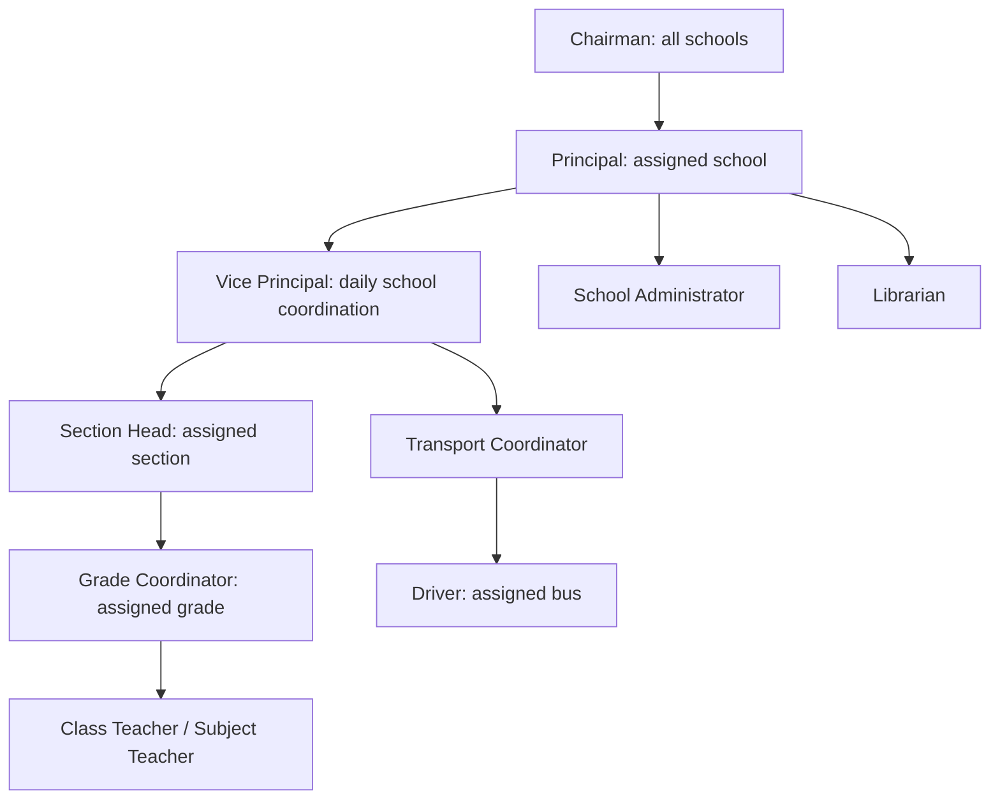

# Sussex College Network — Role Features and Access Reference

**Last updated:** 22 November 2026 (Asia/Colombo).  
**Status:** Implemented browser-only demonstration, with the limitations listed below.  
**Application:** `dist/`; start locally with `python3 -m http.server 4183 --bind 127.0.0.1 --directory dist`.

This is the maintained reference for the **current implementation**, covering all 12 roles. A feature appears here as available only when the prototype implements it. Future suggestions are not permissions. Update this file in the same change as future implementation; the maintenance checklist is at the end.

## Contents

1. [Prototype boundaries](#prototype-boundaries)
2. [Organisation and access model](#organisation-and-access-model)
3. [Role summary](#role-summary)
4. [Chairman](#chairman)
5. [Principal](#principal)
6. [Vice Principal](#vice-principal)
7. [Section Head](#section-head)
8. [Grade Coordinator](#grade-coordinator)
9. [Class Teacher](#class-teacher)
10. [Subject Teacher](#subject-teacher)
11. [School Administrator](#school-administrator)
12. [Transport Coordinator](#transport-coordinator)
13. [Driver](#driver)
14. [Librarian](#librarian)
15. [Parent](#parent)
16. [Cross-role workflows](#cross-role-workflows)
17. [Persistence and reports](#persistence-and-reports)
18. [Demo accounts and validation](#demo-accounts-and-validation)
19. [Maintenance checklist](#maintenance-checklist)

## Prototype boundaries

- This is a UI demonstration, with browser-local data and permission checks. There is no authenticated staff backend, server-side authorization, database, production GPS integration, payment gateway or real messaging service.
- The role/account switcher deliberately lets a presenter preview different accounts. It is not a production login or a security boundary. Staff roles are separate workspaces, even when one person holds several roles.
- Parent admission login uses a linked student's admission number and the shared temporary password `1234`. It demonstrates student selection and access, not real password security.
- School names and approximate locations use the 20-branch Sussex directory verified in the existing project on 19 November 2026. The directory is not refreshed automatically. Internal IDs `colombo` and `lakeside` display as Nugegoda and Malabe.
- The national overview shows 44 simulated buses: eight editable operational demo records at Nugegoda/Malabe and two illustrative vehicles at each other branch. Illustrative vehicles do not create student, teacher or editable bus records.
- Map movement, GPS signals, occupancy, arrival estimates and routes are demonstrations. Street tiles require internet access and retain OpenStreetMap attribution.
- School registers, assessment marks, staffing complements, vacancies and leave requests are illustrative. The default sample school day is **20 November 2026**, even when the real calendar date is later. Register/report date controls support 12 October–20 November; follow-up due dates support 20–27 November. Temporary cover uses 20 November.
- **Actual prototype records** mean the editable sample student accounts, courses, teacher assignments, materials and parent completion data saved in the browser. They are distinct from generated assessment cohorts and attendance registers. A generated student attendance profile is not an editable admission record.
- Section academic/attendance samples cover Grades 1–13, with two illustrative classes (A/B) per grade. Preschool appointments are supported by access configuration, but no Preschool assessment/register fixtures are provided; those views show empty data.
- Courses can be assigned and enrolments changed, but no create/delete-course screen, exam mark entry, timetable engine, payroll, discipline case system or real parent-notification workflow is implemented.

## Organisation and access model



This is the recommended operating hierarchy represented by the prototype. Parent access follows the linked student, rather than the staff hierarchy. A reporting line does not automatically inherit permissions.

### Scope rules

| Scope | Meaning |
| --- | --- |
| Network | All 20 branches, or Chairman-selected branches. |
| School | The school in the active role appointment. Only the Chairman has a school scope selector. |
| Section | One academic section in one appointed school. |
| Grade | The appointed grade in the appointed school. |
| Class | The appointed grade and class in the appointed school. |
| Teaching course | Courses assigned to the active Subject Teacher account in its school. |
| Student | The admission-selected child linked to the active guardian account. |
| Bus | The active driver's currently assigned vehicle in its school. |

Sections are **Preschool (0), Primary (1–5), Middle School (6–9), Senior School (10–13)**. These are prototype configuration values, not a claim about Sussex's official internal management structure.

An appointment is a role plus its school and, where needed, section, grade, class or bus. The same person can hold several appointments; changing the active role changes the available actions. For example, a Section Head who also teaches a course publishes materials through their Teacher workspace, and reviews materials through their Section Head workspace.

## Role summary

| Role / internal key | Current entry | Read scope | Main changes allowed |
| --- | --- | --- | --- |
| Chairman / `chairman` | Overview → Transport | Network or selected school(s) | School details, staff appointments, student/course/material/bus/library management, vacancy review, reports. |
| Principal / `principal` | Overview → Transport | Assigned school | Lower-role appointments, student/course/material/bus/library management, leave decisions, trip controls, vacancy review, reports. |
| Vice Principal / `vice_principal` | Overview → Transport | Assigned school | Daily follow-ups, temporary cover, leave recommendations, cover-request decisions, student/course/material/bus/library coordination, reports. |
| Section Head / `section_head` | Overview → Section Overview | Appointed school and section | Section course assignments/enrolment, material reviews, attendance follow-ups, cover requests, section reports. |
| Grade Coordinator / `coordinator` | Courses | Appointed school and grade | Enrolment in existing grade courses; assigned course teacher is retained. |
| Class Teacher / `class_teacher` | Courses | Appointed school, grade and class | Publish/edit materials only on courses assigned to the same account; review class progress. |
| Subject Teacher / `teacher` | Courses | Assigned teaching courses in school | Publish/edit/download course materials; review enrolled-student completion. |
| School Administrator / `admin` | Students & guardians | Assigned school | Student/admission/guardian records, course teacher assignments and enrolment. |
| Transport Coordinator / `transport` | Bus tracking | Assigned school fleet | Bus route/stop/driver/student assignments. |
| Driver / `driver` | Bus tracking | Currently assigned bus | Start and end the assigned demo trip. |
| Librarian / `librarian` | Library | Assigned school catalogue/orders | Edit price/availability; mark orders collected. |
| Parent / `parent` | Admission login → Bus tracking | Selected linked student and own orders | Download/mark materials done; place book orders; manage own book bag. |

## Chairman

**Entry:** `#chairman/overview/transport`. **Navigation:** Overview, Bus tracking, Courses, Students & guardians, Library, Roles & access.

### Overview views

- **Transport Activity:** full Sri Lanka map; 20 schools and 44 simulated buses; school and bus drill-downs; route, next stop, speed/signal and arrival information; fleet/status filters; school comparisons; pause/resume and reset map.
- **Academic Performance:** subject/grade/term filters; weighted averages and pass rates; school ranking and prior-term changes; trend/distribution charts; branch detail and comparison CSV. Current network assessment grade controls list 6, 8, 10 and 11.
- **Attendance:** student or staff audience; school/date/grade/period filters; one/five/twenty-school-day totals and trends; branch comparisons; repeated absence watchlist; search/pagination and personal 20-day calendars.
- **Staffing Overview:** leadership and staff profiles; headcount, availability and staffing capacity; group/status/search filters; vacancies and persistent review status; links to school appointments. Actual prototype appointments and illustrative staffing records are labelled separately.
- **Executive Reports:** network brief and transport/academic/attendance/staffing reports; selectable branch scope; snapshots, CSV, standalone branded HTML and Print / Save PDF; latest eight reports per Chairman account.

### Management actions

- Edit an existing school's display name/location label.
- Appoint or remove non-Chairman roles, including Principals, within the chosen school scope. The app does not provide Chairman appointment management.
- Add/edit student records and admission numbers; link existing guardian accounts.
- Assign school teachers and matching-class students to existing courses.
- Publish/edit/download materials and review parent-recorded completion.
- Manage existing operational bus routes, stop names, drivers and assigned students.
- Manage catalogue price/availability and collect parent book orders.

**Limits:** synthetic network buses are read-only. Final leave decisions and the dedicated start/end controls in the school overview are exposed in the Principal workflow; Chairman dashboards do not contain an additional leave approval screen. Reviewing a vacancy does not fill it.

## Principal

**Entry:** `#principal/overview/transport`. **Scope:** appointed school. **Navigation:** same six workspaces as Chairman, without a school selector.

- **Daily pulse:** student attendance, unavailable teachers, classes requiring review and delayed bus signals, with links into related views.
- **Transport Activity:** assigned-school map/routes/fleet, bus filters and details; existing vehicle management; start/end demo trips and reset to school routes.
- **Academic Performance:** class/subject/grade/teacher comparisons; assessment filters and charts; actual course/material progress; assign courses, open lecture materials and export comparison CSV.
- **Attendance:** student/staff registers, class summaries, grade/class/date/period filters, personal calendars and repeated absence views.
- **Staffing Overview:** school leadership, availability, capacity, directory, vacancies and sample leave requests. Approve/decline leave; the result changes sample staff availability, attendance, pulse and newly generated reports. See the Vice Principal's recommendation and note before deciding.
- **Executive Reports:** school brief and individual operational reports, CSV/HTML/print, separate school/Principal snapshot history.
- **Management:** add/edit students; assign course teachers/students; publish/edit materials; manage buses and catalogue/orders; appoint/remove lower roles within the school.

**Limits:** no other-school records, no school detail edit, no Principal or Chairman appointments, no network-wide comparisons or report history. Final leave decisions do not send messages.

## Vice Principal

**Entry:** `#vice_principal/overview/transport`. **Scope:** appointed school. **Navigation:** Overview, Bus tracking, Courses, Students & guardians, Library.

- **Daily pulse and follow-up board:** school attendance, teacher availability, classes to review, delayed bus signals; three seed coordination tasks plus added tasks; category, owner, due date, status and dated note history. Open/in progress/resolved states persist locally.
- **Transport Activity:** assigned-school map/fleet/details; record a bus issue as a named follow-up. The separate Bus tracking workspace provides existing bus/driver/student/stop management.
- **Academic Performance:** school comparisons, assignment/material progress, course assignment and comparison CSV; assign or cancel one-day temporary teaching cover.
- **Attendance:** section-independent school/class registers, repeated absences and calendars; create a student-specific attendance follow-up.
- **Staffing Overview:** leadership/capacity/directory/vacancy review, temporary cover and **Leave recommendations**. Add/edit a recommendation and note on a pending leave request; the Principal makes the final decision.
- **Section Head cover requests:** pending requests appear in Staffing Overview. Assign available cover to the requested course, or decline with a note. The Section Head sees the outcome. Cancelling cover linked to a request reopens that request for replacement.
- **School Reports:** operational brief plus transport/academic/attendance/staffing snapshots. Briefs also capture follow-ups, active cover and leave recommendations awaiting Principal decision. CSV/HTML/print; eight snapshots per school/role.
- **Management retained:** school student records, course teacher/student assignments, material publication, existing bus management and catalogue/order management.

**Limits:** no permanent staff appointments, final leave approval, network scope or other-school inboxes/history. Temporary cover is stored separately from permanent course assignments and does not grant Teacher access. Cover requests are acted on through the local demo, not sent as messages.

## Section Head

**Entry:** `#section_head/overview/summary`. **Scope:** the actual school and section appointment. **Navigation:** Overview, Courses, Students & guardians. The overview contains exactly these five views:

### Section Overview

- Assigned school, section and grade range, plus a presenter-only demo account selector.
- Daily sample attendance, actual registered prototype students, teaching staff serving the section and pending recorded attendance follow-ups.
- Prototype course/material counts, completed/expected material assignments and pending cover requests.
- Grade summary with Term 3 Mathematics averages and daily attendance, a five-school-day attendance trend, teaching priorities and links to academic/teaching views.
- Attendance follow-up list with assigned owner, due date, status and update action.

### Academic & Courses

- Grade/class controls limited to the appointed section; four assessment subjects and three terms.
- Class/grade/subject/assigned-teacher comparisons; averages, pass rates and illustrative assessed cohorts. Unassigned illustrative classes are labelled without inventing teacher appointments.
- Courses and lecture-progress list for the selected grades/class. This list is independent of the assessment subject selector, which filters comparison marks.
- Edit teacher/enrolment assignments for existing section courses, using school teaching accounts and matching-class students.
- Open/download published lecture notes and review enrolled-student completion.
- Review course materials as **Ready for learning** or **Updates requested**, with a note. Staff can see the review in the course workspace; parents do not see internal review notes.
- Export the current academic comparison as a section-scoped CSV snapshot.

### Attendance

- Illustrative section student register and class summaries; grade/class/date/period filters; one/five/twenty-school-day totals; trend; search and pagination.
- All students, repeated absence (3+ absences in trailing 20 school days), latest-day absent and latest-day late filters.
- Open a student’s 20-day attendance calendar. Record a follow-up with an owner serving the section (or the Section Head), due date, note and open/in progress/resolved status. Updates retain note history.
- Export attendance summaries. This role does not edit attendance marks or school admission records.

### Teaching Coordination

- Show teachers assigned section courses and relevant grade coordinators/class teachers. Shared teachers' out-of-section courses are excluded from workload and material counts.
- Grade/class/date filters; teacher search; available/unavailable counts; in-section teaching profile and course progress.
- Identify courses without lecture materials and record material review feedback.
- Request one-day cover against an existing section course, with a reason. View pending, cover-assigned or declined outcomes and the Vice Principal's note/cover teacher.
- Duplicate pending requests for the same course/day are rejected. A request does not assign a teacher or alter a permanent assignment.

### Section Reports

- Management brief, academic comparison, attendance and teaching progress report types.
- Section grade/class scope, subject/term and attendance date/period controls; class/grade/subject/assigned-teacher academic comparison selection.
- Snapshot preview, CSV, standalone branded HTML and Print / Save PDF. Briefs include recorded attendance follow-ups for the chosen grade/class scope.
- Latest eight snapshots per school/section. Primary and Middle School at the same branch have separate histories; another school's reports and senior-leader histories are excluded.
- Saved reports remain unchanged when assignments, filters or follow-up statuses change later.

**Limits:** no branch/section expansion, school-wide staff directory or confidential HR/leave decisions; no staff appointments; no final cover allocation; no lecture publication while active as Section Head; no core student edits, library management, bus controls or transport page. The five requested views do not introduce a separate Student Follow-ups or Transport tab. Follow-ups are integrated into Overview/Attendance. Numeric Preschool fixtures are unavailable and show empty states.

## Grade Coordinator

**Entry:** `#coordinator/courses`. **Scope:** appointed school and grade. **Views:** Courses; Students & guardians.

- Read existing grade courses, teacher assignment, enrolment, lecture materials and parent completion.
- Download materials; review the grade’s actual prototype student directory and linked guardians.
- Update matching-class student enrolment on an existing grade course.

**Limits:** cannot change the assigned course teacher, publish/edit materials through this role, edit admission records, appoint staff, view other grades/schools, or access advanced reports/attendance/transport/library/leave management. No dedicated Grade Coordinator dashboard has been implemented yet.

## Class Teacher

**Entry:** `#class_teacher/courses`. **Scope:** appointed school, grade and class. **Views:** Courses; Students & guardians.

- Read class courses, lecture materials and enrolled-student completion.
- Download course materials; view actual class student/guardian records.
- Publish/edit materials only where the course’s assigned Teacher account matches the active Class Teacher account. A class appointment alone does not make the person publisher of every class subject.
- Read Section Head material review feedback on visible staff course details.

**Limits:** no enrolment/teacher reassignment, admission edits, other-class scope, staff appointments, bus controls, library management or advanced attendance/reporting dashboard. No real attendance-mark entry screen exists.

## Subject Teacher

**Entry:** `#teacher/courses`. **Scope:** courses assigned to that account in its appointed school.

- View assigned course cards and class context; read enrolled-student progress.
- Publish/edit lecture notes, worksheets, slides and readings. Add a local attachment up to 2 MB, or publish a sample text handout.
- Download published materials, review parent-recorded completion and read Section Head material review notes.

**Limits:** no access to unassigned course materials/progress, no enrolment/teacher changes, admission management, role appointments, leave approval or standalone school dashboards. An assignment to temporary cover does not itself grant access to the permanent Teacher workspace.

## School Administrator

**Entry:** `#admin/people`. **Scope:** appointed school. **Views:** Students & guardians; Courses.

- Create/edit student names, unique admission numbers, grade/class and linked existing guardian accounts.
- Read student course enrolment/completion and linked guardians.
- Assign school teachers and matching-class students to existing courses; read/download materials and progress.

**Limits:** cannot appoint parent/staff accounts, publish lecture materials through this role, create courses, manage buses/library/leave or access senior-leader dashboards. A Principal/Chairman appoints existing accounts to guardian/staff roles.

## Transport Coordinator

**Entry:** `#transport/transport`. **Scope:** appointed school’s operational buses.

- Fleet map, vehicle status counts, status filters, selected route, stops and simulated progress; pause/resume demonstration.
- Manage existing route name, ordered stop names, school driver assignment and students assigned to a bus.
- Assignment updates are reflected in Driver and Parent portals and the relevant operational network overview vehicle.

**Limits:** cannot edit another school's fleet, synthetic overview vehicles, admissions, courses, staff roles or library orders. Dedicated trip start/end controls belong to Driver/Principal workflows. Vice Principal follow-up ownership records a coordinator name but does not send a message or create a separate coordinator task inbox.

## Driver

**Entry:** `#driver/transport`. **Scope:** one current bus appointment matching its school and driver account.

- Mobile-responsive trip view with assigned route, stop sequence, map/progress and vehicle context.
- Start/end the assigned simulated trip; linked Parent/leadership views reflect status.

**Limits:** no other bus, school roster, route/driver/student reassignment, course/library/role access or real phone GPS upload. No device permission or GPS hardware integration is requested by this UI prototype.

## Librarian

**Entry:** `#librarian/library`. **Scope:** appointed school’s catalogue and orders.

- Read catalogue, pricing and availability; edit existing book prices and availability.
- Read school parents' book orders and mark an order collected.

**Limits:** no payment processing, cross-school orders, student/course/staff/bus management, role appointments or full library lending/inventory system. Book orders are for school collection/payment in the demonstration.

## Parent

**Entry:** `#parent/login`, then `#parent/transport`. **Views:** Bus tracking; Courses; Library. **Scope:** one admission-selected student linked to the guardian’s school role, plus that guardian's own library orders.

- Sign in with the selected student's admission number and `1234`; example cards fill credentials. Login rejects an unknown student, wrong password, or missing linked guardian/school role. Log out to select another student.
- Track the student’s assigned bus, simulated route/progress/stops and arrival context. Show an empty state when no bus is assigned.
- Read only courses in which the selected student is enrolled; download lecture notes/attachments; mark materials done/undone and see progress. Teachers/leadership can review that completion.
- Browse the school book catalogue; search/filter, add/remove quantities in a personal book bag, place an order for school collection and review own order history.
- Session survives refresh. Course completion is stored per student; book bag/order history belongs to the parent account and school.

**Limits:** no other family's orders or unlinked student data, staff role switcher inside the signed-in portal, teacher material publication, admission/course/bus edits, school comparisons, payments or real GPS guarantees. Internal Section Head review notes are hidden from this portal.

## Cross-role workflows

### Course learning and completion

1. Chairman, Principal, Vice Principal, school Administrator or scoped Section Head assigns the teacher and matching-class students to an existing course. Grade Coordinators can change enrolment while retaining the teacher.
2. Assigned Teacher/Class Teacher publishes materials; Chairman/Principal/Vice Principal also have school-scoped publication permission.
3. Section Head reads/reviews materials and records readiness or requested updates; staff see feedback in course details.
4. Enrolled student's Parent downloads materials and marks them done; teaching and leadership views reflect stored completion.

### Temporary cover

1. Section Head records a request for an existing in-section course and the demo date, with a reason. It stays pending.
2. The same school's Vice Principal sees the request in Staffing Overview and assigns available temporary cover or declines with a note.
3. Section Head sees the decision. Cover stays separate from permanent course and role assignments.
4. Cancelling linked active cover reopens the request as pending. The Vice Principal can assign a replacement or decline it.

The Vice Principal may also create cover directly without a request. Cover teacher choices include labelled illustrative teaching staff. Cover allocation does not grant authentication or publication rights.

### Leave decisions

1. Sample staff leave requests exist within a school.
2. Vice Principal records a recommendation and note while the request is pending; availability remains unchanged.
3. Principal reviews and approves/declines; the sample staff register/pulse and newly captured reports update. Section Heads do not see or approve leave requests.

### Attendance follow-ups

- Section Heads record section-owned student follow-ups in their own Overview/Attendance views.
- Vice Principals maintain a separate school operational follow-up board, including named transport/student issues.
- These are distinct local task collections. Owners, dates and notes are recorded; no SMS, email, WhatsApp or automatic cross-board task delivery occurs.

### Transport and books

- Transport Coordinator/authorized school leadership updates the operational bus's route/driver/students; Driver controls its trip; the student's Parent follows the assignment/status.
- Parent places a school collection order; Librarian/authorized school leadership marks collection. No online payment occurs.

## Persistence and reports

- Application state is stored under browser localStorage key `campusway-demo-v1`; the demo merges saved v2 state with defaults to preserve existing records. Parent session storage is separate from the state payload.
- Course assignments, materials, completion, carts/orders, bus status/assignment, staff appointments, leave decisions/recommendations, reviews, follow-ups, cover and snapshots persist in the same browser. Other devices/browsers do not share these changes.
- **Reset demo** restores sample state. Storage failures show an error/toast instead of claiming success. Browser storage and the 2 MB individual attachment limit constrain uploads; this is not durable document storage.
- School executive report history is owned by role/school (Principal/Vice Principal), or Chairman account; the latest eight are retained per workspace. Section report history is separately owned by school + section under the Section Head role, eight per workspace.
- Report snapshots capture values at generation time. Filters/data edits do not rewrite older reports. Scope checks apply to opening, downloading and printing saved reports.
- CSV values are quoted and dangerous leading spreadsheet formula characters are neutralised. Exports carry sample provenance and relevant scope/filter metadata.
- HTML downloads embed the existing logo when it can be read. Print / Save PDF uses the browser's print dialogue; no automatic PDF service is integrated.
- Activity entries record local changes for branch review; they are demonstration records, not a tamper-proof audit log.

## Demo accounts and validation

| Role | Example account(s) / scope |
| --- | --- |
| Chairman | Duminda Wijesinghe — all branches. |
| Principal | Malini Senanayake — Nugegoda; Suresh Jayawardena — Malabe. |
| Vice Principal | Roshani Fernando — Nugegoda; Dilan Mendis — Malabe. |
| Section Head | Dilini Silva — Nugegoda/Middle School; Asha Wickramasinghe — Nugegoda/Primary; Lakshmi Fernando — Malabe/Middle School. |
| Grade Coordinator | Nuwan Gamage — Nugegoda/Grade 8. |
| Class Teacher | Dilini Silva — Nugegoda/Grade 8/Class 8A. |
| Subject Teacher | Dilini Silva, Nuwan Gamage, Rihana Farook, Asha Wickramasinghe — Nugegoda; Lakshmi Fernando — Malabe. Actual course assignments control teaching visibility. |
| Administrator | Anjali Fernando — Nugegoda; Shanika Dias — Malabe. |
| Transport Coordinator | Nimal Rathnayake — Nugegoda; Chamara Silva — Malabe. |
| Driver | Accounts are generated per operational demo bus; choose the presenter account assigned to that bus. |
| Librarian | Hasini Perera — Nugegoda; school librarian appointments also exist at Malabe. |
| Parent | Amaya `SCN-1001`, Kavin `SCN-1002`, Meera `SCN-1008`, Thevin `SCN-1009`; password `1234`. |

Role assignments may be changed in the demo, so these are seeded examples rather than immutable staff records.

### Validation commands and expectations

```sh
node --test tests/*.test.mjs
```

The suite covers access, migration, parent admission selection, network/directory/fleet data, academic/attendance reconciliation, report isolation, Principal leave decisions, Vice Principal coordination, Section Head scope/reviews/follow-ups and the cover-request handoff. Browser verification should cover all five Section Head views, all three seeded Section Head accounts, 390px/320px layouts, course/material interactions, persistent follow-up/review/request outcomes, role switching and report CSV/HTML/print handling. Keep passing test counts/evidence in the change log when updated.

## Maintenance checklist

For **every future implementation**:

1. Read this reference and the relevant source permission, scope and UI handlers before changing behavior.
2. Update the role summary and affected role details to match the resulting views, reads, writes and exclusions.
3. Update both sides of cross-role workflows, ownership/persistence/report rules and demo walkthroughs when affected.
4. Keep implemented features separate from recommendations; label sample/empty/unavailable behavior honestly.
5. Add meaningful scope/workflow checks and exercise representative mobile and desktop paths. Check cross-school/section/class targets and stale report IDs for restricted roles.
6. Add a dated entry below with the scope and validation. Preserve earlier entries.
7. Update README links and relevant demo account examples. Do not broaden site sharing or role permissions just to expose a view.

## Change log

### 22 November 2026

- Created the complete feature/access reference for all 12 existing roles and project instructions requiring future maintenance.
- Implemented the five Section Head views, section-grade academic/attendance filters, scoped teacher workloads, course material reviews, student follow-up history and isolated section reports.
- Connected Section Head cover requests with Vice Principal assignment/decline and reopening after cancellation; temporary cover preserves permanent course assignments.
- Retained Chairman, Principal, Vice Principal, teacher, parent and operational role workflows. Numeric Preschool views intentionally show empty sample data.
- Validation: **53 Node tests passed**, including nine new Section Head/cover-handoff tests. Browser checks passed for all five views, three Section Head accounts, 390px/320px layouts, material review/teacher visibility/parent privacy, follow-up persistence, cover assignment/cancellation/reopening/decline, four report types, CSV/HTML downloads and the print iframe source. Chairman/Principal/Vice Principal views also passed browser smoke checks. The operating system print dialogue and an exported PDF file were not automated.
