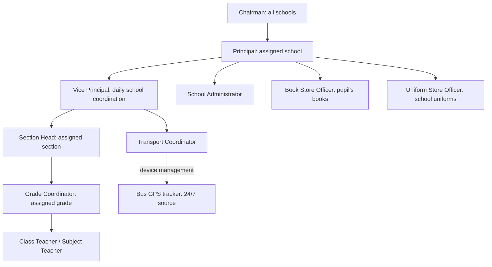

# Sussex College Network — Role Features and Access Reference

**Last updated:** 26 November 2026 (Asia/Colombo).
**Status:** Implemented browser-only demonstration, plus separately labelled proposed requirements; limitations are listed below.

**Application:** `dist/`; start locally with `python3 -m http.server 4183 --bind 127.0.0.1 --directory dist`.

**Hosting:** GitHub Pages is prepared to serve the prototype at the repository root and the presentation at `showcase/` on the same host. The user explicitly approved making `Tradex-Innovations/Sussex-LMS` public on 25 November 2026; the repository is now public. GitHub Pages is published at `https://tradex-innovations.github.io/Sussex-LMS/` and its `showcase/` route; deployment and live browser checks passed. The existing private Site remains separate.

This is the maintained reference for the **current implementation**, covering all 12 roles, and for user-requested features awaiting implementation. A feature appears as available only when the prototype implements it. Record new user feature ideas in **Proposed features and requirements** with their status, affected roles and scope; keep recommendations distinct from requested requirements. Proposed features do not grant current permissions. Update this file alongside future implementation; the maintenance checklist is at the end.

## Contents

1. [Prototype boundaries](#prototype-boundaries)
2. [Organisation and access model](#organisation-and-access-model)
3. [Role summary](#role-summary)
4. [Chairman](#chairman)
5. [Principal](#principal)
6. [Vice Principal](#vice-principal)
7. [Section Head](#section-head)
8. [Grade Coordinator](#grade-coordinator)
9. [Class Teacher](#class-teacher)
10. [Subject Teacher](#subject-teacher)
11. [School Administrator](#school-administrator)
12. [Transport Coordinator](#transport-coordinator)
13. [Book Store Officer](#book-store-officer)
14. [Uniform Store Officer](#uniform-store-officer)
15. [Parent](#parent)
16. [Family communication and school fee workflows](#family-communication-and-school-fee-workflows)
17. [NFC boarding prototype](#nfc-boarding-prototype)
18. [Interactive client presentation](#interactive-client-presentation)
19. [Student subjects, homework and class notices](#student-subjects-homework-and-class-notices)
20. [Cross-role workflows](#cross-role-workflows)
21. [Persistence and reports](#persistence-and-reports)
22. [Demo accounts and validation](#demo-accounts-and-validation)
23. [Proposed features and requirements](#proposed-features-and-requirements)
24. [Maintenance checklist](#maintenance-checklist)
25. [Change log](#change-log)


## Prototype boundaries

- This is a UI demonstration, with browser-local data and permission checks. There is no authenticated staff backend, server-side authorization, database, production GPS integration, payment gateway or real messaging service.
- The role/account switcher deliberately lets a presenter preview different accounts. It is not a production login or a security boundary. Staff roles are separate workspaces, even when one person holds several roles.
- Parent family login uses a family ID or a linked student’s admission alias with temporary password `1234`. One guardian account shows all currently linked children with valid Parent school appointments. This is sample access, not real password security.
- School names and approximate locations use the 20-branch Sussex directory verified in the existing project on 19 November 2026. The directory is not refreshed automatically. Internal IDs `colombo` and `lakeside` display as Nugegoda and Malabe.
- The national overview shows 44 simulated buses: eight editable operational demo records at Nugegoda/Malabe and two illustrative vehicles at each other branch. Illustrative vehicles do not create student, teacher or editable bus records.
- Map movement, GPS signals, occupancy, arrival estimates and routes are demonstrations. Street tiles require internet access and retain OpenStreetMap attribution.
- Student NFC transport cards, bus reader taps, boarding rosters and card lifecycle are implemented as a **browser-local simulation**. No physical NFC card/reader API, device network, backend boarding service, exit scan or notification service is connected. See [NFC boarding prototype](#nfc-boarding-prototype).
- School registers, assessment marks, staffing complements, vacancies and leave requests are illustrative. Class Teachers can save present/absent/late entries over their own generated class register; the affected student totals, calendars, watchlists and newly generated reports use those saved entries across leadership views. This is still sample attendance, not a connection to real student attendance data. The default sample school day is **20 November 2026**, even when the real calendar date is later. Register/report date controls support 12 October–20 November; follow-up due dates support 20–27 November. Temporary cover uses 20 November.
- **Actual prototype records** mean the editable sample student accounts, subjects, teacher assignments, materials and parent completion data saved in the browser. They are distinct from generated assessment cohorts and attendance registers. A generated student attendance profile is not an editable admission record.
- Section, Grade Coordinator and Class Teacher academic/attendance samples cover Grades 1–13, with illustrative classes A/B per grade. Other configured classes and Preschool have no numeric fixture; their numeric views remain empty instead of borrowing a whole grade's data. Actual admission/course records in those scopes remain separately accessible.
- Subjects can be assigned and enrolments changed, but no create/delete-course screen, exam mark entry, timetable engine, payroll, discipline case system or external parent-notification service is implemented. Class notices and homework are available inside the local parent portal.

## Organisation and access model



This is the recommended operating hierarchy represented by the prototype. Parent access follows the linked student, rather than the staff hierarchy. A reporting line does not automatically inherit permissions.

### Scope rules

| Scope | Meaning |
| --- | --- |
| Network | All 20 branches, or Chairman-selected branches. |
| School | The school in the active role appointment. Only the Chairman has a school scope selector. |
| Section | One academic section in one appointed school. |
| Grade | The appointed grade in the appointed school. |
| Class | The appointed grade and class in the appointed school. |
| Teaching subject | Subjects assigned to the active Subject Teacher account in its school. |
| Student / family | All children currently linked to the guardian, each requiring a current Parent appointment in that child’s school; learning, bus, boarding and supplies use the selected child. |
| Bus | School management sees in-scope buses 24/7; Parents see only their selected child’s bus during coordinator-set windows. |

Sections are **Preschool (0), Primary (1–5), Middle School (6–9), Senior School (10–13)**. These are prototype configuration values, not a claim about Sussex's official internal management structure.

An appointment is a role plus its school and, where needed, section, grade, class. The same person can hold several appointments; changing the active role changes the available actions. For example, a Section Head who also teaches a subject publishes materials through their Teacher workspace, and reviews materials through their Section Head workspace.

## Role summary

| Role / internal key | Current entry | Read scope | Main changes allowed |
| --- | --- | --- | --- |
| Chairman / `chairman` | Overview → Transport | Network or selected school(s) | School details, staff appointments, student/course/material/bus and book/uniform store management, vacancy review, reports, read-only fee oversight; NFC school oversight and card management. |
| Principal / `principal` | Overview → Transport | Assigned school | Lower-role appointments, student/course/material/bus and book/uniform store management, leave decisions, vacancy review, reports, read-only fee oversight; NFC school oversight and card management. |
| Vice Principal / `vice_principal` | Overview → Transport | Assigned school | Daily follow-ups, temporary cover, leave recommendations, cover-request decisions, student/course/material/bus and book/uniform store coordination, reports; read NFC trip coverage/manifests. |
| Section Head / `section_head` | Overview → Section Overview | Appointed school and section | Section subject assignments/enrolment, material reviews, attendance follow-ups, cover requests, section reports. |
| Grade Coordinator / `coordinator` | Overview → Grade Overview | Appointed school and grade | Subject enrolment, attendance follow-ups, class coordination reviews, Section Head support requests, grade reports; assigned subject teacher is retained. |
| Class Teacher / `class_teacher` | Overview → Class Overview | Appointed school, grade and class | Student-specific subject selection, common class notices, class-subject homework, own sample-class attendance, transport inbox, letters/email, events/consent, follow-ups, private discussion records and class reports; lecture publication only on subjects assigned to the same account. |
| Subject Teacher / `teacher` | Overview → Subject Overview | Current assigned teaching subjects and matching-class enrolled students in appointed school | Manage each teaching class separately; publish/edit materials and homework, lesson plans, internal learning reviews, class-specific letters/email/events/consent, support requests and subject reports. |
| School Administrator / `admin` | Overview → Administration Overview | Actual student, guardian, subject records and read-only 24/7 fleet in appointed school | Register/edit admissions, link existing guardians, assign school teachers/matching-class enrolments and generate administration reports; manage fee invoices, office payments, reminders and unpaid students; issue/replace/deactivate NFC transport cards. |
| Transport Coordinator / `transport` | Overview → Fleet Activity | Appointed school’s operational fleet, transport roster and own assigned transport follow-ups; 24/7 in-scope GPS | Route/tracker/student allocation, shared Vice Principal issue progress, transport reports, family alerts and GPS hours/completion; NFC rosters, simulated reader taps/sync and boarding corrections. |
| Book Store Officer / `librarian` | Overview → Store Overview | Appointed school’s pupil-book stock and student reservations | Review/confirm/decline, hold stock, prepare collection, record handover, adjust stock and create store reports. |
| Uniform Store Officer / `uniform_store` | Overview → Store Overview | Appointed school’s uniform sizes/stock and student reservations | Same reservation/collection workflow for uniforms only, with size-level stock and separate reports. |
| Parent / `parent` | Family login → Family dashboard | All linked children; selected-child learning, bus, boarding and supplies; family inbox, event consent and school fees; own earlier family book records | Download/mark materials done; reserve pupil’s books and sized uniforms for collection, track status/reference and cancel eligible requests; read own child’s NFC status/history; respond to events, read letters and complete school fee demo checkout. |

## Chairman

**School fees:** additional `#chairman/fees` view reads the active network/school fee invoices, payment history, unpaid-student register, reminder log and CSV. Cannot issue invoices, record payments or send reminders; School Administrator executes those actions. No Class Teacher, Subject Teacher or other family financial scope is inherited.

**Entry:** `#chairman/overview/transport`. **Navigation:** Overview, School fees (read-only), Bus tracking, Subjects, Students & guardians, Pupil’s books, School uniforms, Roles & access, Bus boarding.

### Overview views

- **Transport Activity:** full Sri Lanka map; 20 schools and 44 simulated buses; school and bus drill-downs; route, next stop, speed/signal and arrival information; fleet/status filters; school comparisons; pause/resume and reset map.
- **Academic Performance:** subject/grade/term filters; weighted averages and pass rates; school ranking and prior-term changes; trend/distribution charts; branch detail and comparison CSV. Current network assessment grade controls list 6, 8, 10 and 11.
- **Attendance:** student or staff audience; school/date/grade/period filters; saved Class Teacher sample entries are included; one/five/twenty-school-day totals and trends; branch comparisons; repeated absence watchlist; search/pagination and personal 20-day calendars.
- **Staffing Overview:** leadership and staff profiles; headcount, availability and staffing capacity; group/status/search filters; vacancies and persistent review status; links to school appointments. Actual prototype appointments and illustrative staffing records are labelled separately.
- **Executive Reports:** network brief and transport/academic/attendance/staffing reports; selectable branch scope; snapshots, CSV, standalone branded HTML and Print / Save PDF; latest eight reports per Chairman account.

### Management actions

- Edit an existing school's display name/location label.
- Appoint or remove non-Chairman roles, including Principals, within the chosen school scope. The app does not provide Chairman appointment management.
- Add/edit student records and admission numbers; link existing guardian accounts.
- Assign school teachers and matching-class students to existing courses.
- Publish/edit/download materials and review parent-recorded completion.
- Manage existing operational bus routes, stop names, GPS trackers and assigned students.
- Manage school/network-scoped pupil-book and uniform stock, student reservations and collection; view isolated store report snapshots. No selling, price editing or online payment is provided.

**Limits:** synthetic network buses are read-only. Final leave decisions and the dedicated start/end controls in the school overview are exposed in the Principal workflow; Chairman dashboards do not contain an additional leave approval screen. Reviewing a vacancy does not fill it.

**NFC boarding:** `#chairman/boarding` reads scoped trip rosters, school coverage, histories and CSV manifests. The branch selector applies to NFC data. Transport cards can be managed within the selected/network scope; reader operation and corrections stay with the operational roles.

## Principal

**School fees:** additional `#principal/fees` view gives read-only invoice, payment-history, unpaid-student, reminder-log and CSV oversight within the appointed school. Cannot execute fee writes or payments through the Principal workspace.

**Entry:** `#principal/overview/transport`. **Scope:** appointed school. **Navigation:** Overview, School fees (read-only), Bus tracking, Subjects, Students & guardians, Pupil’s books, School uniforms, Roles & access and Bus boarding, without a school selector.

- **Daily pulse:** student attendance, unavailable teachers, classes requiring review and delayed bus signals, with links into related views.
- **Transport Activity:** assigned-school map/routes/fleet, bus filters and details; existing vehicle management; start/end demo trips and reset to school routes.
- **Academic Performance:** class/subject/grade/teacher comparisons; assessment filters and charts; actual course/material progress; assign subjects, open lecture materials and export comparison CSV.
- **Attendance:** student/staff registers (including saved Class Teacher student entries), class summaries, grade/class/date/period filters, personal calendars and repeated absence views.
- **Staffing Overview:** school leadership, availability, capacity, directory, vacancies and sample leave requests. Approve/decline leave; the result changes sample staff availability, attendance, pulse and newly generated reports. See the Vice Principal's recommendation and note before deciding.
- **Executive Reports:** school brief and individual operational reports, CSV/HTML/print, separate school/Principal snapshot history.
- **Management:** add/edit students; assign subject teachers/students; publish/edit materials; manage buses and pupil-book/uniform reservations/stock; appoint/remove lower roles within the school.

**Limits:** no other-school records, no school detail edit, no Principal or Chairman appointments, no network-wide comparisons or report history. Final leave decisions do not send messages.

**NFC boarding:** `#principal/boarding` reads school coverage, rosters, histories and manifests, and manages school transport cards. It does not operate reader simulation or make Transport Coordinator corrections.

## Vice Principal

**Entry:** `#vice_principal/overview/transport`. **Scope:** appointed school. **Navigation:** Overview, Bus tracking, Subjects, Students & guardians, Pupil’s books, School uniforms, Bus boarding.

- **Daily pulse and follow-up board:** school attendance, teacher availability, classes to review, delayed bus signals; three seed coordination tasks plus added tasks; category, owner, due date, status and dated note history. Transport Coordinators can create bus issues assigned to themselves and update their own transport tasks through the shared board. The Vice Principal sees their progress/bus reference and retains owner, category, title and due-date control. Reassignment removes the task from its former coordinator’s view. No external notification is sent.
- **Transport Activity:** assigned-school map/fleet/details; record a bus issue as a named follow-up. The separate Bus tracking workspace provides existing bus/GPS tracker/student/stop management.
- **Academic Performance:** school comparisons, assignment/material progress, subject assignment and comparison CSV; assign or cancel one-day temporary teaching cover.
- **Attendance:** section-independent school/class registers (including saved Class Teacher sample entries), repeated absences and calendars; create a student-specific attendance follow-up.
- **Staffing Overview:** leadership/capacity/directory/vacancy review, temporary cover and **Leave recommendations**. Add/edit a recommendation and note on a pending leave request; the Principal makes the final decision.
- **Section Head cover requests:** pending requests appear in Staffing Overview. Assign available cover to the requested subject, or decline with a note. The Section Head sees the outcome. Cancelling cover linked to a request reopens that request for replacement.
- **School Reports:** operational brief plus transport/academic/attendance/staffing snapshots. Briefs also capture follow-ups, active cover and leave recommendations awaiting Principal decision. CSV/HTML/print; eight snapshots per school/role.
- **Management retained:** school student records, subject teacher/student assignments, material publication, existing bus management and pupil-book/uniform reservation/stock management.

**Limits:** no permanent staff appointments, final leave approval, network scope or other-school inboxes/history. Temporary cover is stored separately from permanent subject assignments and does not grant Teacher access. Cover requests are acted on through the local demo, not sent as messages.

**NFC boarding:** `#vice_principal/boarding` reads school coverage, rosters, histories and CSV manifests. Card issuance, reader operation and transport corrections stay with their dedicated roles.

## Section Head

**Entry:** `#section_head/overview/summary`. **Scope:** the actual school and section appointment. **Navigation:** Overview, Subjects, Students & guardians. The overview contains exactly these five views:

### Section Overview

- Assigned school, section and grade range, plus a presenter-only demo account selector.
- Daily sample attendance, actual registered prototype students, teaching staff serving the section and pending recorded attendance follow-ups.
- Prototype course/material counts, completed/expected material assignments and pending cover requests.
- Grade summary with Term 3 Mathematics averages and daily attendance, a five-school-day attendance trend, teaching priorities and links to academic/teaching views.
- Attendance follow-up list with assigned owner, due date, status and update action.

### Academic & Subjects

- Grade/class controls limited to the appointed section; four assessment subjects and three terms.
- Class/grade/subject/assigned-teacher comparisons; averages, pass rates and illustrative assessed cohorts. Unassigned illustrative classes are labelled without inventing teacher appointments.
- Subjects and lecture-progress list for the selected grades/class. This list is independent of the assessment subject selector, which filters comparison marks.
- Edit teacher/enrolment assignments for existing section subjects, using school teaching accounts and matching-class students.
- Open/download published lecture notes and review enrolled-student completion.
- Review subject materials as **Ready for learning** or **Updates requested**, with a note. Staff can see the review in the subject workspace; parents do not see internal review notes.
- Export the current academic comparison as a section-scoped CSV snapshot.

### Attendance

- Illustrative section student register and class summaries, including saved Class Teacher attendance entries; grade/class/date/period filters; one/five/twenty-school-day totals; trend; search and pagination.
- All students, repeated absence (3+ absences in trailing 20 school days), latest-day absent and latest-day late filters.
- Open a student’s 20-day attendance calendar. Record a follow-up with an owner serving the section (or the Section Head), due date, note and open/in progress/resolved status. Updates retain note history.
- Export attendance summaries. This role does not edit attendance marks or school admission records.

### Teaching Coordination

- Show teachers assigned section subjects and relevant grade coordinators/class teachers. Shared teachers' out-of-section subjects are excluded from workload and material counts.
- Grade/class/date filters; teacher search; available/unavailable counts; in-section teaching profile and subject progress.
- Identify subjects without lecture materials and record material review feedback.
- Review requests from Grade Coordinators in the appointed school/section. Record an in-progress or resolved response with note history; the coordinator can read it in their Class Coordination view. Material requests link to the existing material-review form; cover requests link to the existing Vice Principal cover-request form. Recording a response does not itself allocate cover or approve lecture materials.
- Request one-day cover against an existing section subject, with a reason. View pending, cover-assigned or declined outcomes and the Vice Principal's note/cover teacher.
- Duplicate pending requests for the same course/day are rejected. A request does not assign a teacher or alter a permanent assignment.

### Section Reports

- Management brief, academic comparison, attendance and teaching progress report types.
- Section grade/class scope, subject/term and attendance date/period controls; class/grade/subject/assigned-teacher academic comparison selection.
- Snapshot preview, CSV, standalone branded HTML and Print / Save PDF. Briefs include recorded attendance follow-ups for the chosen grade/class scope.
- Latest eight snapshots per school/section. Primary and Middle School at the same branch have separate histories; another school's reports and senior-leader histories are excluded.
- Saved reports remain unchanged when assignments, filters or follow-up statuses change later.

**Limits:** no branch/section expansion, school-wide staff directory or confidential HR/leave decisions; no staff appointments; no final cover allocation; no lecture publication while active as Section Head; no core student edits, library management, bus controls or transport page. The five requested views do not introduce a separate Student Follow-ups or Transport tab. Follow-ups are integrated into Overview/Attendance. Numeric Preschool fixtures are unavailable and show empty states.

## Grade Coordinator

**Entry:** `#coordinator/overview/summary`. **Scope:** the actual appointed school and a single grade. **Navigation:** Overview, Subjects, Students & guardians. The overview contains five views:

### Grade Overview

- Fixed school/grade identity, section context and presenter-only demo account selector. No school, section or grade scope selector is available.
- Daily sample student attendance, actual prototype admission count, existing grade subjects and pending attendance follow-ups.
- Published-material counts, parent-recorded completion, open Section Head support requests and class reviews marked as needing support.
- Class summary with appointed class teachers where present, Term 3 Mathematics sample averages, daily sample attendance, subject counts and latest class review; a five-school-day attendance trend; links into learning and class coordination.
- Integrated grade attendance follow-up list, with owner, due date, status and update action.

### Academic & Subjects

- Classes A/B in the appointed grade, four assessment subjects and three terms. Compare classes, subjects and actual assigned teachers; no other-grade comparison is exposed.
- Sample average/pass-rate/assessed-student metrics. Classes without a prototype course/teacher remain labelled as sample/unassigned; the teacher comparison is empty if the selected subject has no assigned subject in this grade.
- Read existing grade subjects, lecture materials, assigned teacher, actual subject enrolment and parent completion. Subject rows follow the class filter, independently of the assessment subject.
- Edit enrolment using matching-class students. The teacher selector is disabled and submission retains the current teacher even if a presenter changes the form field in browser tools.
- Open/download published materials and review student completion. Read existing Section Head review feedback in staff subject details.
- Export the selected academic comparison as a grade-scoped CSV snapshot.

### Attendance

- Illustrative grade/class registers, including saved Class Teacher attendance, class summaries, date/period filters, trend, search and pagination; one/five/twenty-school-day totals.
- All grade students, repeated absence (3+ absences in trailing 20 school days), latest-day absent and latest-day late watchlists.
- Open a student's 20-day attendance calendar. Record a follow-up owned by the coordinator or a staff member serving the grade, with a due date, note and open/in progress/resolved status. Updates retain note history.
- Export attendance snapshots. No actual attendance-mark entry, admission edits or other-grade students are available.

### Class Coordination

- Review course-specific **Subject Teacher** support requests in the appointed school/grade; record an in-progress/resolved response with note history, or separately request Section Head support. Requests from other schools or grades are excluded. Responses do not change subject assignments, lecture readiness, attendance or cover allocation.
- Class teacher context, prototype subject counts, sample averages/attendance and latest coordination review for each selected grade class.
- Record an on-track, needs-support or review-completed class review and note. Repeated reviews retain history. These records do not change assessment marks, attendance or teacher appointments.
- Read teachers serving the grade, availability and workload profiles. Shared teachers' other-grade subjects are excluded.
- Read missing/published-material counts and the Section Head's review outcome for grade courses.
- Review requests from Class Teachers in the appointed school/grade. Record an in-progress or resolved response with note history; the requesting class sees it in Student Support. Course-linked requests can open the existing Section Head support form. A response does not itself change attendance, approve materials or allocate cover.
- Record a course-related **attendance, lecture materials, teaching cover or learning support** request for the Section Head. One open request per course/topic is allowed; an unresolved duplicate is rejected.
- View open/in-progress/resolved request status and the Section Head's response history. This is a local browser queue, not a notification, teacher instruction or automatic cover assignment.

### Grade Reports

- Grade management brief, academic comparison, attendance and learning-progress report types.
- Assigned grade is fixed; class, subject/term, attendance date/period and academic comparison controls apply within it. Class review status is included in the brief; learning-progress reports use actual course/material/completion records.
- Snapshot preview, CSV, branded standalone HTML and Print / Save PDF. Briefs include recorded follow-ups in the selected class scope.
- Eight snapshots retained per school/grade, separately from Section Head and senior-leadership reports. Changing the demo account clears view filters and opens that appointment's history; saved values do not change after later edits.

**Other workspaces:** Subjects retains the existing grade-scoped course/enrolment workflow. Students & guardians is a read-only directory of actual grade students and linked guardians.

**Limits:** cannot change a subject teacher, publish/edit/approve lecture materials through this role, respond as a Section Head, assign or approve temporary cover, make leave decisions, edit admission records, appoint staff, access another grade/school, or manage transport/library/payments. Support responses and task owners do not trigger real messages. The Grade Coordinator, Section Head and Vice Principal attendance follow-up lists are separate local collections.

## Class Teacher

Also manages per-student subject selection, common class notices and homework for the appointed class, receives allocated-student transport alerts, and publishes class/selected-student communications and consent requests. See [Student subjects, homework and class notices](#student-subjects-homework-and-class-notices) for the complete access and persistence rules.

**Entry:** `#class_teacher/overview/summary`. **Scope:** the actual appointed school, grade and exact class. **Navigation:** Overview, Inbox & to do, Letters & email, Events & consent, Subjects, Homework, Notices, Students & guardians. The overview has five views:

### Class Overview

- Fixed class/school/grade identity with a presenter-only account selector. There is no class, grade or school scope selector.
- Daily sample class attendance, actual prototype admission count, existing class subjects and pending attendance follow-ups.
- Number of register entries marked, published materials, parent-recorded completion and open Grade Coordinator support requests.
- Class priorities and planned parent-discussion count, Term 3 subject comparison, a five-school-day attendance trend and recorded follow-up list.
- Actual admission records and generated sample-register students are counted separately and labelled in the interface.

### Subjects & Materials

- Select subjects separately for each actual class student using **Assign subjects**. Saving adds/removes only that student’s matching-class enrolments and records Class Teacher approval; other students and teaching appointments are retained. Parents see only these selected subjects. An empty selection is allowed.
- Read all existing subjects assigned to this class, their subject teachers, enrolment, published materials and parent-recorded completion.
- View/download lecture notes, worksheets, slides/readings and attachments; review enrolled-student completion. Read Section Head material-review feedback and internal Subject Teacher learning reviews in staff subject details.
- Publish/edit materials **only where the subject's assigned teacher account matches the active Class Teacher account**, within the appointed class. For example, Dilini can publish Mathematics 8A but cannot edit Nuwan's Science 8A materials or her own ICT subject in another grade while active as Class Teacher 8A.
- Publication uses the existing sample-text/attachment workflow with the 2 MB attachment limit; enrolled parents can download and mark the new materials done.
- Assessment-term control and subject comparison use only this class's illustrative cohorts. Unsupported numeric fixtures remain empty.
- Teaching appointments remain read-only for this role; individual student subject selection is managed by the Class Teacher.

### Attendance

- Read the exact class's illustrative register, attendance totals/trend, date/period filters, search/pagination and absence/late/repeated-absence watchlists.
- Mark a single student or the whole class sample register as **present, absent or late**. Changes apply to the latest school day shown; late arrivals are included in present totals. Only valid sample school days from 12 October to 20 November are writable.
- The marking dialog lists student names/admission numbers with three large **Present / Absent / Late** radio-button choices. One status is selected per student; existing saved/generated statuses are preselected. Native keyboard navigation and visible focus/selection states are supported, with 44px or larger tap targets.
- For a full class, search by student name or admission number and use **All present** to set every student in the dialog to present, including students hidden by search. Live Present/Absent/Late counts always cover the full list. Single-student dialogs omit the bulk shortcut and search.
- The roster scrolls while summary/search and **Save class attendance** stay visible. Selections and the changed-count are drafts until Save; Cancel/close discards them. Searching (including Enter) does not save. Saving a filtered list still saves the complete class dialog roster. School, grade, class and sample-date restrictions remain the same.
- Saved statuses overlay generated samples for that class/day. Unmarked entries remain generated. The interface displays the marked count, and the same saved values flow into Grade Coordinator, Section Head, Vice Principal, Principal and Chairman student attendance totals/calendars/watchlists and newly captured reports. Staff attendance is unaffected.
- Restore generated sample attendance for the appointed class and selected school day, with a confirmation. Other classes/dates and saved report snapshots remain unchanged.
- Open a sample student's trailing 20-school-day calendar. Record/update an attendance follow-up with a due date, open/in-progress/resolved status and note history; the active Class Teacher is recorded as owner.
- Export the day register or period summary as a class-scoped CSV snapshot. A day register lists sample students and saved/generated source; multi-day reports show daily totals.
- This register uses generated sample students, not the actual admission records shown in Student Support. No real attendance integration or parent attendance portal has been added.

### Student Support

- Read actual class admission records, linked guardians, subject count and material completion; student/admission/guardian assignments remain read-only.
- Record a planned/completed parent discussion against an actual class student, with a date, optional existing linked guardian and note. Updates retain history. Guardian options come only from that student's current school links; no phone/email details are invented.
- Discussion records are private to the class workspace: not copied to parent portals, Grade Coordinator queues or report exports. Records for students moved out of the class are not shown in the current class note list.
- Record a request for the same school's Grade Coordinator: attendance, learning, lecture materials or teaching cover. Attendance/learning can be class-level; material/cover topics require an existing class course. Unresolved duplicates per course/topic are rejected.
- Read the coordinator's in-progress/resolved response history. The coordinator can separately request Section Head support; a response does not allocate cover, appoint a teacher, publish materials or edit attendance.
- No notification is sent and no real parent contact occurs. The form records plans/outcomes for this prototype.

### Class Reports

- Class management brief, subject comparison, attendance register and learning-progress report types.
- Class/school/grade stay fixed. Subject/term and attendance date/period controls operate only within the appointed class.
- Day attendance export includes each illustrative student and saved/generated status source; multi-day attendance export includes daily totals. Saved register entries are included.
- Briefs include scoped attendance follow-ups; progress reports use actual class course/material/completion records. Private discussion text and guardian details are excluded.
- Snapshot preview, CSV, branded standalone HTML and Print / Save PDF. Latest eight snapshots per school/grade/class, separate from sibling classes and other roles. Later register/material changes do not rewrite old reports.

**Other workspaces:** Subjects retains class course/material/progress access with the same publishing rule. Students & guardians is the read-only actual class directory.

**Limits:** no teaching-appointment changes or enrolment beyond the appointed class’s per-student subject selection, core admission/guardian edits, staff appointments, leave decisions, lecture readiness approval, cover allocation, bus/library management, another class's records or another role's reports. Being a Class Teacher does not grant lecture-material publication for all class subjects or permit marking staff attendance. Numeric fixtures exist only for A/B classes and Grades 1–13; other classes/Preschool show empty numeric states.

## Subject Teacher

**Letters, email and consent:** `#teacher/communications` and `#teacher/events` use a current assigned subject/class selector. Whole-class delivery means only enrolled matching-class actual pupils in that teaching subject. Preview recipients, publish portal copies, download letters, withdraw own communications, track event consent, remind pending guardians and export the consent register. Science 8A and 8B remain separate. Reassignment removes access to the old subject’s outbox; a different active role does not inherit the author’s records. See [Family communication and school fee workflows](#family-communication-and-school-fee-workflows).

Also gives homework and manages separate subject classes; the Nuwan demo includes Science 8A and 8B. See [Student subjects, homework and class notices](#student-subjects-homework-and-class-notices) for the complete access and persistence rules.

**Entry:** `#teacher/overview/summary`. **Scope:** current teaching-course assignments for an actual Subject Teacher appointment in its school; enrolled students must also match the subject’s school, grade and class. **Navigation:** Overview, Letters & email, Events & consent, Subjects and Homework. Five overview views are implemented:

### Subject Overview

- Fixed appointed school/teacher identity with a presenter account selector; no school, grade or class scope selector.
- Current teaching subjects, distinct enrolled students, course-enrolment count, published materials and parent-recorded completion (done / expected material assignments).
- Lesson-plan count, enrolled course/student reviews needing practice, subjects missing materials and open Grade Coordinator requests.
- Assigned subject table with material/progress drill-down and publication controls. Metrics use existing prototype admissions, materials and completion; generated school marks/registers are not used as subject results.

### Teaching & Materials

- Filter only among currently assigned teaching courses. View/download/edit published lecture notes, worksheets, slides and readings; add a local file up to 2 MB or a sample text handout.
- Enrolled parents can download published materials and mark them done through the existing portal. Teacher and leadership subject progress reflects those completion flags.
- Create/update internal lesson plans for a teaching course: topic, planned date (20–27 November 2026), planned/in-progress/completed status and outline/update note. Updates retain up to 20 notes.
- Filter lesson plans by subject and status. Plans stay with the course: a newly assigned teacher can read/update their history; the former teacher loses access after reassignment.
- Read Section Head material-readiness/update feedback; publishing a revision does not itself approve readiness.

### Student Progress

- One row per currently enrolled course/student, showing admission number, course/class, materials done / assigned and staff review status. Only students matching the subject’s school, grade and class are included, including in staff course-detail rosters.
- Filter by assigned subject and review status (including unreviewed); search student name, admission number, subject or class.
- Save/update an internal on-track/needs-practice/reviewed learning review with note history (latest 20). Notes are visible to staff with current subject access, including the next assigned teacher, in subject details; they are hidden from parents.
- Reviews do not set parent-completion flags, enter assessment marks or change attendance. Moving a student out of the course/class removes their review from the current roster.

### Teaching Support

- Record course-specific requests for learning, lecture materials, attendance concerns or teaching cover. A current assigned subject and note are required; unresolved duplicates per course/topic are rejected.
- The request appears in the Grade Coordinator queue for that subject’s school and grade. Read in-progress/resolved response history (latest 20) in Teaching Support.
- Grade Coordinators can separately request Section Head support. A response does not allocate cover, change assignments, approve materials or mark attendance.
- Review Section Head material feedback and open the relevant course. Requests stay with the subject and remain accessible to its current assigned teacher after reassignment.
- Requests/responses are local demonstration records; no email, notification or external message is sent.

### Subject Reports

- Four report types: teaching summary, subject materials register, student learning progress and lesson plan register. Choose all current teaching subjects or one assigned course.
- Progress reports use the visible learning-review/search filters. Plan reports use the plan-status filter. Other report types ignore those unrelated filters; their snapshots record the actual applied criteria.
- Capture current course/material/enrolment/completion values, with a snapshot date in Asia/Colombo. No fabricated subject marks, attendance percentages or staff metrics are introduced.
- Preview, formula-safe CSV, branded standalone HTML and Print / Save PDF. Internal free-text learning-review, lesson-outline and support-request/response notes are excluded; lesson topics and review statuses are included where relevant.
- Latest eight snapshots per teacher account and appointed school, separate from all other roles. Captured subject IDs and course/student enrolments are revalidated on open/download/print: reports outside current teaching or student access are hidden. Later completion/material edits do not rewrite snapshots.

**Other workspace:** `#teacher/courses` retains the existing assigned-course material/progress experience.

**Limits:** no subject enrolment/teacher/admission/guardian changes, whole-class or school directories, Class Teacher private discussion notes, class/staff attendance marking, role appointments, leave decisions, readiness approval, cover allocation, transport/library management or another role’s reports. Subject Teacher attendance concerns use the coordinator request workflow. Even a person with both roles marks their own class register only while active as its appointed **Class Teacher**. Temporary cover does not grant permanent teaching access. This remains a browser-only prototype, not server-enforced authorization.

## School Administrator

**School fees:** `#admin/fees` is a separate complete workspace alongside the five administration overview views. Issue one-student invoices, review line items and due dates, record demo office payments including partial payments, inspect payment history/receipts, filter by student/status/name/admission/class, export school CSV, review one row per unpaid student, preview and send selected-invoice portal reminders, and review reminder history. Only actual pupils currently in the appointed school are eligible. No other branch or family’s financial records are exposed. Fee write ownership belongs to this role; Principal/Chairman read oversight is separate.

**Entry:** `#admin/overview/summary`. **Scope:** the current, actual School Administrator appointment in one school. **Navigation:** Overview, School fees, Bus tracking, Students & guardians, Subjects and Bus boarding. Five overview views are implemented:

**24/7 transport oversight:** `#admin/transport` reads the appointed school’s buses, tracker IDs, status and simulated location all day. No device/allocation, GPS-window, issue or dispatch writes are granted through this role.

### Administration Overview

- Fixed school identity, administrator name and presenter-only account selector; no school selector.
- Actual registered-student, school parent-account and existing-course counts, plus the share of students linked to a valid guardian appointment in that school.
- Record-readiness counts for missing guardian links, students without matching-class enrolment, subjects lacking an eligible school teacher and classes with actual records.
- Class-by-class coverage of student admissions, linked access, subject enrolment and existing courses.
- Recent local student-registration/edit and course-assignment activity in the school. Private discussion/review notes, leave decisions and other administrative-role events are not included in this feed.
- Register-student shortcut and links to the admission workspace. No synthetic attendance or academic results are presented as admission records.

### Admissions & Students

- School-only register with grade (Preschool–13), actual class, name/admission/linked-guardian search, missing-guardian/no-course filters and 12-record pagination.
- Register/edit student name, unique admission number, grade/class and linked existing guardian accounts through the existing student form. Admission numbers use 3–32 letters/numbers/hyphens, are normalised to uppercase and must be unique across all schools.
- Class must match the grade. Guardian choices must have a current Parent appointment in the student’s school. A student's school cannot be changed through Edit student.
- Student drill-down shows admission/class, valid guardian links, matching-class subjects, parent-recorded material completion and demo-access readiness.
- Changing grade/class removes incompatible subject enrolments. Existing student identity, bus assignment and completion history are retained; new matching-course enrolment is a separate action. The form explains this effect before saving.
- This is direct registration of prototype admission records. No applicant approval pipeline, fee collection, admission documents or admission-decision workflow is implemented.

### Guardians & Access

- Directory of current Parent appointments in the school, linked students/admission numbers/classes and access-link status.
- Grade/class/search and linked/unlinked filters; when a grade/class is selected, only guardians with a student in that selection are shown.
- Open a guardian's complete school-only student links, then edit a student to add/remove an existing eligible guardian. The separate missing-link register follows the chosen grade/class and shows students needing attention.
- Display admission-based parent demo-login instructions and the existing temporary demo password `1234`; linked student profiles show their demo credentials. Real passwords are not created/reset, and credentials are excluded from reports.
- Principal/Chairman still creates or appoints Parent accounts through Roles & access. This role does not create accounts, change appointments, send invitations or sign in on a parent's behalf.

### Subjects & Enrolment

- Existing school subjects with grade/class/search filters, assigned teacher, matching-class enrolment, material count and parent-completion totals.
- Readiness filters for no eligible teacher, no enrolled students and no published materials.
- Assign an eligible teacher in the school and enrol/remove students whose school, grade and class match the selected course. Invalid or duplicate student selections are rejected before mutation.
- Teacher/enrolment changes immediately affect teacher and parent subject visibility. A newly registered student is not automatically enrolled in a course.
- Read/download materials, Section Head readiness feedback, current subject staff learning-review notes and student completion. Material publishing/editing remains with authorised teaching/leadership roles.
- Shared record writers validate the current appointment before student or subject writes. Grade Coordinators retain their teacher-selection restriction; Section Heads retain section scope.

### Administration Reports

- Four types: administration summary by class, student admission register, guardian access directory and subject enrolment register.
- Assigned school stays fixed; grade/class filters apply throughout. Search and record-readiness filters apply to the selected detailed report type. The summary ignores unrelated search/status filters. Report totals follow the selected report's matching records and their related student/guardian/course links.
- Current prototype data with a capture date in Asia/Colombo. Reports exclude passwords, private class discussions, free-text learning reviews, generated assessment marks and attendance registers.
- Snapshot preview, formula-safe CSV, branded standalone HTML and Print / Save PDF. Latest eight per school under the `admin` role; administrators appointed to the same school share that history, separate from other roles/schools.
- Later record edits do not rewrite snapshots. Current role/school and captured student/course school membership are revalidated on open/download/print; snapshots whose captured records move outside the school are hidden.

**Other workspaces:** `#admin/people` retains the student/guardian directory and edits; `#admin/courses` retains subject assignments and material/progress access.

**Limits:** no staff/parent appointment changes, subject creation/deletion, lecture publication, sample class/staff attendance marking, Class Teacher private discussion records, leave decisions, teaching-cover allocation, bus/library management, another school's records or leadership dashboards. School data edits remain browser-local prototype actions, not server-enforced security.

**NFC transport cards:** `#admin/boarding` issues, replaces, deactivates and records lost cards for school transport students, with a card preview and history. It does not operate readers or read trip passenger rosters. See [NFC boarding prototype](#nfc-boarding-prototype).

## Transport Coordinator

**Tracking hours & alerts:** `#transport/tracking` configures the appointed school’s weekday pickup/drop-off windows, sends parent-facing late/breakdown/other/resolved updates, and completes a visible pickup/drop-off trip to hide its GPS from Parents immediately, while management retains 24/7 visibility. The presenter may choose a shared demo clock or current Asia/Colombo time. This clock is shared across the demonstration; school window settings and bus completion writes stay in the appointed school. Parents have no privacy override. See [Family communication and school fee workflows](#family-communication-and-school-fee-workflows).

**Entry:** `#transport/overview/fleet`. **Scope:** current Transport Coordinator appointment in one school; editable operational buses only. **Navigation:** Overview, Bus tracking, Tracking hours & alerts and Bus boarding. Five overview views are implemented:

### Fleet Activity

- Opens with an OpenStreetMap street map of the assigned school’s routes and operational vehicles, ahead of the summary cards. Select a vehicle through its map marker or school-fleet list.
- Fixed school identity and presenter account selector; no network/school scope selector. New schools with no operational records show an empty fleet rather than the two synthetic national-overview vehicles.
- Saved vehicle-status filters (on route, at school, signal delayed), school-route reset, pan/zoom and shared demonstration pause/resume.
- Selected vehicle shows registration, paired GPS tracker, actual assigned-student count, next stop, route progress, arrival estimate, speed and signal update. Map positions, paths, speed, GPS signals and arrival estimates are labelled simulated.
- Fleet counts, on-route/delayed counts, actual student allocations, unconfigured trackers and the current coordinator’s open issue count. No sample occupancy is presented as a student allocation count.
- Manage the selected bus or record a bus issue. GPS reporting requires no manual trip start or staff login.

### Routes & Stops

- School operational route cards with status, registration/tracker, ordered pickup-stop names, school destination and assigned-student counts.
- Search bus ID, route, registration, tracker or stop; filter by school bus and saved vehicle status.
- Edit an existing route name and the existing ordered stop labels through Manage route & assignments. Final school destination is read-only and validated; map geometry remains illustrative.
- The prototype does not create/delete buses, add/remove stop positions, geocode stop labels, optimise routes or connect GPS hardware.

### Trackers & Students

- Student allocations and GPS trackers are separate searchable views of actual school records. Student rows show admission, class, bus/route and tracker ID; moving students changes only transport allocation, preserving admissions, subjects and progress.
- GPS rows show paired device ID, vehicle, reporting/delayed signal and last simulated device receipt. Configure a tracker through Manage bus; IDs use 4–40 letters/numbers/hyphens and must be unique across all buses, including other schools. Devices are associated with vehicles rather than staff accounts.
- Simulate signal loss / Restore demo signal persists the device status; delayed devices show a last-known simulated position. This does not connect real hardware. Cross-school/synthetic bus writes, duplicate students and stale Driver forms are rejected before mutation.

### Issues & Coordination

- Read only **transport-category** follow-ups currently assigned to the active coordinator in the school, including the illustrative school-readiness seed and Vice Principal assignments.
- Bus-linked school transport follow-ups retain shared coordination history; internal staff notes stay private.
- Record a new issue against an existing school bus with title, due date (20–27 November 2026), open/in-progress/resolved status and note. It is assigned to the current coordinator and saved to the same `viceFollowups` board used by the Vice Principal.
- Update status and add notes (latest 20); read the shared coordination history. Coordinator updates preserve the task’s title, owner, category, due date and bus reference.
- The Vice Principal reviews through **Follow-up board**, can update/reassign the record, and sees the linked bus badge. Ownership or category changes remove it from the old coordinator’s issue view. Other coordinators’ and other schools’ tasks remain unavailable.
- Bus/status/search filters operate only within that assigned queue. Resolving a task does not change trip status, GPS signals, dispatch a vehicle or send an external notification.

### Transport Reports

- Five types: transport coordination brief, fleet activity snapshot, route/stop register, student bus allocations and assigned transport issues.
- School operational bus/status/query filters apply to fleet/routes. Allocation and issue reports use their relevant query/status controls and ignore unrelated vehicle-status filters. The brief ignores unrelated text search.
- Fleet reports capture simulated latitude/longitude, next stop, progress, signal and arrival estimate at generation time. Allocation counts/rows use actual school records. Issue reports include title, bus/school scope, due date, status and owner; free-text note history and guardian credentials are excluded.
- Preview, formula-safe CSV, branded standalone HTML and Print / Save PDF. Latest eight per coordinator account and school, separate from school leadership reports and other coordinators.
- Snapshots remain unchanged after subsequent trip/route/assignment/task edits. Current appointment, captured bus/student school membership and current ownership of captured transport tasks are revalidated on open/download/print; snapshots losing access are hidden.

**Other workspace:** `#transport/transport` retains the existing operational fleet map and bus management experience.

**Limits:** no another-school or synthetic-fleet edits, general staff appointments, admissions/guardian/course/library changes, attendance marking, trip start/end, leave/cover decisions or leadership dashboards. Existing bus records and fixed demo paths are retained. This is a browser-only UI demonstration with local checks, not production transport security or GPS.

**NFC bus boarding:** `#transport/boarding` opens trip rosters, simulates reader taps/offline queues, synchronises events, closes pickup windows and records reasoned transport-status corrections. CSV manifests and event history use school scope. See [NFC boarding prototype](#nfc-boarding-prototype).

## Book Store Officer

**Display role:** Book Store Officer. **Internal key:** `librarian`, retained so existing school appointments/bookmarks keep working. This role now runs a **pupil’s book distribution store**, not a general lending library or additional-book sales catalogue.

**Entry:** `#librarian/overview/summary`. **Navigation:** Overview and Pupil’s books (`#librarian/library` remains a catalogue entry). **Scope:** the currently appointed school, revalidated for reads/writes/reports. Chairman, Principal and Vice Principal also manage stores within their existing network/school scope through Pupil’s books/School uniforms; other staff roles gain no store access.

### Implemented store views

- **Store Overview:** requested, ready-to-collect and collected reservation counts; held-unit total; latest school book requests and the request/confirm/ready/collect workflow. Empty schools do not borrow another branch’s inventory or requests.
- **Catalogue & Stock:** sample school-issued Mathematics, English and Science Pupil’s Books for Grades 1–13, each with a standard edition and on-hand/held/available quantities. These are **2027 demo lists**, not verified Sussex subject/book requirements. Preschool has no seeded book list. Nugegoda/Malabe have sample stock; the other 18 schools remain empty until configured in a future feature.
- **Reservation Requests:** search reference/pupil/admission/item; filter status; review pupil/admission/class and captured item/quantity data. New requests are routed by school and `books` type, visible only in the corresponding store/leadership scope.
- **School Collection:** read ready/collected requests, verify the parent’s reference and pupil admission at handover, enter the receiving adult’s name, then record collection. The reference is a demo collection identifier, not authentication or payment evidence.
- **Store Reports:** activity brief/reservation register, stock availability and collection-register snapshots; preview and formula-safe CSV; eight per account/role/school/store scope. Reports contain scoped operational pupil data but exclude internal notes and receiving-adult details. No invoice, payment report, exported PDF or stock procurement system is added.

### Reservation lifecycle and stock

1. Parent submits **Requested** for the selected linked pupil; requested items do **not** hold stock. Parent sees that confirmation is pending.
2. Store **Confirms** after rechecking every line’s available stock. Confirmation holds the requested units atomically. Insufficient stock cannot be overbooked; staff can adjust stock or decline with a parent-visible reason.
3. Store marks **Ready to collect**, providing a collection date (**22 November–31 December 2026** demo window), counter/location and collection hours. Parent receives those details in the portal; no message is sent.
4. Store records **Collected** only after matching the entered reservation reference and receiving-adult name. On-hand units are reduced once; the held quantity is released. Duplicate/invalid transitions are rejected.
5. Staff can decline Requested or cancel Confirmed/Ready with a parent-facing reason. Parent can cancel own Requested/Confirmed requests; once Ready, the school store handles cancellation. Cancellation releases held units. Collected records are retained and cannot be overwritten through this flow.

Stock edits require an adjustment reason, whole units from 0–10,000 and on-hand stock at least equal to current holds. An item's listing can be hidden (all its sizes/editions); this blocks new requests while existing confirmed reservations can still be fulfilled. Stock adjustment history and fulfilment notes are staff-only. Book title/grade/edition creation/deletion and price editing are not provided.

**Limits:** no uniform-store writes, other-school reservations/stock, school-wide admissions/guardians, role appointments, subject or attendance changes, transport operations, lending/returns, purchase/checkout/payment or external notification. Existing earlier `orders`/`carts` are preserved but cannot be processed through the removed sales actions; Parent sees earlier family book records as a separate read-only archive, without invented pupil ownership or payment actions.

## Uniform Store Officer

**Recommended section name:** Uniform Store. **Internal role:** `uniform_store`. **Entry:** `#uniform_store/overview/summary`. **Navigation:** Overview and School uniforms (`#uniform_store/uniforms`).

- Implements the same five scoped views and reservation lifecycle as Book Store Officer: **Store Overview, Catalogue & Stock, Reservation Requests, School Collection and Store Reports**.
- Sample catalogue: school shirt, trousers, skirt and sports T-shirt. Sizes, illustrations and quantities are prototype examples, not Sussex's approved uniform specification or a sizing guide. Each listed size has separate on-hand/held/available stock and stock-adjustment history.
- Parent chooses a listed size and quantity (1–3 per item/size), reserves for the selected child and collects from the school Uniform Store. No student gender/body measurements or payment information is collected.
- Uniform requests, stock holds, confirmations, collection locations and reports remain distinct from books, even when a parent submits both during one login. Requests route to the child's school and `uniforms` type rather than to an individual officer.
- Only current same-school Uniform Store Officers and scoped leadership can process them. Book Store Officers cannot see/process uniform requests, and Uniform Store Officers cannot process pupil-book requests. Principal/Chairman can appoint the new role through Roles & access.
- No pattern/supplier procurement, tailoring, exchanges/returns, size recommendation engine, invoice/payment or external messaging is implemented. Other school/academic/transport data remains outside this role.

## Parent

Also sees the parent/student identity panel, Class Teacher-selected subjects, common class notices and separate homework. See [Student subjects, homework and class notices](#student-subjects-homework-and-class-notices) for the complete access and persistence rules.

**Entry:** `#parent/login`, then `#parent/family`. **Views:** Family; Bus tracking; Inbox & to do; Events & consent; School fees; Letters & email; Subjects; Homework; Notices; Pupil’s books; School uniforms; Bus boarding. Mobile navigation uses Family / Buses / Inbox / Fees / More. **Scope:** all currently linked children, each requiring a Parent appointment in that child’s school. Learning, transport, boarding and supplies use the selected child; family events, inbox and fees explicitly show all linked children. Earlier family book records remain separately labelled.

- Sign in with `FAMILY-1001` (Nadeesha: Amaya + Kavin) or `FAMILY-1002` (Tharushi: Meera + Thevin), password `1234`. Existing admission numbers remain login aliases and select that child initially. The family dashboard shows every eligible child; switch children without logging out. Unknown IDs, wrong passwords, missing links/appointments are rejected. Existing admission sessions migrate into family access on refresh, without sharing children across unrelated guardians.
- Track the selected child’s assigned bus only during permitted weekday pickup/drop-off hours and before trip completion. Outside these periods the map, route position, next-stop telemetry and coordinates are hidden. Assigned-bus identity and transport alerts remain available. An unallocated child receives an empty state.
- See Parent, Student, Admission number, Class/Grade and School throughout the portal.
- Read only Class Teacher-selected subjects with a valid matching-class enrolment for the selected student; download lecture notes/attachments; mark materials done/undone and see progress. Teachers/leadership can review that completion.
- **Pupil’s books:** browse only the selected child’s current grade and school; search school-issued sample subjects, add one copy per pupil’s book to a student-specific reservation list and submit for school collection. No additional reading books, prices, purchasing or payment portal are offered. Duplicate open reservations for the same pupil/book/year are blocked, including a second guardian; a collected 2027 pupil’s book cannot be requested again in this demo cycle.
- **School uniforms:** browse the child’s school catalogue, choose item/size and 1–3 units per size, then submit a separate request to the Uniform Store. Duplicate open requests for the same pupil/item/size are blocked; later requests after collection are allowed.
- Each reservation list is separated by guardian, selected pupil, school and store type. Remove unavailable/stale entries and recheck quantities before submission. Current stock is checked on submit and again on staff confirmation.
- **My reservations:** read own selected-child references, captured items/sizes/quantities, progress and collection location/date/hours. Cancel Requested/Confirmed requests; contact the relevant store after Ready. Internal staff notes/identity history are hidden, while decline/cancellation reasons are shown.
- Collection is an in-school handover against the reference/admission number. Book/uniform reservations request no payment details. The separate school-fee demo offers Debit/Credit card checkout with fixed Visa/Mastercard fixtures and demo verification only. No external SMS/email/push notification is sent.
- Session survives refresh. Subject completion stays per student; book/uniform lists and reservations are per guardian/student/school/type. Earlier legacy family book records remain read-only and are not automatically assigned to the currently selected child.

**Limits:** no other family's orders or unlinked student data, other guardians’ reservations, internal store notes, staff fulfilment/stock controls, staff role switcher inside the signed-in portal, teacher material publication, admission/course/bus edits, school comparisons, real payments or real GPS guarantees. Internal Section Head review notes are hidden from this portal.

**NFC boarding status:** `#parent/boarding` shows only the selected linked child’s latest transport status, date/direction, bus, recorded time, sync warning and boarding history. It exposes no other passengers, card codes, staff reasons or reader controls. See [NFC boarding prototype](#nfc-boarding-prototype).

## Family communication and school fee workflows

Implemented **26 November 2026**, browser-local only. Feature IDs: `FAMILY-002`, `TRANSPORT-ALERTS-002`, `GPS-PRIVACY-002`, `EVENT-CONSENT-001`, `SCHOOL-FEES-001`, `TEACHER-COMMS-001`.

### Family identity, inbox and action items

- One account per guardian/family; it is not one shared login for every school parent. Each child must still list that guardian and have a valid Parent appointment in its current branch. The child switcher resolves the selected child’s school appointment. Cross-school siblings are supported only when both links/appointments exist.
- Family dashboard shows child cards, admission/class/school identity, family fee balance and action items. Inbox has All / Unread / To do / Transport filters, per-account read state and Open actions that select the correct child before navigating.
- Notifications derive from currently accessible bus allocations, published class notices/homework, fee balances/reminders, communications and event consent. Homework completion and fee settlement remove their outstanding action items; consent requests stop needing action after a response/deadline/cancellation. Read status does not complete a task.
- Parents see only their linked children’s names/details. Class Teachers receive only transport alerts affecting actual admissions in their currently appointed exact class. Other staff roles do not gain the Parent/Class Teacher inbox.

### Transport alerts and GPS privacy

- Saved bus signal delays and shared school transport follow-ups produce safe generic family/Class Teacher alerts. Internal task titles, free-text descriptions, student-transport details and staff notes stay private. A follow-up resolution is a new readable update.
- Transport Coordinator sends an explicit parent-facing message of up to 500 characters: late, breakdown, other travel issue or resolved. Recipient matching uses current student bus/branch allocations and current class appointments; moving an allocation removes access to prior alerts for the old bus. The inbox is local to this browser, not actual email/push/SMS delivery.
- Default weekday tracking windows are **06:00–08:30 pickup** and **13:00–16:00 drop-off**, in **Asia/Colombo**. End times are exclusive. These are configurable demonstration defaults, not verified Sussex schedules.
- Prototype initially uses a clearly labelled **26 November 2026, 07:15 presenter clock** so a client can see the map. Only the Transport Coordinator workspace can change demo/current-time mode; Parents cannot override it. Window settings are school-scoped; the demo clock is shared across the demo network. Current-time mode checks Asia/Colombo independent of device timezone, refreshing loaded UI every 15 seconds when the minute changes.
- Chairman, Principal, Vice Principal, School Administrator and Transport Coordinator maps show in-scope bus locations 24/7. Parent maps hide markers, routes and coordinates outside the school’s configured weekday windows or after Parent trip completion; non-location status and alerts remain. NFC closure is separate from Parent journey completion.
- Management fleet reports retain scoped coordinates outside Parent viewing windows. If a device is no longer configured/available, saved Coordinator fleet views redact that bus’s captured location fields. Already downloaded files cannot be recalled. Static screenshots/backup video are labelled historical demonstration captures, not live GPS. No GPS device collection or production security enforcement is connected.

### Teacher communication, events and consent

- Class Teacher → Letters & email / Events & consent: compose for all actual appointed-class pupils or explicitly selected pupils. Subject Teacher: choose one currently assigned subject/class, with recipients restricted to its enrolled matching-class pupils. No generated attendance students become real recipients.
- Preview title/message, student list and linked guardian delivery before publishing. Students without linked guardians are explicitly shown as requiring school follow-up. No contact email is invented. Email is a demo portal copy; Letter has an escaped standalone HTML download with browser Print / Save PDF. No real external message or mail dispatch occurs.
- Published records snapshot recipients and remain owned by the author’s active class/subject workspace. Current class/school, subject assignment and guardian links are checked again on access. Parents never see classmates, recipient lists, other guardians’ consent or staff delivery records.
- Events/trips capture date, place, message and consent deadline. Each eligible guardian can give consent or decline for a linked child by typing their displayed guardian name. One current response per child is shared between its linked guardians; changes retain prior response history. Responses close after the deadline or cancellation. This typed name is a demo acknowledgement, not a verified/legal electronic signature.
- Teacher sees per-pupil pending/yes/no responses and totals, can export a scoped CSV, remind pending parents once per event/day, or cancel/withdraw own current-class communication. Cancellation retains past responses and a visible cancellation state. Internal parent-discussion notes remain private and do not send messages.

### School fees and demo payments

- School Administrator executes invoice issuance, demo office payment recording and portal reminders in the appointed school. Principal reads its school; Chairman reads its current network/school selection. Other staff roles have no fee workspace or financial export permission.
- Parents read invoices/payment history for all currently linked children, filter by student/status/query, inspect line items/due dates, pay an outstanding balance through Review → Card details → Verify & pay → Processing → Confirmation, and download a text demo receipt. Supported outcomes: success, decline and cancellation. Debit and Credit card options show Visa/Mastercard badges and supplied demo fixtures; no real card numbers or banking credentials are requested/stored, no payment SDK/network is used and no money moves.
- Amounts are integer LKR cents, with positive two-decimal inputs. Successful payments alone reduce balances. Office payments allow partial settlement, reject duplicate school receipt references and overpayment. Checkout rechecks the current family and balance and is idempotent after success; a changed balance rejects stale confirmation. Declines/cancellations leave the balance unchanged.
- Staff views: Invoices, Payment history, Unpaid students (one row per student, aggregated balance, invoice detail/payment actions), Reminders; student/status/name/admission/class filters and scoped CSV. Current school membership is rechecked for every invoice. This is an illustrative ledger, not an accounting, banking or reconciliation integration.
- Selected-invoice reminders are validated as a complete school-scoped unpaid batch before mutation, previewed and delivered only to current linked guardian portals. Missing guardians are shown for school follow-up; duplicate guardian/invoice/day reminders are skipped. Reminder history names the local acting administrator.
- Initial seed includes a sample Bus 01 delay alert and gives each actual demo pupil a LKR 25,000 Term 3 fee invoice due 25 November; Kavin/Thevin have LKR 10,000 sample partial payments. Amounts are invented prototype fixtures, not actual Sussex fee rates. New admissions do not receive automatic real charges; Administrator issues demo invoices explicitly.
- **Pupil’s books and uniforms remain reserve-and-collect only, without online payment.** School fees are a separate feature and ledger.

### Persistence and production limits

- `familyPortalVersion` is an additive one-time migration. New state includes family IDs, fee invoices/payments/checkouts/reminders, communications, consent/history, notification reads, transport alerts, school tracking windows, shared presenter clock and dated/directional trip-completion flags. Existing admissions, assignments, subjects, attendance, stores and NFC records are retained. Deleted/changed family workflow data are not reseeded after migration.
- Parent session still uses `sussex-parent-demo-session`; legacy admission sessions are accepted, and child selection is saved in sessionStorage. Core data stays under `campusway-demo-v1` localStorage. Other browsers/devices do not receive notifications or share consent/payment state.
- Record mutations revalidate current appointments and scope; the app writes a cloned state only after model validation and storage success. This does not supply backend transaction/concurrency guarantees, real authentication, protected GPS, mail delivery, legal consent or payment processing.

## NFC boarding prototype

**Feature:** `NFC-TRANSPORT-001` — implemented as a simulated UI on 22 November 2026. **Entry:** `#<role>/boarding` for Chairman, Principal, Vice Principal, School Administrator, Transport Coordinator and Parent. This is separate from the existing five overview views and from classroom attendance.

### Transport cards

- School Administrators manage cards for actual school transport students; Principals and Chairman can also manage cards within their existing school/network scope. A student must have a valid operational school-bus allocation to issue/replace a card.
- One active demo card per student; codes are normalised, globally unique and cannot reuse retired codes. Fresh demo data supplies four cards for the currently allocated sample students, with a Sussex-branded card preview.
- Issue, mark lost, deactivate and replace cards with a reason. Replacement retains the student's identity and old card history; earlier NFC boarding events retain their captured card reference.
- Card status/history remains visible for an existing card after the student loses a bus allocation, so staff can deactivate it. Card reads follow the student's current school. This is a registry of demo codes, not writing or securing a physical NFC card.

### Trip rosters and boarding status

- Transport Coordinator opens school-bus rosters without a Driver login. Pick a demo date from 20–27 November and a to-school/return-home direction. The default date is the current Sri Lanka date within that sample window, otherwise 20 November.
- Each roster snapshots the bus's current allocated student names, admission numbers and classes. Later allocation/name/class changes do not rewrite it. New allocations apply to subsequent rosters. One roster exists per bus/date/direction; only one pickup window per bus can remain open, and outstanding queued events must sync before another roster opens.
- Opening/closing the NFC roster does not start/end the simulated vehicle trip. GPS device reporting remains independent of roster state and staff login.
- Students start as **Not yet boarded**. A valid tap produces **Boarded**. Repeated taps are ignored for counts and logged; they never imply alighting.
- Closing pickup is a Transport Coordinator action. Untapped students become **Needs review**, including when the reader is online. No missing scan automatically confirms non-boarding or school absence.
- Only the Transport Coordinator records reasoned manual statuses: Boarded, Needs review, Not travelling, or Confirmed not boarded. Confirmed non-boarding requires a closed pickup window, online reader and no queued events. Original events remain in the history.
- A staff Not travelling/non-boarding exception is not silently overwritten by a new scan; it needs coordinator review. Boarding already recorded on another bus for the same trip date/direction is also an exception.

### Reader simulation, offline events and audit history

- Eight seeded demo readers are associated with the eight operational bus records. No synthetic national-map vehicles become NFC readers or trip records.
- On the operator screen, type a demo card code or choose an active card from the expected roster. The screen shows clear success, duplicate, queued or rejection feedback.
- Unknown, inactive/lost/replaced, wrong-school and wrong-bus cards are rejected with a recorded reader event; out-of-roster scans do not disclose a foreign student's identity or automatically reassign transport.
- Simulate offline mode to queue captures locally. Reconnect & sync reconciles each receipt once and retains capture time separately from sync time. Until reconciliation, the tap does not count as confirmed boarding and parents see a sync warning.
- Queue processing uses the card's validity/order at capture: an offline tap captured before loss/replacement can still be accepted; issuing a previously unknown code later does not make its old scan valid. Queued events for unavailable rosters retain a generic rejection receipt.
- Reader taps captured during pickup can sync after closure. New taps after closure are blocked; corrections are a coordinator review action.
- Transport Coordinator can flag a student's scan/card concern with a note. A flag does not itself confirm or reverse boarding. Accepted taps, duplicates, rejections, pickup closure, concerns and corrections remain in a browser-local append-only event list. Staff identity/reasons and Sri Lanka display times are available to authorised roster viewers.
- UI history is not a protected production audit log; Reset demo/browser storage can remove it. No parent push/email/SMS notification is sent.

### Role scope and manifests

| Role | Implemented NFC access |
| --- | --- |
| School Administrator | Manage school transport cards and lifecycle history; no trip passenger roster or reader operations. |
| Transport Coordinator | School trip history/rosters and manifests; open/close pickup, simulate scans/offline/sync, flag concerns and make reasoned status corrections. |
| Parent | Only the selected linked child’s current-school trip history and latest status, including prior bus allocations. No passenger list, card codes, staff reasons, CSV manifest or write controls. |
| Principal | School oversight/rosters/event history/manifests and card management; no reader simulation or boarding correction. |
| Vice Principal | School oversight/rosters/event history/manifests; no card, reader or correction writes. |
| Chairman | Scoped school/network coverage, rosters/event history/manifests and card management; no operational reader or correction writes. |

- Leadership coverage totals all accessible recorded demo trip entries, not unique students. Schools with no NFC rosters show zero recorded coverage, not invented scans.
- Current appointments are validated on writes. other-school rosters/readers/cards and stale bus/trip IDs are rejected. Staff rosters are unavailable if captured students move outside their school; Parent reads remain child-only.
- Manifest CSV is generated from the current accessible roster, including admission/class, bus/direction, transport status, recorded time/source and reader/sync context. It excludes card codes, free-text reasons and guardian credentials, and neutralises spreadsheet formula characters. It is a current export, not an added saved-report history or PDF service.
- Bus boarding never writes Class Teacher attendance, academic marks, subject enrolment or parent lesson completion.

## Interactive client presentation

**Entry:** [GitHub Pages `/showcase/`](https://tradex-innovations.github.io/Sussex-LMS/showcase/) (canonical), the separately hosted original private Site, or local `http://127.0.0.1:4183/showcase/`. **Title:** Sussex College Network — Connected Transport. **Source:** `showcase/`; **built output:** `dist/showcase/`. The LMS remains at `/` with all existing roles, features, routes and browser data.

The GitHub Pages prefix applies to both routes: `/Sussex-LMS/` and `/Sussex-LMS/showcase/`. Workspace links resolve the current host/prefix and fixed role hashes. This presentation adds no LMS permissions or migrations; its offline cache stays inside `showcase/`.

### Story and interaction scope

**Implemented 26 November 2026 — `PRESENTATION-TRANSPORT-004`.** The narrative, chapter menu, examples, screenshot gallery, procedural 3D props and backup video introduce transport only. Academic, attendance, fees, stores and general family/role tours are removed from the narrative. The separate **full system mind map is preserved unchanged**, including every role and non-transport capability; all LMS functionality is retained.

Each chapter opens in **Screens**, with actual prototype captures inside browser/phone frames. The transport-only registry contains **18 actual PNG captures**. Tabs select related views; select a capture to enlarge it, switch **Actual size / Fit to view**, or follow **Open transport view** to its real portal route. **Explore flow** opens an in-memory presentation example. Chapters restore Screens on entry. Large headlines and functional controls remain; narration and technical limits are in Notes. Actual portal text inside screenshots is not edited.

The manifest records source commit/hash, dimensions and original capture dates. Four new captures show routes, student allocations, issue coordination and a generated report. They were taken from the actual browser UI on 26 November; unchanged transport captures retain their source dates. Removed non-transport media is no longer bundled/cached by the presentation. No screenshot fetches live records or changes permissions.

1. **Connected transport** (`#network`): actual Sri Lanka coastline and 20 previously verified approximate school points, accessible school selector, Chairman network transport and assigned-school Principal map. Branch selection does not fabricate operational routes.
2. **The GPS connection** (`#tracker`): new procedural GPS device and tracker → mobile data → system → management/Parent flow. Signal interruption/recovery distinguishes last-known location from a fresh feed. GPS reports independently of a Driver phone, login or manual trip start.
3. **The parent journey** (`#journey`): actual mobile map and boarding status; illustrative Nugegoda Bus 01 progress through its stops. Notes explain one family account, child selection and allocated-bus scope. The illustrated progress is not a verified ETA.
4. **The right visibility** (`#privacy`): actual coordinator settings, after-hours Parent screen and management GPS screen. The interactive example compares 07:15, 14:30 and 18:00, weekend and completed Parent trips. Parent routes are absent outside weekday 06:00–08:30 / 13:00–16:00 Asia/Colombo or after coordinator trip closure; in-scope management remains visible 24/7. Real settings are changed only by the Transport Coordinator in the portal, not this simplified example. Class Teachers receive alerts, not blanket fleet-map access.
5. **Keep everyone informed** (`#alerts`): actual Parent/Class Teacher inboxes and coordinator update workspace. Try Late / Breakdown / Other issue / Resolved updates to illustrate allocated families and their students’ current Class Teachers. Alerts remain readable outside GPS hours; presentation controls send no messages.
6. **Every boarding recorded** (`#boarding`): procedural NFC card/reader, actual school roster, Parent status and card management. Accepted/repeated/offline/queued/synced taps, pickup closure and missing-tap review. Confirmed boarding is retained; a missing tap never marks classroom absence. Card exceptions and reasoned corrections are explained in Notes. NFC closure does not close GPS visibility.
7. **Transport control** (`#operations`): real routes, students, issues, reports and Vice Principal transport views. Five interactive workspace choices cover fleet, routes/stops, tracker/student allocations, issues and scoped reports. Private follow-ups remain separate from Parent alerts. There is no Driver account, dispatch or automatic optimisation claim.
8. **Start with one bus** (`#pilot`): proposed school/bus/card-group pilot, GPS/NFC connectivity, route/signal/offline/privacy/recipient validation, training and phased expansion. Pilot plan and Transport Coordinator workspace links remain. Full System map entry remains in the header, menu and final chapter.

### Presenter, exploration and resilience

- **Present:** fullscreen where supported, eight direct chapters, Next/Previous, Notes, pause/resume. Left/right and Page Up/Down navigate, Space pauses outside controls, N opens notes and M chapters. Native form/tab keys are retained. Labelled modal dialogs support Escape and focus containment.
- **Explore:** scene-area wheel and horizontal touch-swipe navigation; mobile chapter content scrolls vertically. Chapter hashes and Explore/simple-graphics query choices survive reload.
- **Motion/graphics:** one shared React Three Fiber canvas, GSAP, original country/bus/GPS-device/card/reader meshes. Removed classroom/tablet/book/uniform props. Reduced-motion preference/manual override and 2D SVG/CSS fallback cover every flow, including tracker signal states.
- **Offline:** content-versioned showcase-only worker caches local HTML/JS/CSS/font/logo, the 18 images/manifest, poster and video after initial online loading. It removes only old showcase caches. LMS links need connectivity and the original private Site retains its audience. Release freshness behaviour below is retained.
- **Backup:** refreshed **45-second silent 1440×900 H264 MP4**, captured from all eight transport chapters. It includes actual portal views and interactive transport examples, with aspect-preserving letterboxing, poster and download. It is not live GPS/NFC footage.

### Interactive system role mind map

**Implemented 26 November 2026 — `PRESENTATION-MINDMAP-001`.** Open **System map** from the presentation header, **Explore the role mind map** in the final transport pilot chapter, or Presentation menu → **Explore the system role mind map**.

- **Full architecture:** `/showcase/#mind-map` presents the planned product through all 12 roles and the recommended network/school/academic/operational reporting structure. Chairman spans 20 schools; Principal and Vice Principal are school-scoped; Section Head → Grade Coordinator → Class/Subject Teacher shows academic coordination; school administration, the two stores, transport coordination have separate responsibilities; bus GPS is a device rather than a role. The structure is the proposed system access architecture, not a verified official Sussex organisational chart.
- **Family connection:** Parent is a separate linked-student role, not a subordinate staff appointment. Dashed overview lines illustrate learning/consent, journey updates and school collection. Role-scope panels also link all relevant collaborating roles, including class notices/alerts, guardian/fee administration and Book Store collection. A reporting or collaboration line does not inherit permissions or broaden access.
- **Role drill-through:** select a role node or use **Find a role**. `/showcase/#mind-map/<role>` opens that role at the centre of a feature mind map. Every existing navigation workspace and every overview module is represented. Labels come from the current LMS role definitions; the explanatory feature catalogue is maintained against this reference and validated by tests.
- **Planning language:** role scopes, features and notes describe the intended system, without demo/prototype/sample/simulation wording, temporary credentials or fabricated fleet counts. This changes explanation copy, not the implementation or permissions of linked prototype workspaces.
- **Feature drill-through:** select a capability branch. `/showcase/#mind-map/<role>/<feature>` opens a **Can view / Can do** panel with applicable limits and fixed links into that role’s actual prototype workspaces. Select the central role card, or `.../<role>/scope`, for school/section/grade/class/subject/bus/family scope, explicit permission limits and related roles. External workspace links retain the current host and repository prefix and open the ordinary prototype/demo login in a separate tab.
- Coverage includes bus/GPS privacy and alerts, NFC boarding/cards, academic comparisons, attendance, staffing/appointments/leave/temporary cover, student/guardian records, subject selection and lectures/homework, teacher communication/event consent, school fee workflows, separate book/uniform collections, scoped reports and request/recommendation/approval hand-offs. Read-only leadership fees, Class Teacher publication limits, coordinator enrolment-only writes and school/subject/student scope stay explicit.
- **Navigation:** breadcrumbs, Full architecture, per-role selector, browser Back/Forward, and direct-link refresh. **← Presentation** returns to the previously active chapter in the same visit; opening a mind-map URL directly defaults the return chapter to the network introduction. The eight transport story chapters and 18 actual transport screenshots remain available; all system-map roles and features are unchanged.
- **Interaction:** drag/pinch, wheel zoom, +/−, Fit and zoom percentage. With the canvas focused, arrow keys pan and Home/0 fits; +/− zoom. Normal chapter shortcuts and Explore swipes/wheel do not change chapters while explaining a mind map. Semantic HTML role/feature buttons are rendered over SVG connectors; map and outline controls have accessible names, visible focus and headings.
- **Small screens:** an optional Outline view lists the staff hierarchy or role features with large buttons. Feature details form a separately scrolling lower panel; desktop uses a side panel. The role picker, breadcrumbs, map controls and workspace links remain reachable. The header uses a compact logo on narrow phones.
- **Persistence and limits:** selected role/feature is represented in the URL; zoom/pan and outline mode are in presentation memory. Reload retains the direct role/feature but resets the camera/outline. It does not access or mutate LMS localStorage/sessionStorage, users, enrolments, GPS, payments, consent or messages. This is a presenter/explanation view, not a new authenticated role or a permission management interface. All current prototype integrations remain simulations.
- **Release updates:** online navigation fetches fresh HTML; visible tabs check releases every minute and on focus. A new release refreshes open mind-map tabs at the same role/feature URL. Existing LMS pages and chapter interactions are not reloaded. Offline navigation uses the active release cache.
- **Offline and maintenance:** bundled SVG/HTML/CSS and role metadata use existing assets/icons/fonts and the showcase’s generated offline cache; no graph service, external graph dependency or generated raster mind-map asset is required. `showcase/src/mind-map-data.js` and this role reference must be updated together when role capabilities/navigation change. The backup video still covers the eight narrative chapters; this additional explorer is used interactively.

### Access, state, production limits and maintenance

The Site identity/audience is retained. The presentation is a client-facing explanation, not an authenticated LMS role. Transport example state is in memory and resets on reload/menu reset. It does not access LMS localStorage/sessionStorage, family sessions, allocations, GPS, cards, attendance or messages. Fixed workspace links open the ordinary portal role/login in another tab. Parent portal test account remains FAMILY-1001 / 1234; the presentation does not embed credentials in the mind map.

The intended GPS/NFC/mobile-data connection, hardware monitoring and external notification delivery still require production integration and pilot validation. No backend, physical device, push/SMS/email delivery or protected authorization is added by this change. In-portal workflows already implemented in the LMS remain available. See `showcase/ASSETS.md` for source/licence/provenance and `showcase/PRESENTATION_GUIDE.md` for the transport meeting walkthrough. The Vite build empties only `dist/showcase/`. Re-capture changed screens, rebuild/re-record the backup and maintain this reference with future changes.

## Common product presentation

**Implemented 28 November 2026 — `PRESENTATION-COMMON-007`.** The reusable, unbranded presentation is published separately at [GitHub Pages `/product/`](https://tradex-innovations.github.io/Sussex-LMS/product/), with its full [system map](https://tradex-innovations.github.io/Sussex-LMS/product/#mind-map). Local route: `http://127.0.0.1:4183/product/`. The existing `/showcase/` client presentation and root LMS remain unchanged.

- **Presentation:** uses the neutral title School Management Platform, the same eight transport chapters, controls, animations, 3D bus/GPS/NFC objects, fallback, presenter notes, enlargement and mobile layouts. Client names/logos are removed from header, mind-map header, notes, alt/title text, 3D textures, fallback illustrations, screenshots, video and poster.
- **Exact system-map architecture:** generated from the existing `RoleMindMap.jsx` and `mind-map-data.js` at build time. All 12 roles, nodes, reporting/service/collaboration connections, scope rules, features, views/actions/limits, layouts, deep links, pan/zoom/Fit, Outline and presentation return are preserved. Only client branding is neutralised. The original source files are not edited; no duplicate role catalogue is maintained.
- **Neutral workspaces:** all feature/workspace links and screenshot links retain the current host/project prefix and go to `/product/portal/#<role>/<page>`. This companion preview uses the same existing frontend roles/workflows with neutral text and sample campus records, rather than opening the client-branded portal. Explicit sample admission/card/device identifiers use NET instead of the client prefix. Real client directory URLs, street addresses and map embeds are omitted; geographic sample campus positions remain illustrative. No extra role or permission is introduced.
- **Screens/media:** 18 new actual captures of the neutral preview, including desktop management, tracker, roster, privacy, inbox and reporting views and portrait Parent map/boarding screens. No branded screenshots are reused or painted over. Source dates/routes/dimensions/hashes are in `showcase/product-public/assets/screens/captures.json`. A separate 45-second silent 1440×900 backup and poster cover the generic chapters; no client-branded video is linked. PNG dimensions, portrait aspect and black-region quality checks apply to this set too.
- **State isolation:** the common portal stores its illustrative records in `school-product-demo-v1` and Parent session in `school-product-parent-demo-session`. It does not read/write the original `campusway-demo-v1` or client Parent session. Presentation examples remain in memory. Neutral Parent family login is FAMILY-1001 / 1234, with linked admissions NET-1001/NET-1002; role switches and UI restrictions remain demonstrations, not server authorization.
- **Offline/release isolation:** the generated worker is scoped to `/product/`, uses `school-product-*` caches and SCHOOL_PRODUCT_UPDATED messages, and caches the common presentation/media and neutral portal assets after initial loading. It never deletes `sussex-showcase-*` caches or intercepts root/`showcase/` requests. Map release refreshes keep the role/feature URL. Cached application assets do not imply live GPS, hardware or external-service connectivity.
- **Build/maintenance:** `npm run build --prefix showcase` builds both presentations. `npm run build:product --prefix showcase` rebuilds the common version alone. `showcase/build-product.mjs` prepares only `dist/product/`, using an ignored staging directory; it copies the public frontend with neutral identity and separate storage, retains branch index/scope fields, removes client logo assets and versions transformed modules. Keep both capture sets/media current when their UI changes. Existing hardware, payment, notification, privacy and role-scope limitations remain exactly as documented above.

## Student subjects, homework and class notices

**Implemented:** 23 November 2026. Visible terminology throughout the prototype and presentation is **Subjects** and **Homework**. Existing internal `courses`, assignment records and legacy `/courses` hash links are retained for compatibility; the navigation uses `/subjects`.

- **Class Teacher:** `#class_teacher/subjects` or Overview → Subjects & Materials lists actual students in the appointed school/grade/class. **Assign subjects** selects each student’s subjects; it updates only that pupil’s matching-class enrolments and parent-facing approval. It cannot appoint teachers or select subjects from another class, grade or school. Other classmates keep their selections. Core admission/guardian records remain read-only.
- **Parent:** `#parent/subjects` shows the intersection of the Class Teacher’s current selection and valid matching-class enrolment for the admission-selected child. The persistent identity panel shows Parent, Student, Admission number, Class/Grade and School. Direct material download/completion and homework access use this same subject scope. Linked siblings are selected through the family child switcher without another login.
- **Administration / academic leadership:** existing teaching-appointment and scoped enrolment functions remain. They cannot create a new Class Teacher approval through those forms. Removing an enrolment removes its approval; changing a pupil’s grade/class clears approved subjects until the new Class Teacher selects them. Teaching-appointment changes do not transfer Class Teacher permissions.
- **Notices:** `#class_teacher/notices` publishes a title/message to all current student parents in the exact appointed class, regardless of their selected subjects. The Class Teacher can edit or withdraw class-owned notices; a newly appointed teacher in that same class can maintain them. `#parent/notices` exposes only the selected child’s current-class published notices. **Mark as read** persists per guardian/student/notice revision; edited notices become unread. Withdrawn notices remain in the staff list and disappear from parents. Private discussion/review notes are never copied to notices.
- **Homework:** `#class_teacher/homework` may publish for any subject in the appointed class, including a subject taught by another teacher. `#teacher/homework` may publish only for a currently assigned teaching subject/class. Title, instructions and a valid due date are required. Each record stays tied to that exact subject/class; staff can edit or withdraw it, without changing its subject. Class Teachers oversee their own class’s homework; Subject Teachers manage their currently assigned subject classes. Reassignment removes the former Subject Teacher’s access.
- **Parent homework:** `#parent/homework` lists published work only for the child’s selected/enrolled subjects. Download instructions as TXT; toggle **Mark done** independently of lecture-material completion, assessment marks and attendance. Completion is per student/homework and retains the recording guardian/time. Parents cannot publish, edit, grade or submit homework files.
- **Separate teaching classes:** Subjects groups a Subject Teacher’s classes by subject. Each class has its own roster, lecture materials/progress, homework, plans and reviews through existing class-specific subject IDs. Nuwan’s Science 8A/8B example contains different pupils and homework; no class data is merged. Administrative appointments/enrolment and the Class Teacher’s parent-facing selections remain separate responsibilities.
- **Persistence / migration:** `academicPortalVersion: 1` performs a one-time migration, retaining existing valid matching-class enrolments as imported demo selections so saved parent views are preserved. These imported selections are labelled by source in the data rather than claiming a teacher actually approved them. After migration, only the Class Teacher selection workflow grants new approval. `studentSubjects`, `classNotices`, `noticeReads`, `homework` and `homeworkCompleted` persist in the existing browser store. The migration adds a separate Science 8B demo class and two actual sample admissions without bus/guardian allocations, plus sample notices/homework; later removals/edits are retained. No real school records are loaded.
- **Limits:** these are local UI workflows with current-appointment and school/class/subject/student checks, not server-enforced authorization. Notices appear in the portal; no SMS, email, push delivery, external contact, protected audit log, homework upload/marking engine or production backend is connected. Reports retain their existing scope; no new notice/homework report exports are claimed.

## Cross-role workflows

### School administration and parent access

1. The School Administrator registers a student with a network-unique admission number and a class matching the grade, and links existing Parent accounts appointed to the same school. Principal/Chairman still controls account creation/appointments.
2. Link readiness appears in the school admission/guardian views. The guardian uses that student's current admission number and demo password `1234` in the existing Parent login; no invitation or real password reset occurs.
3. The administrator separately assigns an eligible school teacher and matching-class students to an existing course. Assigned teaching access and enrolled parent subject access use that same assignment record.
4. Teaching staff publish materials; parents download/mark them done; school administration reads the stored completion totals. It cannot publish through the Administrator role.
5. Moving a student to another grade/class removes incompatible enrolments and retains identity/completion history. Admission-number or guardian-link edits affect subsequent parent authentication against current records. Saved administration reports retain capture-time values.

### Subject learning and completion

1. Chairman, Principal, Vice Principal, school Administrator or scoped Section Head assigns the teacher and matching-class students to an existing course. Grade Coordinators can change enrolment while retaining the teacher.
2. Assigned Teacher/Class Teacher publishes materials; Chairman/Principal/Vice Principal also have school-scoped publication permission.
3. Section Head reads/reviews materials and records readiness or requested updates; staff see feedback in subject details.
4. Enrolled student's Parent downloads materials and marks them done; teaching and leadership views reflect stored completion.
5. Subject Teachers add internal course/student learning-review status and notes. Staff with current subject access see these in subject details; parents do not. Completion flags and assessment marks remain separate.

### Temporary cover

1. Section Head records a request for an existing in-section subject and the demo date, with a reason. It stays pending.
2. The same school's Vice Principal sees the request in Staffing Overview and assigns available temporary cover or declines with a note.
3. Section Head sees the decision. Cover stays separate from permanent subject and role assignments.
4. Cancelling linked active cover reopens the request as pending. The Vice Principal can assign a replacement or decline it.

The Vice Principal may also create cover directly without a request. Cover teacher choices include labelled illustrative teaching staff. Cover allocation does not grant authentication or publication rights.

### Leave decisions

1. Sample staff leave requests exist within a school.
2. Vice Principal records a recommendation and note while the request is pending; availability remains unchanged.
3. Principal reviews and approves/declines; the sample staff register/pulse and newly captured reports update. Section Heads do not see or approve leave requests.

### Class Teacher register, parent discussions and coordinator requests

1. The appointed Class Teacher marks a single or full illustrative register for their own class and sample school day. Saved entries overlay generated statuses; related class/grade/section/school attendance reads and new reports use those same entries. Late counts as present.
2. Restoring the generated sample removes only that class/day's saved entries. Historical snapshots retain their captured values.
3. Parent discussion plans/outcomes use actual class admission records and linked guardian accounts. They stay in the class workspace and are excluded from parent views and reports; no message or phone call is made by the application.
4. Class Teacher support requests appear only for Grade Coordinators in the same school/grade. The coordinator records a response, or separately opens the existing Section Head request workflow for a course-linked matter. Responding does not execute the requested operational action.

### Subject Teacher preparation and coordinator support

1. The active Subject Teacher prepares lesson plans, publishes materials and reviews only current matching-class subject enrolments in the appointed school.
2. Course-specific learning/material/attendance/cover requests appear only in **Grade Coordinator → Class Coordination → Requests from Subject Teachers** for that school/grade.
3. The coordinator responds in progress/resolved; the teacher sees the response in Teaching Support. The coordinator can separately use the existing Section Head request workflow. Operational decisions remain separate actions.
4. Plans, internal learning reviews and requests follow the subject on teacher reassignment; the former teacher loses access. Subject report history stays owned by the capturing teacher/school, and snapshots losing any captured course/student access are hidden rather than rewritten.
5. The Subject Teacher role cannot mark the class register, including on a multi-role staff account. Switch to the appointed Class Teacher role to mark that exact class.

### Grade Coordinator support and class reviews

1. The Grade Coordinator records a grade-course support request (materials, cover or learning) in Class Coordination.
2. It appears only for Section Heads appointed to the same school and containing section. The Section Head records an in-progress/resolved response; the coordinator sees the note history.
3. Material requests can open the Section Head material review form. Cover requests can open the existing Section Head → Vice Principal cover-request form. These are separate actions; responding to a support request does not itself publish materials, appoint teachers or allocate cover.
4. Grade class review notes are owned by school/grade/class. They track coordination and retain history without modifying sample marks or registers.

### Attendance follow-ups

- Grade Coordinators record grade-owned student follow-ups in their own Overview/Attendance views.
- Section Heads record section-owned student follow-ups in their own Overview/Attendance views.
- Vice Principals maintain a separate school operational follow-up board, including named transport/student issues.
- Class Teachers maintain their own class attendance follow-ups.
- These are four distinct local task collections. Owners, dates and notes are recorded; no SMS, email, WhatsApp or automatic cross-board task delivery occurs.

### Bus GPS devices and family visibility

1. Transport Coordinator (or authorised school leadership) pairs a network-unique tracker ID with an existing school bus. Students retain their same-school allocations. The final school stop stays fixed.
2. The bus-mounted device is the intended 24/7 source, independent of staff login. The prototype simulates positions and device signal loss/recovery; actual GPS ingestion, SIM connectivity and device authentication are future integration work.
3. Chairman sees the selected network/schools; Principal, Vice Principal, School Administrator and Transport Coordinator see their appointed school’s buses 24/7, including outside school transport hours and after Parent trip completion. School Administrator is read-only.
4. Transport Coordinator sets weekday pickup/drop-off windows for Parents, sends family/Class Teacher alerts and may close that bus’s current Parent window. Parents see only the selected linked child’s allocated bus in an open window; hidden maps contain no marker, route or position. Alerts remain available.
5. NFC readers operate separately from GPS. Transport Coordinator demonstrates reader taps, offline reconciliation and roster corrections without a Driver account. A missed tap is not classroom absence.

### NFC cards and trip boarding

1. Register/allocate a school transport student using existing admission and bus-allocation tools. School Administrator/Principal/Chairman issues a demo card from Bus boarding → Transport cards.
2. Transport Coordinator opens the expected bus roster for the date/direction, then uses the simulated bus reader to record taps. Offline captures queue locally and do not yet confirm boarding.
3. Transport Coordinator flags concerns; Coordinator synchronises readers, closes pickup and reviews untapped students. Confirmed not boarded is a reasoned, post-sync review action. Classroom attendance stays separate.
4. Parents see only their selected linked child’s status/history. School leadership reads scoped coverage/manifests; physical devices and external notifications remain future integration work; transport issue alerts are available in the portal.

### Transport and school supplies

- Transport Coordinator/authorised school leadership updates an operational bus’s route labels, unique GPS tracker and school students. The final school stop stays fixed. Student moves change only the transport allocation; Management/Parent views use the current bus and status.
- GPS reporting runs independently of login or manual dispatch. Signal simulations affect only existing operational buses in scope; coordinator issues do not dispatch vehicles.
- Transport Coordinator issues and Vice Principal follow-ups share `viceFollowups`. Only transport tasks assigned to the active coordinator are writable in their role; the Vice Principal controls ownership/category/title/due dates. Reassignment removes old-coordinator task/report access. This is local coordination, without messages or notifications.
- Parent reserves pupil’s books or sized uniforms for the selected child. Requests route to the school Book Store or Uniform Store separately. Staff confirm stock, set collection details and verify handover; scoped leadership coordinates both. Parent sees own request progress without internal notes or online payment.

## Persistence and reports

- Application state is stored under browser localStorage key `campusway-demo-v1`; the demo merges saved v2 state with defaults to preserve existing records. Parent session storage is separate from the state payload.
- Subject assignments, materials, completion, legacy carts/orders, new reservation lists/store requests/stock, bus status/assignment, staff appointments, leave decisions/recommendations, reviews, follow-ups, cover and snapshots persist in the same browser. Other devices/browsers do not share these changes.
- **Reset demo** restores sample state. Storage failures show an error/toast instead of claiming success. Browser storage and the 2 MB individual attachment limit constrain uploads; this is not durable document storage.
- School executive report history is owned by role/school (Principal/Vice Principal), or Chairman account; the latest eight are retained per workspace. Section report history is separately owned by school + section under the Section Head role, eight per workspace.
- Grade Coordinator report history is independently owned by school + grade under the `coordinator` role, with eight snapshots per workspace; it does not share Section Head or executive report history.
- New coordination state includes grade attendance follow-ups, class review histories and Section Head support requests/responses. A one-time `gradeCoordinatorVersion` migration adds two new demo coordinator accounts to existing v2 browser data while retaining user assignments, materials and appointments; later removed demo appointments are not restored.
- Class Teacher state additionally includes class/day attendance overrides, class follow-ups, private parent-discussion histories, Grade Coordinator support requests/responses and isolated class report history (eight per school/grade/class). Attendance totals bypass the generated-summary cache when saved entries exist for that school/day so edits and restores are reflected consistently.
- Subject Teacher state includes `subjectLessonPlans`, `subjectLearningReviews`, `subjectSupportRequests` and `subjectReports`. No new demo accounts or migration flag are required. Notes/history persist in this browser; subject ownership follows current assignments. Reports retain eight per teacher/school and recheck captured course/student access. Learning-review text is available to current subject staff, excluded from exports/parent views, and never copied into generic activity messages.
- A one-time `classTeacherVersion` migration adds Nugegoda 6A and Malabe 8A demo Class Teacher accounts while retaining existing enrolment, materials, progress, roles and saved state. Removed appointments are not restored on later loads.
- School Administrator adds `adminReports`, eight per appointed school/role, shared by administrators in the same school and isolated from other roles. No new demo accounts or migration are required. Captured student/course school membership and the current appointment are rechecked before report access. New admissions, guardian links and subject assignments use existing student/assignment storage; report exports omit passwords and internal note text.
- Transport Coordinator adds `coordinatorReports`, eight per coordinator account/school, and bus-linked transport tasks in the existing `viceFollowups` list. No new demo accounts or migration are required. Saved tasks retain shared note history; reports omit note text and recheck captured task ownership/category plus bus/student school scope. GPS tracker configuration replaces staff bus appointments.
- `gpsTransportVersion: 1` seeds a GPS device per existing bus once. The migration removes active Driver appointments/accounts and bus driver fields; mixed-role accounts retain other grants. Previous Driver accounts, appointments, runs, incidents and reports containing retired Driver fields/columns are archived under `retiredTransport` without an active UI/export. Existing academic, family, NFC, fee and route data is preserved. Explicitly removed/unconfigured trackers are not reseeded on later loads.
- Stores add `storeCatalog`, `storeReservations`, `reservationBags`, `storeReports` and sequence `storeSequence`. A one-time `storesVersion` migration adds sample book/uniform inventories and missing Uniform Store demo accounts while preserving older orders/carts, admissions, subjects, NFC and historical transport data. Later edits/deactivated listings/removed accounts are not reseeded. Existing `librarian` appointments are renamed in the UI, not replaced. Status transitions and stock changes validate before mutation; this is browser-local consistency, not concurrent server/database transactions.
- Store reports are independent per active account/role/school/kind, latest eight. Snapshots retain captured values; current appointment, branch scope and captured pupils’ current school membership are rechecked before access/export. A reservation is unavailable to staff/parent if its pupil leaves that school; its units no longer contribute to accessible stock holds. No school-move operational transfer process is added.
- NFC state includes `nfcCards`, `nfcReaders` (online state/queue/sync), `nfcTrips` (snapshot rosters), `nfcEvents` and ordering counter `nfcSequence`. A one-time `nfcVersion` migration seeds readers/cards from the browser’s current buses/allocated students without replacing existing admissions, assignments, notes or trip state. Later lost/replaced cards, queued taps and event histories persist and are not reseeded. All roles share this browser-local demonstration state; there is no device/backend synchronisation service.
- Report snapshots capture values at generation time. Filters/data edits do not rewrite older reports. Scope checks apply to opening, downloading and printing saved reports.
- CSV values are quoted and dangerous leading spreadsheet formula characters are neutralised. Exports carry sample provenance and relevant scope/filter metadata.
- HTML downloads embed the existing logo when it can be read. Print / Save PDF uses the browser's print dialogue; no automatic PDF service is integrated.
- Activity entries record local changes for branch review; they are demonstration records, not a tamper-proof audit log.

## Demo accounts and validation

| Role | Example account(s) / scope |
| --- | --- |
| Chairman | Duminda Wijesinghe — all branches. |
| Principal | Malini Senanayake — Nugegoda; Suresh Jayawardena — Malabe. |
| Vice Principal | Roshani Fernando — Nugegoda; Dilan Mendis — Malabe. |
| Section Head | Dilini Silva — Nugegoda/Middle School; Asha Wickramasinghe — Nugegoda/Primary; Lakshmi Fernando — Malabe/Middle School. |
| Grade Coordinator | Nuwan Gamage (`nuwan`) — Nugegoda/Grade 8; Tharushi Jayasekara (`coordinator6_c`) — Nugegoda/Grade 6; Kasun Perera (`coordinator8_l`) — Malabe/Grade 8. |
| Class Teacher | Dilini Silva (`dilini`) — Nugegoda/8A; Sanduni Rathnayake (`class_teacher6_c`) — Nugegoda/6A; Chamodi Senanayake (`class_teacher8_l`) — Malabe/8A. Only actual subject assignments permit publication. |
| Subject Teacher | Dilini Silva (`dilini`, Mathematics 8A + ICT 6A); Nuwan Gamage (`nuwan`, Science 8A); Rihana Farook (`rihana`, English 6A); Asha Wickramasinghe (`asha`, Mathematics 4A) — Nugegoda. Lakshmi Fernando (`lakshmi`) — Malabe teaching courses. Actual assignments control visibility. |
| Administrator | Anjali Fernando (`admin_c`) — Nugegoda; Shanika Dias (`admin_l`) — Malabe. Both preview all five administration views in their own school. |
| Transport Coordinator | Nimal Rathnayake (`transport_c`) — Nugegoda (six operational buses); Chamara Silva (`transport_l`) — Malabe (two operational buses). Both have five scoped overview views. |
| Book Store Officer | Hasini Perera (`librarian_c`) — Nugegoda; Kumari Rodrigo (`librarian_l`) — Malabe. Existing appointments retained under the renamed role. |
| Uniform Store Officer | Ishara Senanayake (`uniform_c`) — Nugegoda; Dulani Jayawardena (`uniform_l`) — Malabe. Both have the five store views. |
| Parent | Nadeesha `FAMILY-1001` — Amaya + Kavin; Tharushi `FAMILY-1002` — Meera + Thevin; password `1234`. Existing admission aliases still work. |

Role assignments may be changed in the demo, so these are seeded examples rather than immutable staff records.

### Validation commands and expectations

```sh
node --test tests/*.test.mjs
```

The suite covers access, migration, parent admission selection, network/directory/fleet data, academic/attendance reconciliation, report isolation, Principal leave decisions, Vice Principal coordination, Section Head scope/reviews/follow-ups and the cover-request handoff, Grade Coordinator scope/class reviews/follow-ups/reports, Section Head support responses and new-account migration. Browser verification should cover all five Section Head views, all three seeded Section Head accounts, 390px/320px layouts, course/material interactions, persistent follow-up/review/request outcomes, role switching and report CSV/HTML/print handling. Grade Coordinator browser checks should cover all five views, all three seeded grade accounts, enrolment teacher protection, material downloads, class/follow-up note persistence, Section Head queue isolation/responses, report exports and 390px/320px layouts. Class Teacher checks should cover fixed class scope, own-subject publication and parent completion, attendance overlays/restores across leadership views, private discussion notes, coordinator responses, report isolation and mobile forms. Check one-choice attendance buttons, keyboard navigation, live totals, draft cancellation, search/empty states, whole-list All present, saving while filtered, saved preselection and persistent Save controls at small screen sizes. Subject Teacher checks cover actual grant and course/student scope, own-course publication and parent completion, plan/review history, staff-only note visibility, coordinator queue isolation/responses, Class Teacher attendance separation, reassignment, report retention and scoped CSV/HTML/print. Check five teaching accounts and 1500px/390px/320px layouts, including forms. School Administrator checks cover both schools, direct registration/edit and duplicate admissions, same-school guardian links, class-change enrolment cleanup, subject teacher/enrolment writes and parent completion, private-note exclusion, current-appointment checks, filtered report totals/history, legacy routes and desktop/mobile forms. Transport Coordinator checks cover the operational-only street map, filtering/selection and paused simulation, tracker configuration and student moves, fixed school destination, cross-school rejection, Management/Parent propagation, shared Vice Principal task history/reassignment, five report types with note exclusion/history isolation, legacy tracking, empty-school fleets and mobile forms/maps. NFC checks cover six roles, current school/bus/child scope, card issue/loss/replacement and migration, roster snapshots, repeated/wrong-card taps, offline receipt reconciliation and historical card validity, coordinator review/closure rules, Parent privacy, CSV exclusion and mobile reader/card/review forms. GPS checks cover 24/7 scoped management access, Parent window boundaries/weekends/completion, stale appointments, unique devices, signal loss/recovery and preservation of legacy records. Store checks cover grade/student/school/type isolation, uniform sizes/quantities, separate pupil bags, duplicate requests/guardians, stock holds/oversubscription, lifecycle/cancellation/reference verification, private-note exclusion, stock adjustments/listing changes, stale bag cleanup, report ownership/CSV safety, legacy-data migration and mobile catalogue/request/stock/collection forms. Keep passing test counts/evidence in the change log when updated.

## Proposed features and requirements

### Reusable presentation without client branding

**Feature ID:** `PRESENTATION-COMMON-007`. **Requested:** 28 November 2026. **Status:** Implemented as a separate common-product route.

**User requirement:** create another presentation with the exact same system map, without the Sussex logo/name or references to that college, suitable for any prospective client, under a separate path on the same hosted site. Implemented `/product/` with the same 12-role architecture and transport narrative, neutral wording/3D assets, 18 newly captured neutral screens and a separate video. The recommended companion `/product/portal/` keeps workspace links unbranded and separates its browser data/session/cache from the original client portal. Existing client presentation, full system map source, role permissions and hosting audience are preserved. No real GPS/NFC, gateway, messaging or backend connection is added.


### Complete Parent transport-alert screenshot

**Feature ID:** `PRESENTATION-CAPTURE-006`. **Requested:** 27 November 2026. **Status:** Implemented presentation correction.

**User requirement:** fix the blacked-out Parent alerts screenshot in Keep everyone informed. The source PNG contained a black region covering about 79% of its pixels; the portal itself renders correctly. Replaced it with an actual full desktop Parent inbox capture with the Transport filter selected, showing the linked student and bus-delay notification. The new filename avoids reuse of the damaged cached asset. Updated dimensions/provenance, actual-size enlargement and the backup-video alert frame/offline build. All 18 portal images are now checked for large near-black capture failures, alongside existing dimension and mobile portrait validation. No role permissions, Parent/teacher alert scope, stored portal records or system-map content changes.


### Parent screenshot proportions in the presentation

**Feature ID:** `PRESENTATION-PHONE-005`. **Requested:** 26 November 2026. **Status:** Implemented presentation correction.

**User requirement:** fix the malformed Parent map/phone screenshot in The parent journey. The old source image was 375×211 with miniaturised mobile content and a wide blank area. Replaced it with an actual 390×844 portrait browser capture, scrolled to show the selected child, bus details and complete map. Screenshot metadata and intrinsic image dimensions now match every source PNG; mobile captures must have portrait proportions in validation. The replacement uses a new asset filename so existing offline caches cannot reuse the malformed image after a page refresh. Compact laptop sizing also scales the phone frame to keep its bottom and portal link above the footer. Parent map/boarding tabs, enlargement, workspace links, full system map and LMS access are preserved. Updated the affected backup-video frame and offline build. No role permissions or portal data workflow changes.


### Transport-only client introduction

**Feature ID:** `PRESENTATION-TRANSPORT-004`. **Requested:** 26 November 2026. **Status:** Implemented presentation-only.

**User requirement:** completely introduce transport tracking in the presentation, remove other presentation content and keep the system map as it is. Replaced the former general-school narrative with eight transport chapters covering 24/7 bus-mounted GPS, network/school oversight, Parent child/bus scope, coordinator-set viewing hours, late/breakdown/other/resolved alerts, NFC boarding/exceptions and transport coordination/reporting/pilot. Removed non-transport narrative examples, screenshot assets and backup-video scenes. Retained the full 12-role system mind map byte-for-byte, all capability/workspace links and every LMS role/feature. The recommended pilot and interactive signal/privacy examples explain the existing scope without granting permissions or claiming connected hardware. Updated actual captures, notes, guides, offline build and scoped tests in the same change.


### Mind-map release freshness

**Feature ID:** `PRESENTATION-MINDMAP-UPDATES-003`. **Requested:** 26 November 2026, after the user showed the previous School fee demo payments label still visible. **Status:** Implemented presentation update handling.

The planned-system label remains School fee payments. Presentation navigation now bypasses stale HTML; installation refreshes cached assets from the network. Visible presentation tabs check for releases every minute and when focused. When an updated showcase worker activates, open mind-map tabs reload the same role/feature URL. Narrative chapter interactions and LMS pages are not automatically reloaded; LMS storage and permissions are untouched. Offline map navigation continues using the active release’s cached HTML/assets. Existing old tabs may need one reload to install this update handler.

### Planned-system wording in the role mind map

**Feature ID:** `PRESENTATION-MINDMAP-COPY-002`. **Requested:** 26 November 2026. **Status:** Implemented presentation copy update.

**User requirement:** the system mind map explains the planned product. Remove words such as demo/prototype and related implementation wording from its client-facing architecture, role scopes, feature explanations and access notes. The map now describes planned school workflows, live GPS/device operations, communication and card payments without sample counts, temporary logins or simulation instructions. Existing role responsibilities, school/class/family boundaries, fee oversight, Parent GPS hours and reserve-and-collect supplies remain explicit. This is a presentation narrative change only: actual prototype screens, payment safeguards, role permissions and connected-integration status are unchanged. Technical implementation limits remain documented in this reference and the main presentation notes, separately from the planning map.

### Card-only school fee checkout

**Feature ID:** `SCHOOL-FEES-CARDS-002`. **Requested:** 26 November 2026. **Status:** Implemented prototype UI.

**User requirement:** make online school fee payment resemble a real card checkout, offer Debit card and Credit card with Visa/Mastercard badges, and remove bank transfers and bank receipt uploads. The prototype implements Review → Card details → Verify & pay → Processing → Confirmation/receipt. This applies to school fees only; books/uniforms remain reserve-and-collect with no payment.

Parents choose the card type and use supplied Visa/Mastercard fixtures, name, expiry and CVV, then demo verification code `123456`. Visa `4242 4242 4242 4242` and Mastercard `5555 5555 5555 4444` succeed; Visa `4000 0000 0000 0002` demonstrates decline. All use expiry `12/30` and CVV `123`. Only fixture numbers are accepted. No card number, CVV, typed holder value or OTP is persisted or sent externally. The saved checkout/payment retains only card type, brand, last four digits and simulated outcome. Existing legacy payments remain stored; an earlier bank entry displays as Previous payment, with no new bank option. Pending old checkouts return through the card form.

Only the owning guardian with current child/school access can prepare/verify a payment. Balance and current appointment are rechecked before settlement; success is idempotent. Decline/cancel leave the fee balance unchanged. Administrator office-payment, reminders and unpaid-student views retain their existing school scope; Principal/Chairman retain read-only financial oversight. These steps simulate a gateway and card verification; no real processor, bank, OTP message or money movement is connected.

### GPS-device transport and removal of the Driver role

**Feature ID:** `TRANSPORT-GPS-003`. **Requested:** 26 November 2026. **Status:** Implemented UI prototype; hardware integration pending.

**User requirement:** remove the Driver role from the whole system. A GPS tracker installed on each bus reports location 24 hours a day without a Driver account, phone or login. **Clarified visibility:** school management sees in-scope buses 24/7; Parents see only their linked child’s bus during time ranges configured by the Transport Coordinator. Implementation covers role/appointment migration, bus/device setup, NFC operations without Driver login, transport reports, parent privacy, presentation/tours/screenshots and the role mind map. Existing browser records must be retained safely; actual physical tracker ingestion remains a future production integration because this is a UI prototype.

### Drill-through system role mind map

**Feature ID:** `PRESENTATION-MINDMAP-001`. **Requested:** 26 November 2026. **Status:** Implemented in the interactive presentation.

**User requirement:** include an interactive presentation mind map whose full view explains how all system roles are distributed. Selecting a role drills into a role-specific mind map explaining what that role can view and do. Recommended implementation: a full-canvas architecture view, role/feature drill-through, scope and permission limits, reporting versus family-service links, zoom/pan, keyboard/mobile navigation and direct prototype workspace links. This explains current prototype permissions; it does not grant access, add roles or turn the presentation into an authenticated LMS workspace.

### Family, transport alerts, events, communication and school fees

**Feature IDs:** `FAMILY-002`, `TRANSPORT-ALERTS-002`, `GPS-PRIVACY-002`, `EVENT-CONSENT-001`, `SCHOOL-FEES-001`, `TEACHER-COMMS-001`. **Requested:** 26 November 2026. **Status:** Implemented in the prototype and interactive presentation (demo-only integrations).

**User requirements:** notify Parents and Class Teachers about late buses, breakdowns and other issues; hide bus GPS outside school pickup/drop-off periods; one family login showing all linked children; event/trip consent and to-do notifications; full school fee views including demo online payment, reminders and unpaid students; teachers send whole-class or selected-student emails/letters and consent requests. Recommended ownership: School Administrator manages fees, Principal/Chairman read scoped fee oversight, teachers own their current classes, guardians respond per child. External delivery, real payments and device GPS remain unsupported; book/uniform reservations remain collect-only without payment.

### GitHub Pages with two routes

**Feature ID:** `HOSTING-GITHUB-001`. **Requested:** 25 November 2026. **Status:** **Implemented and published.**

**User requirement:** host the prototype and presentation under one GitHub-hosted URL with different routes, using the newly connected remote. Prepared `.github/workflows/pages.yml` to check all role/model tests, build the presentation into `dist/showcase/`, upload only `dist/` and deploy through the GitHub Pages environment on `main` pushes or manual dispatch. Added host-relative prototype links so the repository path is preserved. GitHub initially blocked Pages on the private repository. The user explicitly chose “Make Sussex-LMS public and publish from this repository” and completed GitHub access confirmation. Repository visibility was changed to public; no subscription change was made. The Pages frontend is public; the original private Site audience is unchanged. No LMS role permissions or production integrations are added.

This section captures user-requested features before implementation. Keep their status explicit, distinguish the request from recommended additions, and move implemented details into the relevant role/workflow sections only when the system actually supports them. These entries do not change current permissions or imply deployment.

### Subjects, parent identity, notices, homework and separate teaching classes

**Feature ID:** `ACADEMIC-FAMILY-001`. **Requested:** 23 November 2026. **Status:** **Implemented** in the prototype and full system mind map. Academic narrative/captures were later removed from the transport-only presentation by `PRESENTATION-TRANSPORT-004`.

**User requirements:** rename Courses to Subjects; let the Class Teacher select subjects per student and show only those subjects to parents; display parent/student/admission details; publish common class notices from the Class Teacher to class parents; use Homework as a separate feature given by Class Teachers or Subject Teachers; keep each Subject Teacher’s classes separate. **Implementation:** the scoped subject-selection, identity, notices/read/withdraw, homework/download/completion and class-specific teaching workflows above. The original presentation included refreshed academic captures/examples; current transport narrative excludes them while the LMS and full system map retain the workflows. No new production integration or external messaging is implied.

### Interactive product presentation

**Feature ID:** `CLIENT-SHOWCASE-001`. **Requested:** 23 November 2026. **Status:** **Implemented**; the original general-school story below was superseded by transport-only `PRESENTATION-TRANSPORT-004` on 26 November 2026.

Original scope (historical): the user approved the recommended web presentation as proposed: a separate fullscreen experience, Sussex navy/gold, Sri Lanka network map, 3D school bus and NFC card/reader, interactive transport/boarding/learning/leadership/collection examples, Presenter/Explore modes, four guided role tours and all 13 prototype links. Keyboard/touch navigation, notes, reduced motion/2D fallback, offline caching and a short backup video are included. See [Interactive client presentation](#interactive-client-presentation). This is presentation access only and adds no LMS role permissions or production integrations.

### Clean presentation and actual prototype screenshots

**Feature ID:** `CLIENT-SHOWCASE-SCREENS-001`. **Requested:** 23 November 2026. **Status:** **Implemented**; initial screenshot/tour counts below are historical. The current transport registry contains 18 images and uses Screens / Explore flow.

**User requirement:** remove all small extra presentation texts and add actual prototype screenshots. **Implementation:** retain large headlines and operational controls, remove surrounding ancillary annotations, and default all eight chapters to captured prototype views. Added 32 original PNG captures, related-screen tabs, all 13 role previews, four three-screen role sequences and an enlarge/actual-size dialog. The recommended **Screens / Try demo** switch retains the interactive scenarios. Presenter notes retain useful narration and production limitations. Refreshed the short video backup and offline cache. Actual LMS text inside the captures remains unchanged. This change creates no role permissions, backend capability, live-data feed or edits to the LMS's browser state.

### Pupil’s books and school uniform reservations

**Feature ID:** `SCHOOL-SUPPLIES-RESERVATION-001`. **Requested and confirmed:** 22 November 2026. **Status:** **Prototype implemented**.

**User requirement:** replace additional-book ordering with pupil’s book distribution reservations; add the same reserve-and-collect process for school uniforms; send requests to the Book Store or uniform section and complete both staff roles. The user explicitly confirmed **“Reserve and collect only — no online payment.”**

**Recommended and implemented:** Book Store Officer (existing `librarian` key renamed), new Uniform Store Officer/Uniform Store section, pupil-specific lists and snapshots, separate school/store queues, stock confirmation/holds, Ready collection details, reference-checked handover, controlled cancellation, staff notes, stock adjustment and scoped CSV reports. School book lists/designs/stock are illustrative. Production stock/device/service integration, notifications, sales/payments and uniform returns/exchanges remain unsupported.

### Driver daily workspace (retired 26 November 2026)

Superseded by `TRANSPORT-GPS-003`. This historical request no longer represents an available role, login or workflow.

**Feature ID:** `DRIVER-WORKSPACE-001`. **Requested:** 22 November 2026 (“next role - driver”). **Status:** Retired; historical prototype requirement.

The user requested the next Driver role implementation. The recommended daily overview, pre-trip safety checklist, sequential route confirmations, current-bus students, school-coordinator issue handoff and own trip history/CSV are implemented in the former workspace, now retired. Existing map/NFC functions are retained. Real hardware, GPS uploads, emergency dispatch, notifications, authenticated services and student alighting remain outside this prototype.

### NFC transport cards and boarding register

**Feature ID:** `NFC-TRANSPORT-001`. **Requested:** 22 November 2026.

**Status:** **Prototype implemented** as a browser-local simulation. See [NFC boarding prototype](#nfc-boarding-prototype) for current views, access, workflows, persistence and limits.

The requested student-linked cards, bus reader representation, boarding taps and boarded/not-boarded registers are demonstrable. The prototype also implements card lifecycle, offline queues/sync, duplicate/wrong-card handling, explicit review, scoped parent status and CSV manifests.

**Still planned:** physical NFC card/reader selection and integration, authenticated device registration, real connectivity/offline transport, protected server storage/audit and retention. No hardware has been connected or purchased through this change.

**Optional follow-ups remaining:** explicit alighting/drop-off events and parent/staff notifications. Repeated boarding taps do not toggle exit status; boarding alone does not establish current on-board occupancy after drop-offs.

## Maintenance checklist

For **every new user feature idea or future implementation**:

1. Read this reference and the relevant source permission, scope and UI handlers before changing behavior.
2. Record new user-requested ideas in **Proposed features and requirements**, even when no implementation is requested yet. State requested/proposed/implemented status and keep recommended additions distinct.
3. When implemented, update the role summary and affected role details to match resulting views, reads, writes and exclusions.
4. Update both sides of cross-role workflows, ownership/persistence/report rules and demo walkthroughs when affected.
5. Keep implemented features separate from proposals/recommendations; label sample/empty/unavailable behavior honestly.
6. For implementation changes, add meaningful scope/workflow checks and exercise representative mobile and desktop paths. Check cross-school/section/class targets and stale report IDs for restricted roles.
7. Add a dated entry below with the scope and validation. For requirements-only changes, state that no runtime implementation was made. Preserve earlier entries.
8. Update README links and relevant demo account examples. Do not broaden site sharing or role permissions just to expose a view.

## Change log

### 28 November 2026 — Common product presentation on a separate route

- Added `/product/` and `/product/#mind-map`, generated from the same architecture, features, interactions and layout as the client presentation with neutral School Management Platform identity. Preserved the original `/showcase/` and LMS.
- Added neutral workspace previews at `/product/portal/`, separate records/Parent session/module versions and product-only offline/release namespace. Preserved branch scope/index fields and existing role workflows; removed client directory identity, links and logo assets.
- Recaptured all 18 screens, recorded a separate generic 45-second backup/poster, and extended the existing build/hosting pipeline to publish all routes together. Added tests for exact map/catalogue parity, prefix-safe workspace links, valid neutral staff/sample data, fresh captures and branding/cache/storage isolation.
- Validation: **214 Node tests passed**, including exact architecture/feature/layout equality, neutral sample/staff integrity, fresh PNG quality, host-prefix links, browser-storage reads and worker isolation from client caches/pages. Both production builds and the runtime-version/diff checks passed. Reviewed the 18 neutral captures together; all 12 role maps and workspace links, eight chapters at 390px/320px, mobile Outline, 45-second video playback, offline readiness, privacy, NFC sync and 2D fallback were verified. Original client presentation/runtime source and built files remain unchanged.


### 27 November 2026 — Replace blacked-out Parent alerts capture

- Replaced the damaged Parent inbox PNG with a complete 1280×720 actual transport-filtered capture and a new filename; refreshed metadata and the backup/offline presentation assets.
- Added dependency-free PNG pixel validation across all 18 portal captures. The check rejects the old damaged image; the other 17 captures pass. Retained the full system map and all LMS roles/access.
- Validation: **207 Node tests passed**, including a new pixel-quality check demonstrated failing on the damaged PNG and passing all 18 corrected captures. Production build, module-version and diff checks passed. Visually reviewed the full capture contact sheet; browser checks passed for all three alert tabs at 1280×640, 1440×900, 390px and 320px, full-size enlargement, portal links and image loading without browser errors. The full system-map source files remain unchanged.


### 26 November 2026 — Correct Parent phone screenshot proportions

- Replaced the malformed landscape Parent bus image with a verified actual 390×844 portrait capture showing the complete map and child/bus context.
- Supplied real intrinsic dimensions for all gallery images and added portrait validation for mobile screenshot assets. Refreshed the transport video’s Parent frame and offline cache; retained the existing full system map and all role/access behaviour.
- Validation: **206 Node tests passed** with mobile portrait/metadata checks; production build and module-version check passed. Browser checks confirmed map/boarding portrait ratios and complete phone/link visibility above the footer at 1280×640, 1280×720 and 1440×900, no horizontal overflow at 390px/320px, and correct full-resolution enlargement. No browser errors observed; full system-map source files remain unchanged.


### 26 November 2026 — Transport-only client presentation

- Implemented `PRESENTATION-TRANSPORT-004`: eight transport chapters, new 3D GPS device/2D fallback, signal/privacy/alert/boarding interactions and five transport workspace choices. Removed non-transport narrative, examples and screenshot/media coverage; retained the complete LMS.
- Preserved `RoleMindMap.jsx`, `mind-map-data.js` and `mind-map.css` unchanged, including all 12 roles, non-transport features, clean planned-system wording and deep links.
- Narrowed the gallery from 50 to 18 transport-only actual screenshots; added real routes, allocations, issues and report captures. Re-recorded the 45-second 1440×900 backup and poster; regenerated the offline cache.
- Validation: transport/visibility/NFC, screenshot metadata and unchanged mind-map/release tests pass. Desktop 1280×720 and 390px/320px chapter/image width checks passed; interactive phone flows, signal loss, after-hours hiding vs management visibility, breakdown recipient illustration, offline NFC sync, 2D fallback and Parent mind-map return passed without observed browser errors. **206 Node tests passed**, including the transport example/visibility/NFC, screenshot metadata, full mind-map scope and release-isolation checks. Production build passed with 31 cached local assets; the runtime module version check and diff whitespace check passed. Final-build browser checks confirmed 45-second 1440×900 video playback, offline readiness, screenshot enlargement/actual-size and the new tracker fallback.


### 26 November 2026 — Prevent stale mind-map wording

- Confirmed the source and hosted label is School fee payments. Added cache-bypassing navigation/install requests and periodic/focus release checks so older wording does not remain in open mind-map tabs after updates.
- New worker activation refreshes only map URLs in the showcase scope, retaining role/feature routes. Other presentation chapters, other caches and LMS pages/storage are preserved; offline fallback stays available.
- **207 Node tests passed**, covering fresh installation, cache bypass, offline fallback, cache/school-portal isolation and map-only release handling. A browser test loaded the old fee label, published a new release to an isolated local server and observed the open map automatically change to School fee payments without manual reload; the Parent route was preserved and no browser errors were observed.

### 26 November 2026 — Planned-system mind map language

- Rewrote the system mind map as a planned-product explanation across all 12 roles. Removed demo/prototype/sample/simulation labels, temporary login examples and hardware/payment/email implementation disclaimers from the map’s visible copy.
- Preserved role scopes, reporting relationships, school fee ownership, Parent bus visibility and school collection rules. Actual prototype payment notices and safeguards remain unchanged.
- Updated related presenter guidance and scoped regression expectations. **202 Node tests passed**. All role/feature catalogue text was checked for demo/prototype/sample/simulation language; browser checks passed for Parent fees, Chairman transport, Transport Coordinator privacy, Class Teacher scope and map-specific presenter/menu notes, with no observed browser errors.

### 26 November 2026 — Card-only online fee checkout

- Replaced the basic payment choices with a responsive debit/credit card checkout, Visa/Mastercard badges, realistic card fields, masked card verification, processing, success/decline/cancellation and receipts.
- Removed new bank-transfer methods and bank receipt uploads; preserved historic payment amounts and school-office payment scope. Only demo fixtures are accepted; full card credentials and OTP are never stored.
- Updated parent fee presentation/mind-map copy and affected captures. **202 Node tests passed**, including leaving the Parent session during processing, card fixtures, verification, decline/cancel, family/role isolation, idempotency, legacy preservation and credential exclusion. Browser checks passed for debit/credit selection, Visa/Mastercard form, wrong-code and unsupported-number feedback, success receipt, decline without balance change, 390px/320px layouts and the matching presentation flow. No browser errors were observed.

Older entries below describe historical implementations. Driver functionality and earlier all-role GPS gates were superseded by the 26 November device-GPS update.

### 26 November 2026 — Device GPS and role retirement

- Removed the Driver role, accounts, appointments, pages, tours, report columns and presentation captures; the system has 12 current roles. Historical records are archived locally without reactivating old permissions.
- Added unique bus GPS tracker configuration and signal loss/recovery simulation under Transport Coordinator. Chairman, Principal, Vice Principal, School Administrator (read-only) and Transport Coordinator see in-scope GPS 24/7; Parents retain coordinator-set weekday windows and selected-child scope.
- Removed manual Driver trip/checklist requirements; NFC reader simulation and roster review remain with Transport Coordinator. Device hardware/API ingestion remains unconnected in this UI prototype.
- Updated role mind maps, presentation screenshots, guides and regression coverage for scope, migration, device validation and Parent privacy. Validation: **194 Node tests passed**. Browser checks passed for removal from role menus/tours, unique tracker pairing, signal loss/recovery, management GPS after hours, Parent hidden/visible windows, NFC taps without a Driver login, 320px/390px layouts and GPS capability drill-through. The presentation has 50 actual screen captures; affected captures and the eight-chapter backup recording were refreshed. Runtime module versions prevent a cached browser mixing old/new modules.

### 26 November 2026 — Drill-through presentation role mind map

- Added `PRESENTATION-MINDMAP-001`: full 13-role architecture, per-role capability mind maps, feature/scope panels, view/action/limit explanations, related roles and existing-workspace links. Added header, role-chapter and presentation-menu entry points with shareable role/feature URLs.
- Preserved current appointment/school/section/grade/class/subject/bus/family boundaries and the distinction between reporting relationships, collaboration and permission grants. No LMS role, permission, record workflow or production integration changed.
- Added drag/pinch/wheel/keyboard pan and zoom, Fit, breadcrumbs, browser history, presentation return, accessible role selection and a mobile Outline view. Updated the existing offline build and walkthrough documentation; kept the eight narrative chapters, 51 captures and chapter backup video intact.
- Validation: **205 Node tests passed**, including role/navigation/overview coverage, graph hierarchy integrity, direct-link parsing, canvas fit/zoom invariants and financial/academic/family permission distinctions. Browser checks passed for all 13 role/first-feature drill-downs, desktop and 390px/320px layouts, feature panels, scope navigation, zoom/keyboard pan, outline, browser history, menu/chapter entries and direct-link refresh, with no observed console errors. Production build passed; hosted deployment is verified separately before completion.

### 26 November 2026 — Family workflows, communication, transport privacy and school fees

- Implemented six user requirements across Parent, Class Teacher, Subject Teacher, School Administrator, Transport Coordinator, Driver, Principal and Chairman. Added family home/child switching, shared in-portal inbox/to-dos, parent-facing bus alerts, GPS hour/completion gate, teacher email/letters/recipient preview, events/consent, fee invoices/demo checkout/receipts/reminders/unpaid students and scoped exports.
- Extended the presentation to eight chapters and 51 actual prototype screens, including family/consent/fees, transport privacy and staff registers. Refreshed affected existing captures and the backup recording; retained original capture dates for unchanged store/boarding examples.
- Validation: 200 Node tests (including 12 new cross-scope/state/privacy/payment workflow tests); browser verification of family login, successful demo checkout, per-child consent, selected-student letter preview/publication, transport alerts to Class Teacher, after-hours GPS hiding, invoice issuance/reminders and 390px/320px layouts. Presentation production build passed. [GitHub Pages deployment 45761354096](https://github.com/Tradex-Innovations/Sussex-LMS/actions/runs/45761354096) completed successfully for feature commit `69ae2a0`. Public browser checks passed for family login, both child identities, Kavin’s selected English subject, transport inbox alerts, successful demo bank checkout, the new family presentation chapter, screenshot enlargement and repository-prefixed prototype links. Hosted family/fee source, showcase HTML and capture manifest matched the tested local artifacts; no browser errors were observed.


### 25 November 2026 — GitHub Pages preparation

- Prepared one Pages deployment with the prototype at the repository root and the presentation at `showcase/`. Added GitHub Actions build/test/deploy configuration and portable presentation links that preserve the current host and project prefix. Added standard local dependency/environment ignores.
- Kept the original private Site identity and all school/academic/role boundaries. The user approved the repository becoming public to resolve the Pages plan restriction; source and commit history are public. Updated the README and this feature/access reference.
- Validation: **188 Node tests passed**, including root-host, localhost and GitHub project-prefix link resolution; presentation build passed with 51 local offline assets. Browser checks passed for the presentation screenshots and Subject Teacher prototype loaded under `/Sussex-LMS/`; Open prototype retained that prefix and used the current host. Repository visibility is public with explicit user approval. GitHub Actions run `45555471117` succeeded for source `70ba399651ff620bec7c37cebc92d9fd8a6a0be4`; both live routes, parent demo login/identity/subjects/homework/notices, presentation screenshots and same-host prototype links were verified without browser errors.

### 22 November 2026

- Created the complete feature/access reference for all 12 existing roles and project instructions requiring future maintenance.
- Implemented the five Section Head views, section-grade academic/attendance filters, scoped teacher workloads, subject material reviews, student follow-up history and isolated section reports.
- Connected Section Head cover requests with Vice Principal assignment/decline and reopening after cancellation; temporary cover preserves permanent subject assignments.
- Retained Chairman, Principal, Vice Principal, teacher, parent and operational role workflows. Numeric Preschool views intentionally show empty sample data.
- Validation: **53 Node tests passed**, including nine new Section Head/cover-handoff tests. Browser checks passed for all five views, three Section Head accounts, 390px/320px layouts, material review/teacher visibility/parent privacy, follow-up persistence, cover assignment/cancellation/reopening/decline, four report types, CSV/HTML downloads and the print iframe source. Chairman/Principal/Vice Principal views also passed browser smoke checks. The operating system print dialogue and an exported PDF file were not automated.


### 22 November 2026 — Grade Coordinator

- Implemented Grade Overview, Academic & Subjects, Attendance, Class Coordination and Grade Reports for the appointed school/grade.
- Preserved enrolment-only subject changes; teacher assignment, publication, Section Head review, cover allocation, leave and staff appointments remain outside this role.
- Added persistent grade follow-ups and class reviews, with a scoped Grade Coordinator → Section Head support queue and response history. Support responses are separate from operational approval/allocation actions.
- Added Nugegoda Grade 6 and Malabe Grade 8 demo coordinator accounts, with a one-time migration that preserves existing browser edits and removed appointments on later loads.
- Updated this reference and the README walkthrough. Validation: **62 Node tests passed**, including nine new grade-scope/workflow/migration tests. Browser checks passed for the five views, three accounts, 1500px/390px/320px layouts, protected teacher assignment, downloads, follow-up/class-review persistence, Section Head response privacy, four report types and CSV/HTML/print iframe source. Section Head/parent/senior-leadership regression workflows also passed. The operating-system print dialogue and an exported PDF file were not automated.


### 22 November 2026 — Class Teacher

- Implemented Class Overview, Learning & Materials, Attendance, Student Support and Class Reports for the exact school/grade/class appointment.
- Added own-class sample attendance marking/restoration with consistent leadership totals, calendars, watchlists and new reports; retained late-as-present and immutable saved snapshots.
- Preserved subject-assignment publication rules, read-only class enrolment/teacher assignments and the existing parent download/completion workflow.
- Added class follow-up history, private actual-student discussion records, a Class Teacher → Grade Coordinator request/response queue and eight class-scoped report snapshots. Discussion notes are excluded from parent views, coordinator queues and exports.
- Added Nugegoda 6A and Malabe 8A demo Class Teachers through a one-time migration preserving prior data and later removed appointments. Updated this reference and README walkthrough.
- Validation: **74 Node tests passed**, including 12 new class-scope, register/cache, privacy, workflow, snapshot and migration tests. Browser checks passed for five views, three teacher accounts, 1500px/390px/320px layouts, owned-course publication and parent completion, single/bulk attendance, leadership propagation, sample restoration, immutable reports, follow-up/discussion history, coordinator response privacy, four report types and CSV/HTML/print iframe source. Grade Coordinator and Section Head/parent/senior-leadership regression workflows also passed. The operating-system print dialogue and an exported PDF file were not automated.

### 22 November 2026 — Subject Teacher

- Added Subject Overview, Teaching & Materials, Student Progress, Teaching Support and Subject Reports with Overview/Courses navigation, current teaching-course scope and matching school/grade/class enrolments.
- Added local subject lesson plans, staff learning-review history, coordinator support requests/responses and four scoped report types. Existing publication/parent completion and Section Head feedback remain connected.
- Added Grade Coordinator’s Subject Teacher request inbox and current-course staff learning-review display; tightened Subject Teacher student visibility and staff subject rosters to matching-class enrolments.
- Preserved Class Teacher own-class attendance marking and active-role separation. Subject Teachers record attendance concerns through coordinator requests and cannot invoke register writes.
- Reports exclude internal free-text notes, retain eight per teacher/school, and hide snapshots losing captured course/student access. Updated this complete role reference and README walkthrough.
- Validation: **85 Node tests passed**, including 11 new teaching-scope, enrolment/privacy, plan/review, coordinator workflow, attendance separation, report/reassignment, persistence and export-escaping tests. Browser checks passed for five views, five accounts, 1500px/390px/320px layouts, material publication/edit/download and parent completion, lesson plan/review history, same-school/grade coordinator responses, role/action rejection, four report types, eight-report retention, CSV/embedded-logo HTML/print iframe source and course-reassignment history. Full Class Teacher browser regression passed, including single/bulk register writes, leadership propagation, restore and private records. Grade Coordinator and Section Head/parent/senior-leadership browser regressions also passed. OS print dialogue and exported PDF files were not automated.

### 22 November 2026 — Faster Class Teacher attendance

- Replaced attendance dropdowns with student rows and large, labelled Present/Absent/Late choices, using native radio groups for keyboard and assistive-technology support. Selected states use both colour and a checked indicator.
- Added full-class All present, name/admission search with match/empty states, live full-list status counts and draft change counts. A searched list does not narrow the save or bulk-action roster.
- Kept summary/search and Save/Cancel visible while the roster scrolls, with responsive stacked choices on mobile. Enter in search does not submit; edits persist only on Save and Cancel/close discards drafts. Existing data shape, scoped permissions and attendance reconciliation are retained.
- Updated this role reference and the README walkthrough. Validation: **85 Node tests passed**. Browser workflow checks passed for individual/full-class selection, keyboard arrows, live counts, cancellation, name/admission search, empty matches, All present and saving while filtered, preselection/reload persistence, leadership attendance reconciliation, cross-school and Subject Teacher rejection, and 1500×1000 / 390×844 / 320×844 / 320×568 layouts. Save controls remained visible and choices met 44px minimum tap targets; no browser errors were observed.

### 22 November 2026 — School Administrator

- Added Administration Overview, Admissions & Students, Guardians & Access, Subjects & Enrolment and Administration Reports with fixed appointed-school scope and Overview/Students/Courses navigation.
- Connected registration, unique admission validation, eligible guardian links, student profiles, teacher assignments, matching-class enrolment and parent-completion reads to the existing records. Added school record-readiness filters, search, student pagination, guardian profiles and relevant local record activity.
- Extracted shared student/course record writers with current-appointment and atomic input validation, preserving leadership/section/grade permissions and class-change cleanup. Added a student-form explanation for incompatible enrolment removal.
- Added four administration report types with applied-filter provenance, matching-record summary totals, CSV/HTML/print and eight immutable snapshots per school/role. Passwords and private notes are excluded. Updated this role reference and README walkthrough.
- Validation: **97 Node tests passed**, including 12 new administrator/shared-write tests for school/role scope, admissions, guardian links, class changes, assignment validation, protected teacher selection, parent login, report filtering/privacy/history, persistence, escaping and empty schools. Browser checks passed for five views, both demo schools, 1500px/390px/320px layouts, registration/edit, duplicate/mismatched-class errors, guardian profiles/linking, teacher/enrolment changes, an admission → teacher publication → parent download/completion walkthrough, class-change cleanup, reload persistence, four report types, eight-report retention, school isolation, legacy routes and mobile forms. Grade Coordinator, Section Head/parent/senior-leadership and the quick Class Teacher attendance regression workflows passed. The OS print dialogue and exported PDF files were not automated.

### 22 November 2026 — Transport Coordinator

- Added Fleet Activity, Routes & Stops, Drivers & Students, Issues & Coordination and Transport Reports with an appointed-school-only street map opening ahead of summary cards. Existing Bus tracking remains available.
- Added searchable driver/student allocation views and quick allocation forms, retained full route/bus management, fixed the final school destination, and preserved existing illustrative route geometry. Student counts come from real prototype allocations; map telemetry remains simulated.
- Extracted scoped, atomic bus assignment and Driver synchronisation. Replaced/cleared drivers retain an unassigned appointment and can be allocated again. Principal/Chairman Driver provisioning remains available; school roles cannot move an already-assigned driver out of another school.
- Connected coordinator bus issues and owned transport-task progress to the Vice Principal’s existing follow-up records and note history. Vice Principal retains owner/category/title/due-date control; reassignment removes old-coordinator task/report access.
- Added five report types, snapshot/filter provenance, formula-safe CSV/embedded-logo HTML/print and eight reports per coordinator/school. Reports omit free-text issue notes and revalidate current role, school records and captured task ownership. Updated this full reference and README walkthrough.
- Validation: **111 Node tests passed**, including 14 new scope, operational-only fleet, driver/student assignment, atomic validation, cross-school transfer, shared task history/ownership, filtered report/privacy/persistence and empty-school tests. Browser checks passed for five views, both schools, 1500px/390px/320px layouts, OSM map/attribution, marker/status selection, pause/resume, route/stop edits, driver and student moves, Driver/Parent status propagation, Vice Principal issue review/history/reassignment, five report types, CSV/embedded-logo HTML/print source, eight-report retention, report/school isolation, legacy tracking and mobile route/issue dialogs. Principal Driver account provisioning and cross-school transfer rejection passed a separate browser check. School Administrator, Section Head/parent/senior-leadership and quick Class Teacher attendance regression workflows passed. The OS print dialogue and exported PDF files were not automated.

### 22 November 2026 — NFC transport requirement capture (documentation only)

- Recorded the user-requested student NFC cards, bus-mounted readers, boarding taps and boarded/not-boarded trip registers as `NFC-TRANSPORT-001`, explicitly not implemented.
- Added recommended trip/status rules, proposed role access, event fields, offline/duplicate handling, card replacement, correction history and reports. Kept alighting, notifications and a simulated-tap demonstration separate as optional recommendations.
- Clarified that pending/missing scans are not automatically non-boarding or classroom absence. Linked the proposal from affected role entries and README.
- Updated project maintenance instructions to capture future user feature ideas in this reference before implementation. Validation: reviewed feature status/role boundaries and Markdown links; no application code or runtime behaviour changed, so application tests were not rerun.

### 22 November 2026 — NFC boarding prototype implementation

- Implemented `NFC-TRANSPORT-001` as a labelled browser-local simulation with Bus boarding navigation for seven roles, Sussex-branded card registry, card lifecycle/history, bus-trip snapshot rosters, reader taps/offline queues/sync and scoped boarding views.
- Added explicit pickup closure/review: pending scans become Needs review; only a Transport Coordinator can confirm non-boarding after closure and sync with a reason. Repeat taps do not alight students; classroom attendance and learning records are untouched.
- Added append-only demo event history, duplicate/invalid-card exceptions, Driver concern flags, current-child Parent status/history and scoped leadership coverage/manifests. CSV excludes card codes and free-text reasons. Driver scope is the current bus’s latest roster.
- Added one-time NFC seed migration preserving current browser edits, with eight demo readers and cards for current allocated students. Updated affected role entries, feature status, scope, persistence, README walkthrough and future-feature capture instructions. Physical NFC integration, alighting and notifications remain unimplemented.
- Validation: **130 Node tests passed**, including 19 new NFC scope, lifecycle, snapshot, duplicate/offline/history, capture-order validity, manual review, parent privacy, CSV, migration and unavailable-roster receipt tests. Browser checks passed for seven roles at 1500px/390px/320px, card issue/search/loss/replacement, scan/repeat/unknown/wrong-bus/wrong-school/inactive feedback, offline queue/closure/sync, blocked premature non-boarding, Driver flags, Coordinator corrections, immutable classroom attendance, parent privacy/history, latest-trip Driver scope, leadership branch scope, manifest exclusions, reload persistence and mobile card/reader/review forms. Existing Transport Coordinator and quick Class Teacher attendance workflows also passed. No physical reader, push notification, OS print dialogue or exported boarding PDF was tested or added.

### 22 November 2026 — Driver daily workspace

- Added five mobile-responsive Driver views: Daily Overview, Route & Stops, Assigned Students, Safety & Issues and Trip History. Overview is the role's default entry; legacy tracking and NFC boarding remain available.
- Added five-check preparation drafts, recorded morning-trip start, sequential stop/school-arrival confirmations and completion, route/student-change review, captured trip snapshots and formula-safe trip CSV. Preserved seeded-map completion without inventing historical logs.
- Added own-bus student/card-readiness/latest-NFC summaries and driver concerns routed to appointed school Transport Coordinators through the Vice Principal's shared follow-up board. Driver receives submitted-text/status visibility only; staff notes remain private.
- Added browser-persistent Driver collections and current-appointment/current-bus validation, with stale/foreign record and recipient rejection. Reassignment hides former-bus logs/issues/exports. Updated related Driver/Coordinator/Vice Principal, workflow, persistence, demo-account, proposed-feature and README entries.
- Validation: **145 Node tests passed**, including 15 new Driver cases. Browser checks passed for partial/full checklists, start, sequential stops/completion, coordinator issue handoff/status privacy, CSV exclusion, assigned-student search/NFC integration, reassignment and Malabe account separation. All five views passed 1500px/390px/320px width checks; mobile checklist and issue forms were inspected. Existing Transport Coordinator workflows (including Driver/Parent propagation) and all seven NFC portals also passed browser regression checks. No physical devices, real alerts, emergency dispatch or alighting were added.

### 22 November 2026 — Pupil’s books and Uniform Store reservations

- Replaced active additional-book sales/cart/price/checkout controls with grade-matching pupil-book reservation lists and separate sized-uniform reservations for the admission-selected child. User confirmed collection only, without online payment. Earlier family order/cart data is preserved as legacy data, with Parent read-only order history.
- Completed Book Store Officer (renamed existing Librarian appointment) and new Uniform Store Officer roles with five views each: Store Overview, Catalogue & Stock, Reservation Requests, School Collection and Store Reports. Added Nugegoda/Malabe Uniform Store demo appointments and the Principal/Chairman appointment option; leadership retains scoped store coordination.
- Added requested/confirmed/ready/collected/cancelled/declined state transitions, stock holds and single collection consumption, size-level uniform stock, collection details/reference/receiving-adult capture, private store notes and stock-adjustment history. Added isolated snapshot reports and safe CSV; Parent cancellation/duplicate protection and current school/student/store access are checked.
- Added one-time store migration preserving academic, transport, NFC, admissions and earlier orders/carts. Updated role reference, hierarchy, current permission/workflow/persistence sections, feature tracker and README. No additional-book sales, payment gateway, production inventory/backend, notification, lending or uniform returns service is connected.
- Validation: **165 Node tests passed**, including 20 new store/reservation cases. Browser checks passed for selected-pupil grade-matching books, sized/quantity uniform requests, separate school/store queues, confirmation/holds, ready collection details, reference validation and handover, single stock consumption, stock edits, parent cancellation, note/guardian/pupil privacy, CSV snapshots, reload persistence and leadership oversight. Both five-view store portals and both Parent sections passed 1500px/390px/320px width checks; mobile stock/request dialogs were inspected. Existing Driver workflows and all seven NFC portals also passed browser regression checks. No physical stock, payment, external message or actual school-counter handover was connected or performed.

### 23 November 2026 — Interactive client product showcase

- Implemented the approved eight-chapter web showcase at `/showcase/`, with Sussex navy/gold styling, a shared 3D canvas, procedural Sri Lanka/bus/NFC scenes and supporting product props. Added scoped narrative demos, four three-step role tours and all 13 prototype links.
- Added Present/Explore modes, notes, keyboard/touch/chapter controls, fullscreen/pause, reduced motion/2D fallback, isolated in-memory examples and content-versioned offline caching. Supplied a short H264 screen-recording backup and meeting guide. Preserved the main LMS and Site audience; no production integrations or LMS permissions were added.
- Updated the feature tracker, maintained reference, README and asset/dependency provenance. Validation evidence follows.

- **173 Node tests passed**, including eight presentation cases for chapter/branch/role completeness, fixed prototype links, NFC offline/duplicate/missing-scan behavior, academic/attendance separation, collection progression, shared assessment calculations and reset isolation.
- Browser checks passed for the seven interactive chapters, navigation/notes, delayed routes, NFC states, actual sample-note download, publication/completion/attendance, comparisons, book/uniform flows, four contextual role tours/all 13 roles, pilot information, Explore scrolling, reduced motion and full 2D fallback. The LMS storage payload stayed unchanged.
- All eight chapters passed width/reachability checks at 1500×1000, 1366×768, 1024×768, 768×1024, 390×844 and 320×800; additional WebGL mobile checks passed at 390/320px. Desktop/mobile visuals were inspected. An actual disconnected-browser reload passed with WebGL and NFC interaction. All 12 presentation assets were cached, including the 36.25-second 1440×810 H264 backup; online/offline video playback and fullscreen entry/exit passed.

### 23 November 2026 — Clean presentation and actual prototype captures

- Removed small surrounding captions, chapter descriptions, fact rows, timing labels, scene annotations and repeated explanations. Kept headlines, working controls and presenter notes. Added default Screens view and Try demo, 32 original PNG captures with provenance, related-view tabs, all 13 role screenshots, four three-screen sequences, exact prototype links and an enlargement dialog with actual-size scrolling.
- Captured the existing LMS in an isolated local demo browser; preserved the main application, role permissions, user browser state and current Site audience. Refreshed the silent backup video to 32.125 seconds at 1440×900. Updated this reference, requirement tracker, README, meeting guide and asset provenance.
- **175 Node tests passed**, including screenshot-file signatures/dimensions/provenance, route validity, chapter coverage and all-role screenshot coverage. Browser checks passed for every screen tab, four role sequences/all 13 roles, enlargement/actual-size/fit/Escape, retained NFC/learning/attendance/reservation interactions and unchanged LMS storage. All eight chapters passed width checks at 1500×1000, 1366×768, 1024×768, 768×1024, 390×844 and 320×800, with mobile enlargement and 2D fallback. No browser errors were observed; desktop and phone visuals were inspected.
- Additional laptop checks verified that whole screenshots and their prototype links fit above the footer at 1366×768, 1024×768 and 1280×640. A disconnected-browser reload passed screenshot decoding/enlargement, WebGL/NFC interaction, fullscreen and online/offline H264 playback. All 45 local assets were cached, including the 32.125-second 1440×900 video.

### 23 November 2026 — Subjects, family notices and homework

- Renamed visible Courses wording to Subjects across role views, forms, reports and presentation; retained internal record keys and legacy hash routes. Added canonical Subjects navigation.
- Added Class Teacher subject selection per actual pupil, approval-gated Parent visibility and a parent/student/admission/class/school identity panel. Administrative enrolment alone grants no new parent-facing subject; class changes clear approvals.
- Added common class notices with publish/edit/withdraw and parent read state, plus separate subject/class homework from Class Teachers and Subject Teachers. Parents download instructions and record homework completion separately from notes, attendance and marks.
- Grouped teaching classes by subject; added distinct Science 8A/8B demo pupils/homework. Added one-time browser migration preserving existing enrolments and edits. Refreshed the presentation’s actual captures and matching interactive scenarios. Updated all affected role rules, requirements, README and meeting/asset guides. Validation: **187 Node tests passed**, including student-specific subject approval, class/school/role rejection, current-appointment checks, class-change approval reset, notice visibility/read/withdraw, separate homework completion and class-specific presentation examples. Browser checks passed for the Class Teacher → Parent selection/notice/homework flows, identity display, persistence, TXT homework download, Subject Teacher 8A/8B material/homework isolation, sibling rejection, legacy/canonical Subjects routes, and 1440px/390px/320px pages/forms without browser errors. Refreshed all 51 actual captures; presentation/offline validation is recorded below.

- Presentation validation: all nine classroom screenshot choices and the new class/subject/homework/notice examples passed browser checks; all eight chapters passed desktop/tablet/phone width checks, enlargement/actual-size and 2D fallback. Laptop frames and prototype links fit at 1366×768, 1024×768 and 1280×640. A disconnected browser loaded the new subject/class/homework/notice captures and enlarged images, ran NFC and played the 39-second H264 backup. All 51 local assets were cached; fullscreen and unchanged LMS storage checks passed.
