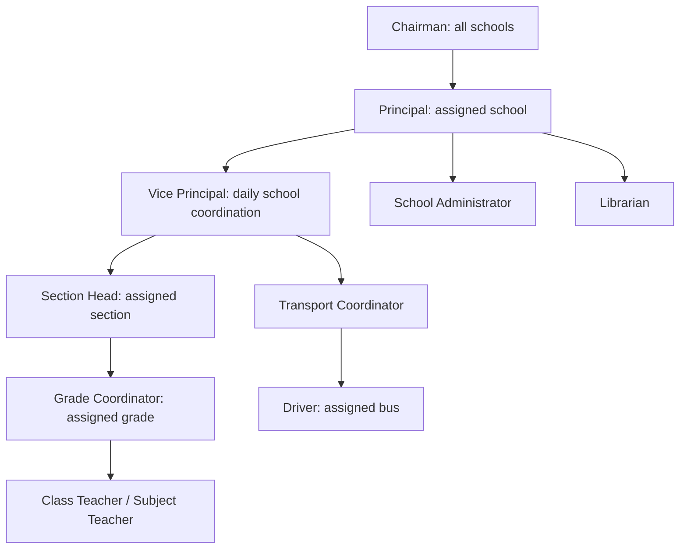

# Sussex College Network — Role Features and Access Reference

**Last updated:** 22 November 2026 (Asia/Colombo).  
**Status:** Implemented browser-only demonstration, with the limitations listed below.  
**Application:** `dist/`; start locally with `python3 -m http.server 4183 --bind 127.0.0.1 --directory dist`.

This is the maintained reference for the **current implementation**, covering all 12 roles. A feature appears here as available only when the prototype implements it. Future suggestions are not permissions. Update this file in the same change as future implementation; the maintenance checklist is at the end.

## Contents

1. [Prototype boundaries](#prototype-boundaries)
2. [Organisation and access model](#organisation-and-access-model)
3. [Role summary](#role-summary)
4. [Chairman](#chairman)
5. [Principal](#principal)
6. [Vice Principal](#vice-principal)
7. [Section Head](#section-head)
8. [Grade Coordinator](#grade-coordinator)
9. [Class Teacher](#class-teacher)
10. [Subject Teacher](#subject-teacher)
11. [School Administrator](#school-administrator)
12. [Transport Coordinator](#transport-coordinator)
13. [Driver](#driver)
14. [Librarian](#librarian)
15. [Parent](#parent)
16. [Cross-role workflows](#cross-role-workflows)
17. [Persistence and reports](#persistence-and-reports)
18. [Demo accounts and validation](#demo-accounts-and-validation)
19. [Maintenance checklist](#maintenance-checklist)

## Prototype boundaries

- This is a UI demonstration, with browser-local data and permission checks. There is no authenticated staff backend, server-side authorization, database, production GPS integration, payment gateway or real messaging service.
- The role/account switcher deliberately lets a presenter preview different accounts. It is not a production login or a security boundary. Staff roles are separate workspaces, even when one person holds several roles.
- Parent admission login uses a linked student's admission number and the shared temporary password `1234`. It demonstrates student selection and access, not real password security.
- School names and approximate locations use the 20-branch Sussex directory verified in the existing project on 19 November 2026. The directory is not refreshed automatically. Internal IDs `colombo` and `lakeside` display as Nugegoda and Malabe.
- The national overview shows 44 simulated buses: eight editable operational demo records at Nugegoda/Malabe and two illustrative vehicles at each other branch. Illustrative vehicles do not create student, teacher or editable bus records.
- Map movement, GPS signals, occupancy, arrival estimates and routes are demonstrations. Street tiles require internet access and retain OpenStreetMap attribution.
- School registers, assessment marks, staffing complements, vacancies and leave requests are illustrative. Class Teachers can save present/absent/late entries over their own generated class register; the affected student totals, calendars, watchlists and newly generated reports use those saved entries across leadership views. This is still sample attendance, not a connection to real student attendance data. The default sample school day is **20 November 2026**, even when the real calendar date is later. Register/report date controls support 12 October–20 November; follow-up due dates support 20–27 November. Temporary cover uses 20 November.
- **Actual prototype records** mean the editable sample student accounts, courses, teacher assignments, materials and parent completion data saved in the browser. They are distinct from generated assessment cohorts and attendance registers. A generated student attendance profile is not an editable admission record.
- Section, Grade Coordinator and Class Teacher academic/attendance samples cover Grades 1–13, with illustrative classes A/B per grade. Other configured classes and Preschool have no numeric fixture; their numeric views remain empty instead of borrowing a whole grade's data. Actual admission/course records in those scopes remain separately accessible.
- Courses can be assigned and enrolments changed, but no create/delete-course screen, exam mark entry, timetable engine, payroll, discipline case system or real parent-notification workflow is implemented.

## Organisation and access model



This is the recommended operating hierarchy represented by the prototype. Parent access follows the linked student, rather than the staff hierarchy. A reporting line does not automatically inherit permissions.

### Scope rules

| Scope | Meaning |
| --- | --- |
| Network | All 20 branches, or Chairman-selected branches. |
| School | The school in the active role appointment. Only the Chairman has a school scope selector. |
| Section | One academic section in one appointed school. |
| Grade | The appointed grade in the appointed school. |
| Class | The appointed grade and class in the appointed school. |
| Teaching course | Courses assigned to the active Subject Teacher account in its school. |
| Student | The admission-selected child linked to the active guardian account. |
| Bus | The active driver's currently assigned vehicle in its school. |

Sections are **Preschool (0), Primary (1–5), Middle School (6–9), Senior School (10–13)**. These are prototype configuration values, not a claim about Sussex's official internal management structure.

An appointment is a role plus its school and, where needed, section, grade, class or bus. The same person can hold several appointments; changing the active role changes the available actions. For example, a Section Head who also teaches a course publishes materials through their Teacher workspace, and reviews materials through their Section Head workspace.

## Role summary

| Role / internal key | Current entry | Read scope | Main changes allowed |
| --- | --- | --- | --- |
| Chairman / `chairman` | Overview → Transport | Network or selected school(s) | School details, staff appointments, student/course/material/bus/library management, vacancy review, reports. |
| Principal / `principal` | Overview → Transport | Assigned school | Lower-role appointments, student/course/material/bus/library management, leave decisions, trip controls, vacancy review, reports. |
| Vice Principal / `vice_principal` | Overview → Transport | Assigned school | Daily follow-ups, temporary cover, leave recommendations, cover-request decisions, student/course/material/bus/library coordination, reports. |
| Section Head / `section_head` | Overview → Section Overview | Appointed school and section | Section course assignments/enrolment, material reviews, attendance follow-ups, cover requests, section reports. |
| Grade Coordinator / `coordinator` | Overview → Grade Overview | Appointed school and grade | Course enrolment, attendance follow-ups, class coordination reviews, Section Head support requests, grade reports; assigned course teacher is retained. |
| Class Teacher / `class_teacher` | Overview → Class Overview | Appointed school, grade and class | Own sample-class attendance, follow-ups, private discussion records, Grade Coordinator support requests, class reports, publication only on courses assigned to the same account. |
| Subject Teacher / `teacher` | Overview → Subject Overview | Current assigned teaching courses and matching-class enrolled students in appointed school | Publish/edit materials, lesson plans, internal learning reviews, Grade Coordinator support requests and subject reports. |
| School Administrator / `admin` | Students & guardians | Assigned school | Student/admission/guardian records, course teacher assignments and enrolment. |
| Transport Coordinator / `transport` | Bus tracking | Assigned school fleet | Bus route/stop/driver/student assignments. |
| Driver / `driver` | Bus tracking | Currently assigned bus | Start and end the assigned demo trip. |
| Librarian / `librarian` | Library | Assigned school catalogue/orders | Edit price/availability; mark orders collected. |
| Parent / `parent` | Admission login → Bus tracking | Selected linked student and own orders | Download/mark materials done; place book orders; manage own book bag. |

## Chairman

**Entry:** `#chairman/overview/transport`. **Navigation:** Overview, Bus tracking, Courses, Students & guardians, Library, Roles & access.

### Overview views

- **Transport Activity:** full Sri Lanka map; 20 schools and 44 simulated buses; school and bus drill-downs; route, next stop, speed/signal and arrival information; fleet/status filters; school comparisons; pause/resume and reset map.
- **Academic Performance:** subject/grade/term filters; weighted averages and pass rates; school ranking and prior-term changes; trend/distribution charts; branch detail and comparison CSV. Current network assessment grade controls list 6, 8, 10 and 11.
- **Attendance:** student or staff audience; school/date/grade/period filters; saved Class Teacher sample entries are included; one/five/twenty-school-day totals and trends; branch comparisons; repeated absence watchlist; search/pagination and personal 20-day calendars.
- **Staffing Overview:** leadership and staff profiles; headcount, availability and staffing capacity; group/status/search filters; vacancies and persistent review status; links to school appointments. Actual prototype appointments and illustrative staffing records are labelled separately.
- **Executive Reports:** network brief and transport/academic/attendance/staffing reports; selectable branch scope; snapshots, CSV, standalone branded HTML and Print / Save PDF; latest eight reports per Chairman account.

### Management actions

- Edit an existing school's display name/location label.
- Appoint or remove non-Chairman roles, including Principals, within the chosen school scope. The app does not provide Chairman appointment management.
- Add/edit student records and admission numbers; link existing guardian accounts.
- Assign school teachers and matching-class students to existing courses.
- Publish/edit/download materials and review parent-recorded completion.
- Manage existing operational bus routes, stop names, drivers and assigned students.
- Manage catalogue price/availability and collect parent book orders.

**Limits:** synthetic network buses are read-only. Final leave decisions and the dedicated start/end controls in the school overview are exposed in the Principal workflow; Chairman dashboards do not contain an additional leave approval screen. Reviewing a vacancy does not fill it.

## Principal

**Entry:** `#principal/overview/transport`. **Scope:** appointed school. **Navigation:** same six workspaces as Chairman, without a school selector.

- **Daily pulse:** student attendance, unavailable teachers, classes requiring review and delayed bus signals, with links into related views.
- **Transport Activity:** assigned-school map/routes/fleet, bus filters and details; existing vehicle management; start/end demo trips and reset to school routes.
- **Academic Performance:** class/subject/grade/teacher comparisons; assessment filters and charts; actual course/material progress; assign courses, open lecture materials and export comparison CSV.
- **Attendance:** student/staff registers (including saved Class Teacher student entries), class summaries, grade/class/date/period filters, personal calendars and repeated absence views.
- **Staffing Overview:** school leadership, availability, capacity, directory, vacancies and sample leave requests. Approve/decline leave; the result changes sample staff availability, attendance, pulse and newly generated reports. See the Vice Principal's recommendation and note before deciding.
- **Executive Reports:** school brief and individual operational reports, CSV/HTML/print, separate school/Principal snapshot history.
- **Management:** add/edit students; assign course teachers/students; publish/edit materials; manage buses and catalogue/orders; appoint/remove lower roles within the school.

**Limits:** no other-school records, no school detail edit, no Principal or Chairman appointments, no network-wide comparisons or report history. Final leave decisions do not send messages.

## Vice Principal

**Entry:** `#vice_principal/overview/transport`. **Scope:** appointed school. **Navigation:** Overview, Bus tracking, Courses, Students & guardians, Library.

- **Daily pulse and follow-up board:** school attendance, teacher availability, classes to review, delayed bus signals; three seed coordination tasks plus added tasks; category, owner, due date, status and dated note history. Open/in progress/resolved states persist locally.
- **Transport Activity:** assigned-school map/fleet/details; record a bus issue as a named follow-up. The separate Bus tracking workspace provides existing bus/driver/student/stop management.
- **Academic Performance:** school comparisons, assignment/material progress, course assignment and comparison CSV; assign or cancel one-day temporary teaching cover.
- **Attendance:** section-independent school/class registers (including saved Class Teacher sample entries), repeated absences and calendars; create a student-specific attendance follow-up.
- **Staffing Overview:** leadership/capacity/directory/vacancy review, temporary cover and **Leave recommendations**. Add/edit a recommendation and note on a pending leave request; the Principal makes the final decision.
- **Section Head cover requests:** pending requests appear in Staffing Overview. Assign available cover to the requested course, or decline with a note. The Section Head sees the outcome. Cancelling cover linked to a request reopens that request for replacement.
- **School Reports:** operational brief plus transport/academic/attendance/staffing snapshots. Briefs also capture follow-ups, active cover and leave recommendations awaiting Principal decision. CSV/HTML/print; eight snapshots per school/role.
- **Management retained:** school student records, course teacher/student assignments, material publication, existing bus management and catalogue/order management.

**Limits:** no permanent staff appointments, final leave approval, network scope or other-school inboxes/history. Temporary cover is stored separately from permanent course assignments and does not grant Teacher access. Cover requests are acted on through the local demo, not sent as messages.

## Section Head

**Entry:** `#section_head/overview/summary`. **Scope:** the actual school and section appointment. **Navigation:** Overview, Courses, Students & guardians. The overview contains exactly these five views:

### Section Overview

- Assigned school, section and grade range, plus a presenter-only demo account selector.
- Daily sample attendance, actual registered prototype students, teaching staff serving the section and pending recorded attendance follow-ups.
- Prototype course/material counts, completed/expected material assignments and pending cover requests.
- Grade summary with Term 3 Mathematics averages and daily attendance, a five-school-day attendance trend, teaching priorities and links to academic/teaching views.
- Attendance follow-up list with assigned owner, due date, status and update action.

### Academic & Courses

- Grade/class controls limited to the appointed section; four assessment subjects and three terms.
- Class/grade/subject/assigned-teacher comparisons; averages, pass rates and illustrative assessed cohorts. Unassigned illustrative classes are labelled without inventing teacher appointments.
- Courses and lecture-progress list for the selected grades/class. This list is independent of the assessment subject selector, which filters comparison marks.
- Edit teacher/enrolment assignments for existing section courses, using school teaching accounts and matching-class students.
- Open/download published lecture notes and review enrolled-student completion.
- Review course materials as **Ready for learning** or **Updates requested**, with a note. Staff can see the review in the course workspace; parents do not see internal review notes.
- Export the current academic comparison as a section-scoped CSV snapshot.

### Attendance

- Illustrative section student register and class summaries, including saved Class Teacher attendance entries; grade/class/date/period filters; one/five/twenty-school-day totals; trend; search and pagination.
- All students, repeated absence (3+ absences in trailing 20 school days), latest-day absent and latest-day late filters.
- Open a student’s 20-day attendance calendar. Record a follow-up with an owner serving the section (or the Section Head), due date, note and open/in progress/resolved status. Updates retain note history.
- Export attendance summaries. This role does not edit attendance marks or school admission records.

### Teaching Coordination

- Show teachers assigned section courses and relevant grade coordinators/class teachers. Shared teachers' out-of-section courses are excluded from workload and material counts.
- Grade/class/date filters; teacher search; available/unavailable counts; in-section teaching profile and course progress.
- Identify courses without lecture materials and record material review feedback.
- Review requests from Grade Coordinators in the appointed school/section. Record an in-progress or resolved response with note history; the coordinator can read it in their Class Coordination view. Material requests link to the existing material-review form; cover requests link to the existing Vice Principal cover-request form. Recording a response does not itself allocate cover or approve lecture materials.
- Request one-day cover against an existing section course, with a reason. View pending, cover-assigned or declined outcomes and the Vice Principal's note/cover teacher.
- Duplicate pending requests for the same course/day are rejected. A request does not assign a teacher or alter a permanent assignment.

### Section Reports

- Management brief, academic comparison, attendance and teaching progress report types.
- Section grade/class scope, subject/term and attendance date/period controls; class/grade/subject/assigned-teacher academic comparison selection.
- Snapshot preview, CSV, standalone branded HTML and Print / Save PDF. Briefs include recorded attendance follow-ups for the chosen grade/class scope.
- Latest eight snapshots per school/section. Primary and Middle School at the same branch have separate histories; another school's reports and senior-leader histories are excluded.
- Saved reports remain unchanged when assignments, filters or follow-up statuses change later.

**Limits:** no branch/section expansion, school-wide staff directory or confidential HR/leave decisions; no staff appointments; no final cover allocation; no lecture publication while active as Section Head; no core student edits, library management, bus controls or transport page. The five requested views do not introduce a separate Student Follow-ups or Transport tab. Follow-ups are integrated into Overview/Attendance. Numeric Preschool fixtures are unavailable and show empty states.

## Grade Coordinator

**Entry:** `#coordinator/overview/summary`. **Scope:** the actual appointed school and a single grade. **Navigation:** Overview, Courses, Students & guardians. The overview contains five views:

### Grade Overview

- Fixed school/grade identity, section context and presenter-only demo account selector. No school, section or grade scope selector is available.
- Daily sample student attendance, actual prototype admission count, existing grade courses and pending attendance follow-ups.
- Published-material counts, parent-recorded completion, open Section Head support requests and class reviews marked as needing support.
- Class summary with appointed class teachers where present, Term 3 Mathematics sample averages, daily sample attendance, course counts and latest class review; a five-school-day attendance trend; links into learning and class coordination.
- Integrated grade attendance follow-up list, with owner, due date, status and update action.

### Academic & Courses

- Classes A/B in the appointed grade, four assessment subjects and three terms. Compare classes, subjects and actual assigned teachers; no other-grade comparison is exposed.
- Sample average/pass-rate/assessed-student metrics. Classes without a prototype course/teacher remain labelled as sample/unassigned; the teacher comparison is empty if the selected subject has no assigned course in this grade.
- Read existing grade courses, lecture materials, assigned teacher, actual course enrolment and parent completion. Course rows follow the class filter, independently of the assessment subject.
- Edit enrolment using matching-class students. The teacher selector is disabled and submission retains the current teacher even if a presenter changes the form field in browser tools.
- Open/download published materials and review student completion. Read existing Section Head review feedback in staff course details.
- Export the selected academic comparison as a grade-scoped CSV snapshot.

### Attendance

- Illustrative grade/class registers, including saved Class Teacher attendance, class summaries, date/period filters, trend, search and pagination; one/five/twenty-school-day totals.
- All grade students, repeated absence (3+ absences in trailing 20 school days), latest-day absent and latest-day late watchlists.
- Open a student's 20-day attendance calendar. Record a follow-up owned by the coordinator or a staff member serving the grade, with a due date, note and open/in progress/resolved status. Updates retain note history.
- Export attendance snapshots. No actual attendance-mark entry, admission edits or other-grade students are available.

### Class Coordination

- Review course-specific **Subject Teacher** support requests in the appointed school/grade; record an in-progress/resolved response with note history, or separately request Section Head support. Requests from other schools or grades are excluded. Responses do not change course assignments, lecture readiness, attendance or cover allocation.
- Class teacher context, prototype course counts, sample averages/attendance and latest coordination review for each selected grade class.
- Record an on-track, needs-support or review-completed class review and note. Repeated reviews retain history. These records do not change assessment marks, attendance or teacher appointments.
- Read teachers serving the grade, availability and workload profiles. Shared teachers' other-grade courses are excluded.
- Read missing/published-material counts and the Section Head's review outcome for grade courses.
- Review requests from Class Teachers in the appointed school/grade. Record an in-progress or resolved response with note history; the requesting class sees it in Student Support. Course-linked requests can open the existing Section Head support form. A response does not itself change attendance, approve materials or allocate cover.
- Record a course-related **attendance, lecture materials, teaching cover or learning support** request for the Section Head. One open request per course/topic is allowed; an unresolved duplicate is rejected.
- View open/in-progress/resolved request status and the Section Head's response history. This is a local browser queue, not a notification, teacher instruction or automatic cover assignment.

### Grade Reports

- Grade management brief, academic comparison, attendance and learning-progress report types.
- Assigned grade is fixed; class, subject/term, attendance date/period and academic comparison controls apply within it. Class review status is included in the brief; learning-progress reports use actual course/material/completion records.
- Snapshot preview, CSV, branded standalone HTML and Print / Save PDF. Briefs include recorded follow-ups in the selected class scope.
- Eight snapshots retained per school/grade, separately from Section Head and senior-leadership reports. Changing the demo account clears view filters and opens that appointment's history; saved values do not change after later edits.

**Other workspaces:** Courses retains the existing grade-scoped course/enrolment workflow. Students & guardians is a read-only directory of actual grade students and linked guardians.

**Limits:** cannot change a course teacher, publish/edit/approve lecture materials through this role, respond as a Section Head, assign or approve temporary cover, make leave decisions, edit admission records, appoint staff, access another grade/school, or manage transport/library/payments. Support responses and task owners do not trigger real messages. The Grade Coordinator, Section Head and Vice Principal attendance follow-up lists are separate local collections.

## Class Teacher

**Entry:** `#class_teacher/overview/summary`. **Scope:** the actual appointed school, grade and exact class. **Navigation:** Overview, Courses, Students & guardians. The overview has five views:

### Class Overview

- Fixed class/school/grade identity with a presenter-only account selector. There is no class, grade or school scope selector.
- Daily sample class attendance, actual prototype admission count, existing class courses and pending attendance follow-ups.
- Number of register entries marked, published materials, parent-recorded completion and open Grade Coordinator support requests.
- Class priorities and planned parent-discussion count, Term 3 subject comparison, a five-school-day attendance trend and recorded follow-up list.
- Actual admission records and generated sample-register students are counted separately and labelled in the interface.

### Learning & Materials

- Read all existing courses assigned to this class, their subject teachers, enrolment, published materials and parent-recorded completion.
- View/download lecture notes, worksheets, slides/readings and attachments; review enrolled-student completion. Read Section Head material-review feedback and internal Subject Teacher learning reviews in staff course details.
- Publish/edit materials **only where the course's assigned teacher account matches the active Class Teacher account**, within the appointed class. For example, Dilini can publish Mathematics 8A but cannot edit Nuwan's Science 8A materials or her own ICT course in another grade while active as Class Teacher 8A.
- Publication uses the existing sample-text/attachment workflow with the 2 MB attachment limit; enrolled parents can download and mark the new materials done.
- Assessment-term control and subject comparison use only this class's illustrative cohorts. Unsupported numeric fixtures remain empty.
- Course teacher assignments and enrolment are read-only for this role.

### Attendance

- Read the exact class's illustrative register, attendance totals/trend, date/period filters, search/pagination and absence/late/repeated-absence watchlists.
- Mark a single student or the whole class sample register as **present, absent or late**. Changes apply to the latest school day shown; late arrivals are included in present totals. Only valid sample school days from 12 October to 20 November are writable.
- The marking dialog lists student names/admission numbers with three large **Present / Absent / Late** radio-button choices. One status is selected per student; existing saved/generated statuses are preselected. Native keyboard navigation and visible focus/selection states are supported, with 44px or larger tap targets.
- For a full class, search by student name or admission number and use **All present** to set every student in the dialog to present, including students hidden by search. Live Present/Absent/Late counts always cover the full list. Single-student dialogs omit the bulk shortcut and search.
- The roster scrolls while summary/search and **Save class attendance** stay visible. Selections and the changed-count are drafts until Save; Cancel/close discards them. Searching (including Enter) does not save. Saving a filtered list still saves the complete class dialog roster. School, grade, class and sample-date restrictions remain the same.
- Saved statuses overlay generated samples for that class/day. Unmarked entries remain generated. The interface displays the marked count, and the same saved values flow into Grade Coordinator, Section Head, Vice Principal, Principal and Chairman student attendance totals/calendars/watchlists and newly captured reports. Staff attendance is unaffected.
- Restore generated sample attendance for the appointed class and selected school day, with a confirmation. Other classes/dates and saved report snapshots remain unchanged.
- Open a sample student's trailing 20-school-day calendar. Record/update an attendance follow-up with a due date, open/in-progress/resolved status and note history; the active Class Teacher is recorded as owner.
- Export the day register or period summary as a class-scoped CSV snapshot. A day register lists sample students and saved/generated source; multi-day reports show daily totals.
- This register uses generated sample students, not the actual admission records shown in Student Support. No real attendance integration or parent attendance portal has been added.

### Student Support

- Read actual class admission records, linked guardians, course count and material completion; student/admission/guardian assignments remain read-only.
- Record a planned/completed parent discussion against an actual class student, with a date, optional existing linked guardian and note. Updates retain history. Guardian options come only from that student's current school links; no phone/email details are invented.
- Discussion records are private to the class workspace: not copied to parent portals, Grade Coordinator queues or report exports. Records for students moved out of the class are not shown in the current class note list.
- Record a request for the same school's Grade Coordinator: attendance, learning, lecture materials or teaching cover. Attendance/learning can be class-level; material/cover topics require an existing class course. Unresolved duplicates per course/topic are rejected.
- Read the coordinator's in-progress/resolved response history. The coordinator can separately request Section Head support; a response does not allocate cover, appoint a teacher, publish materials or edit attendance.
- No notification is sent and no real parent contact occurs. The form records plans/outcomes for this prototype.

### Class Reports

- Class management brief, subject comparison, attendance register and learning-progress report types.
- Class/school/grade stay fixed. Subject/term and attendance date/period controls operate only within the appointed class.
- Day attendance export includes each illustrative student and saved/generated status source; multi-day attendance export includes daily totals. Saved register entries are included.
- Briefs include scoped attendance follow-ups; progress reports use actual class course/material/completion records. Private discussion text and guardian details are excluded.
- Snapshot preview, CSV, branded standalone HTML and Print / Save PDF. Latest eight snapshots per school/grade/class, separate from sibling classes and other roles. Later register/material changes do not rewrite old reports.

**Other workspaces:** Courses retains class course/material/progress access with the same publishing rule. Students & guardians is the read-only actual class directory.

**Limits:** no teacher/enrolment reassignment, core admission/guardian edits, staff appointments, leave decisions, lecture readiness approval, cover allocation, bus/library management, another class's records or another role's reports. Being a Class Teacher does not grant publication for all class subjects or permit marking staff attendance. Numeric fixtures exist only for A/B classes and Grades 1–13; other classes/Preschool show empty numeric states.

## Subject Teacher

**Entry:** `#teacher/overview/summary`. **Scope:** current teaching-course assignments for an actual Subject Teacher appointment in its school; enrolled students must also match the course’s school, grade and class. **Navigation:** Overview and Courses. Five overview views are implemented:

### Subject Overview

- Fixed appointed school/teacher identity with a presenter account selector; no school, grade or class scope selector.
- Current teaching courses, distinct enrolled students, course-enrolment count, published materials and parent-recorded completion (done / expected material assignments).
- Lesson-plan count, enrolled course/student reviews needing practice, courses missing materials and open Grade Coordinator requests.
- Assigned course table with material/progress drill-down and publication controls. Metrics use existing prototype admissions, materials and completion; generated school marks/registers are not used as subject results.

### Teaching & Materials

- Filter only among currently assigned teaching courses. View/download/edit published lecture notes, worksheets, slides and readings; add a local file up to 2 MB or a sample text handout.
- Enrolled parents can download published materials and mark them done through the existing portal. Teacher and leadership course progress reflects those completion flags.
- Create/update internal lesson plans for a teaching course: topic, planned date (20–27 November 2026), planned/in-progress/completed status and outline/update note. Updates retain up to 20 notes.
- Filter lesson plans by course and status. Plans stay with the course: a newly assigned teacher can read/update their history; the former teacher loses access after reassignment.
- Read Section Head material-readiness/update feedback; publishing a revision does not itself approve readiness.

### Student Progress

- One row per currently enrolled course/student, showing admission number, course/class, materials done / assigned and staff review status. Only students matching the course’s school, grade and class are included, including in staff course-detail rosters.
- Filter by assigned course and review status (including unreviewed); search student name, admission number, course or class.
- Save/update an internal on-track/needs-practice/reviewed learning review with note history (latest 20). Notes are visible to staff with current course access, including the next assigned teacher, in course details; they are hidden from parents.
- Reviews do not set parent-completion flags, enter assessment marks or change attendance. Moving a student out of the course/class removes their review from the current roster.

### Teaching Support

- Record course-specific requests for learning, lecture materials, attendance concerns or teaching cover. A current assigned course and note are required; unresolved duplicates per course/topic are rejected.
- The request appears in the Grade Coordinator queue for that course’s school and grade. Read in-progress/resolved response history (latest 20) in Teaching Support.
- Grade Coordinators can separately request Section Head support. A response does not allocate cover, change assignments, approve materials or mark attendance.
- Review Section Head material feedback and open the relevant course. Requests stay with the course and remain accessible to its current assigned teacher after reassignment.
- Requests/responses are local demonstration records; no email, notification or external message is sent.

### Subject Reports

- Four report types: teaching summary, course materials register, student learning progress and lesson plan register. Choose all current teaching courses or one assigned course.
- Progress reports use the visible learning-review/search filters. Plan reports use the plan-status filter. Other report types ignore those unrelated filters; their snapshots record the actual applied criteria.
- Capture current course/material/enrolment/completion values, with a snapshot date in Asia/Colombo. No fabricated subject marks, attendance percentages or staff metrics are introduced.
- Preview, formula-safe CSV, branded standalone HTML and Print / Save PDF. Internal free-text learning-review, lesson-outline and support-request/response notes are excluded; lesson topics and review statuses are included where relevant.
- Latest eight snapshots per teacher account and appointed school, separate from all other roles. Captured course IDs and course/student enrolments are revalidated on open/download/print: reports outside current teaching or student access are hidden. Later completion/material edits do not rewrite snapshots.

**Other workspace:** `#teacher/courses` retains the existing assigned-course material/progress experience.

**Limits:** no course enrolment/teacher/admission/guardian changes, whole-class or school directories, Class Teacher private discussion notes, class/staff attendance marking, role appointments, leave decisions, readiness approval, cover allocation, transport/library management or another role’s reports. Subject Teacher attendance concerns use the coordinator request workflow. Even a person with both roles marks their own class register only while active as its appointed **Class Teacher**. Temporary cover does not grant permanent teaching access. This remains a browser-only prototype, not server-enforced authorization.

## School Administrator

**Entry:** `#admin/people`. **Scope:** appointed school. **Views:** Students & guardians; Courses.

- Create/edit student names, unique admission numbers, grade/class and linked existing guardian accounts.
- Read student course enrolment/completion and linked guardians.
- Assign school teachers and matching-class students to existing courses; read/download materials and progress.

**Limits:** cannot appoint parent/staff accounts, publish lecture materials through this role, create courses, manage buses/library/leave or access senior-leader dashboards. A Principal/Chairman appoints existing accounts to guardian/staff roles.

## Transport Coordinator

**Entry:** `#transport/transport`. **Scope:** appointed school’s operational buses.

- Fleet map, vehicle status counts, status filters, selected route, stops and simulated progress; pause/resume demonstration.
- Manage existing route name, ordered stop names, school driver assignment and students assigned to a bus.
- Assignment updates are reflected in Driver and Parent portals and the relevant operational network overview vehicle.

**Limits:** cannot edit another school's fleet, synthetic overview vehicles, admissions, courses, staff roles or library orders. Dedicated trip start/end controls belong to Driver/Principal workflows. Vice Principal follow-up ownership records a coordinator name but does not send a message or create a separate coordinator task inbox.

## Driver

**Entry:** `#driver/transport`. **Scope:** one current bus appointment matching its school and driver account.

- Mobile-responsive trip view with assigned route, stop sequence, map/progress and vehicle context.
- Start/end the assigned simulated trip; linked Parent/leadership views reflect status.

**Limits:** no other bus, school roster, route/driver/student reassignment, course/library/role access or real phone GPS upload. No device permission or GPS hardware integration is requested by this UI prototype.

## Librarian

**Entry:** `#librarian/library`. **Scope:** appointed school’s catalogue and orders.

- Read catalogue, pricing and availability; edit existing book prices and availability.
- Read school parents' book orders and mark an order collected.

**Limits:** no payment processing, cross-school orders, student/course/staff/bus management, role appointments or full library lending/inventory system. Book orders are for school collection/payment in the demonstration.

## Parent

**Entry:** `#parent/login`, then `#parent/transport`. **Views:** Bus tracking; Courses; Library. **Scope:** one admission-selected student linked to the guardian’s school role, plus that guardian's own library orders.

- Sign in with the selected student's admission number and `1234`; example cards fill credentials. Login rejects an unknown student, wrong password, or missing linked guardian/school role. Log out to select another student.
- Track the student’s assigned bus, simulated route/progress/stops and arrival context. Show an empty state when no bus is assigned.
- Read only courses in which the selected student is enrolled; download lecture notes/attachments; mark materials done/undone and see progress. Teachers/leadership can review that completion.
- Browse the school book catalogue; search/filter, add/remove quantities in a personal book bag, place an order for school collection and review own order history.
- Session survives refresh. Course completion is stored per student; book bag/order history belongs to the parent account and school.

**Limits:** no other family's orders or unlinked student data, staff role switcher inside the signed-in portal, teacher material publication, admission/course/bus edits, school comparisons, payments or real GPS guarantees. Internal Section Head review notes are hidden from this portal.

## Cross-role workflows

### Course learning and completion

1. Chairman, Principal, Vice Principal, school Administrator or scoped Section Head assigns the teacher and matching-class students to an existing course. Grade Coordinators can change enrolment while retaining the teacher.
2. Assigned Teacher/Class Teacher publishes materials; Chairman/Principal/Vice Principal also have school-scoped publication permission.
3. Section Head reads/reviews materials and records readiness or requested updates; staff see feedback in course details.
4. Enrolled student's Parent downloads materials and marks them done; teaching and leadership views reflect stored completion.
5. Subject Teachers add internal course/student learning-review status and notes. Staff with current course access see these in course details; parents do not. Completion flags and assessment marks remain separate.

### Temporary cover

1. Section Head records a request for an existing in-section course and the demo date, with a reason. It stays pending.
2. The same school's Vice Principal sees the request in Staffing Overview and assigns available temporary cover or declines with a note.
3. Section Head sees the decision. Cover stays separate from permanent course and role assignments.
4. Cancelling linked active cover reopens the request as pending. The Vice Principal can assign a replacement or decline it.

The Vice Principal may also create cover directly without a request. Cover teacher choices include labelled illustrative teaching staff. Cover allocation does not grant authentication or publication rights.

### Leave decisions

1. Sample staff leave requests exist within a school.
2. Vice Principal records a recommendation and note while the request is pending; availability remains unchanged.
3. Principal reviews and approves/declines; the sample staff register/pulse and newly captured reports update. Section Heads do not see or approve leave requests.

### Class Teacher register, parent discussions and coordinator requests

1. The appointed Class Teacher marks a single or full illustrative register for their own class and sample school day. Saved entries overlay generated statuses; related class/grade/section/school attendance reads and new reports use those same entries. Late counts as present.
2. Restoring the generated sample removes only that class/day's saved entries. Historical snapshots retain their captured values.
3. Parent discussion plans/outcomes use actual class admission records and linked guardian accounts. They stay in the class workspace and are excluded from parent views and reports; no message or phone call is made by the application.
4. Class Teacher support requests appear only for Grade Coordinators in the same school/grade. The coordinator records a response, or separately opens the existing Section Head request workflow for a course-linked matter. Responding does not execute the requested operational action.

### Subject Teacher preparation and coordinator support

1. The active Subject Teacher prepares lesson plans, publishes materials and reviews only current matching-class course enrolments in the appointed school.
2. Course-specific learning/material/attendance/cover requests appear only in **Grade Coordinator → Class Coordination → Requests from Subject Teachers** for that school/grade.
3. The coordinator responds in progress/resolved; the teacher sees the response in Teaching Support. The coordinator can separately use the existing Section Head request workflow. Operational decisions remain separate actions.
4. Plans, internal learning reviews and requests follow the course on teacher reassignment; the former teacher loses access. Subject report history stays owned by the capturing teacher/school, and snapshots losing any captured course/student access are hidden rather than rewritten.
5. The Subject Teacher role cannot mark the class register, including on a multi-role staff account. Switch to the appointed Class Teacher role to mark that exact class.

### Grade Coordinator support and class reviews

1. The Grade Coordinator records a grade-course support request (materials, cover or learning) in Class Coordination.
2. It appears only for Section Heads appointed to the same school and containing section. The Section Head records an in-progress/resolved response; the coordinator sees the note history.
3. Material requests can open the Section Head material review form. Cover requests can open the existing Section Head → Vice Principal cover-request form. These are separate actions; responding to a support request does not itself publish materials, appoint teachers or allocate cover.
4. Grade class review notes are owned by school/grade/class. They track coordination and retain history without modifying sample marks or registers.

### Attendance follow-ups

- Grade Coordinators record grade-owned student follow-ups in their own Overview/Attendance views.
- Section Heads record section-owned student follow-ups in their own Overview/Attendance views.
- Vice Principals maintain a separate school operational follow-up board, including named transport/student issues.
- Class Teachers maintain their own class attendance follow-ups.
- These are four distinct local task collections. Owners, dates and notes are recorded; no SMS, email, WhatsApp or automatic cross-board task delivery occurs.

### Transport and books

- Transport Coordinator/authorized school leadership updates the operational bus's route/driver/students; Driver controls its trip; the student's Parent follows the assignment/status.
- Parent places a school collection order; Librarian/authorized school leadership marks collection. No online payment occurs.

## Persistence and reports

- Application state is stored under browser localStorage key `campusway-demo-v1`; the demo merges saved v2 state with defaults to preserve existing records. Parent session storage is separate from the state payload.
- Course assignments, materials, completion, carts/orders, bus status/assignment, staff appointments, leave decisions/recommendations, reviews, follow-ups, cover and snapshots persist in the same browser. Other devices/browsers do not share these changes.
- **Reset demo** restores sample state. Storage failures show an error/toast instead of claiming success. Browser storage and the 2 MB individual attachment limit constrain uploads; this is not durable document storage.
- School executive report history is owned by role/school (Principal/Vice Principal), or Chairman account; the latest eight are retained per workspace. Section report history is separately owned by school + section under the Section Head role, eight per workspace.
- Grade Coordinator report history is independently owned by school + grade under the `coordinator` role, with eight snapshots per workspace; it does not share Section Head or executive report history.
- New coordination state includes grade attendance follow-ups, class review histories and Section Head support requests/responses. A one-time `gradeCoordinatorVersion` migration adds two new demo coordinator accounts to existing v2 browser data while retaining user assignments, materials and appointments; later removed demo appointments are not restored.
- Class Teacher state additionally includes class/day attendance overrides, class follow-ups, private parent-discussion histories, Grade Coordinator support requests/responses and isolated class report history (eight per school/grade/class). Attendance totals bypass the generated-summary cache when saved entries exist for that school/day so edits and restores are reflected consistently.
- Subject Teacher state includes `subjectLessonPlans`, `subjectLearningReviews`, `subjectSupportRequests` and `subjectReports`. No new demo accounts or migration flag are required. Notes/history persist in this browser; course ownership follows current assignments. Reports retain eight per teacher/school and recheck captured course/student access. Learning-review text is available to current course staff, excluded from exports/parent views, and never copied into generic activity messages.
- A one-time `classTeacherVersion` migration adds Nugegoda 6A and Malabe 8A demo Class Teacher accounts while retaining existing enrolment, materials, progress, roles and saved state. Removed appointments are not restored on later loads.
- Report snapshots capture values at generation time. Filters/data edits do not rewrite older reports. Scope checks apply to opening, downloading and printing saved reports.
- CSV values are quoted and dangerous leading spreadsheet formula characters are neutralised. Exports carry sample provenance and relevant scope/filter metadata.
- HTML downloads embed the existing logo when it can be read. Print / Save PDF uses the browser's print dialogue; no automatic PDF service is integrated.
- Activity entries record local changes for branch review; they are demonstration records, not a tamper-proof audit log.

## Demo accounts and validation

| Role | Example account(s) / scope |
| --- | --- |
| Chairman | Duminda Wijesinghe — all branches. |
| Principal | Malini Senanayake — Nugegoda; Suresh Jayawardena — Malabe. |
| Vice Principal | Roshani Fernando — Nugegoda; Dilan Mendis — Malabe. |
| Section Head | Dilini Silva — Nugegoda/Middle School; Asha Wickramasinghe — Nugegoda/Primary; Lakshmi Fernando — Malabe/Middle School. |
| Grade Coordinator | Nuwan Gamage (`nuwan`) — Nugegoda/Grade 8; Tharushi Jayasekara (`coordinator6_c`) — Nugegoda/Grade 6; Kasun Perera (`coordinator8_l`) — Malabe/Grade 8. |
| Class Teacher | Dilini Silva (`dilini`) — Nugegoda/8A; Sanduni Rathnayake (`class_teacher6_c`) — Nugegoda/6A; Chamodi Senanayake (`class_teacher8_l`) — Malabe/8A. Only actual subject assignments permit publication. |
| Subject Teacher | Dilini Silva (`dilini`, Mathematics 8A + ICT 6A); Nuwan Gamage (`nuwan`, Science 8A); Rihana Farook (`rihana`, English 6A); Asha Wickramasinghe (`asha`, Mathematics 4A) — Nugegoda. Lakshmi Fernando (`lakshmi`) — Malabe teaching courses. Actual assignments control visibility. |
| Administrator | Anjali Fernando — Nugegoda; Shanika Dias — Malabe. |
| Transport Coordinator | Nimal Rathnayake — Nugegoda; Chamara Silva — Malabe. |
| Driver | Accounts are generated per operational demo bus; choose the presenter account assigned to that bus. |
| Librarian | Hasini Perera — Nugegoda; school librarian appointments also exist at Malabe. |
| Parent | Amaya `SCN-1001`, Kavin `SCN-1002`, Meera `SCN-1008`, Thevin `SCN-1009`; password `1234`. |

Role assignments may be changed in the demo, so these are seeded examples rather than immutable staff records.

### Validation commands and expectations

```sh
node --test tests/*.test.mjs
```

The suite covers access, migration, parent admission selection, network/directory/fleet data, academic/attendance reconciliation, report isolation, Principal leave decisions, Vice Principal coordination, Section Head scope/reviews/follow-ups and the cover-request handoff, Grade Coordinator scope/class reviews/follow-ups/reports, Section Head support responses and new-account migration. Browser verification should cover all five Section Head views, all three seeded Section Head accounts, 390px/320px layouts, course/material interactions, persistent follow-up/review/request outcomes, role switching and report CSV/HTML/print handling. Grade Coordinator browser checks should cover all five views, all three seeded grade accounts, enrolment teacher protection, material downloads, class/follow-up note persistence, Section Head queue isolation/responses, report exports and 390px/320px layouts. Class Teacher checks should cover fixed class scope, own-subject publication and parent completion, attendance overlays/restores across leadership views, private discussion notes, coordinator responses, report isolation and mobile forms. Check one-choice attendance buttons, keyboard navigation, live totals, draft cancellation, search/empty states, whole-list All present, saving while filtered, saved preselection and persistent Save controls at small screen sizes. Subject Teacher checks cover actual grant and course/student scope, own-course publication and parent completion, plan/review history, staff-only note visibility, coordinator queue isolation/responses, Class Teacher attendance separation, reassignment, report retention and scoped CSV/HTML/print. Check five teaching accounts and 1500px/390px/320px layouts, including forms. Keep passing test counts/evidence in the change log when updated.

## Maintenance checklist

For **every future implementation**:

1. Read this reference and the relevant source permission, scope and UI handlers before changing behavior.
2. Update the role summary and affected role details to match the resulting views, reads, writes and exclusions.
3. Update both sides of cross-role workflows, ownership/persistence/report rules and demo walkthroughs when affected.
4. Keep implemented features separate from recommendations; label sample/empty/unavailable behavior honestly.
5. Add meaningful scope/workflow checks and exercise representative mobile and desktop paths. Check cross-school/section/class targets and stale report IDs for restricted roles.
6. Add a dated entry below with the scope and validation. Preserve earlier entries.
7. Update README links and relevant demo account examples. Do not broaden site sharing or role permissions just to expose a view.

## Change log

### 22 November 2026

- Created the complete feature/access reference for all 12 existing roles and project instructions requiring future maintenance.
- Implemented the five Section Head views, section-grade academic/attendance filters, scoped teacher workloads, course material reviews, student follow-up history and isolated section reports.
- Connected Section Head cover requests with Vice Principal assignment/decline and reopening after cancellation; temporary cover preserves permanent course assignments.
- Retained Chairman, Principal, Vice Principal, teacher, parent and operational role workflows. Numeric Preschool views intentionally show empty sample data.
- Validation: **53 Node tests passed**, including nine new Section Head/cover-handoff tests. Browser checks passed for all five views, three Section Head accounts, 390px/320px layouts, material review/teacher visibility/parent privacy, follow-up persistence, cover assignment/cancellation/reopening/decline, four report types, CSV/HTML downloads and the print iframe source. Chairman/Principal/Vice Principal views also passed browser smoke checks. The operating system print dialogue and an exported PDF file were not automated.


### 22 November 2026 — Grade Coordinator

- Implemented Grade Overview, Academic & Courses, Attendance, Class Coordination and Grade Reports for the appointed school/grade.
- Preserved enrolment-only course changes; teacher assignment, publication, Section Head review, cover allocation, leave and staff appointments remain outside this role.
- Added persistent grade follow-ups and class reviews, with a scoped Grade Coordinator → Section Head support queue and response history. Support responses are separate from operational approval/allocation actions.
- Added Nugegoda Grade 6 and Malabe Grade 8 demo coordinator accounts, with a one-time migration that preserves existing browser edits and removed appointments on later loads.
- Updated this reference and the README walkthrough. Validation: **62 Node tests passed**, including nine new grade-scope/workflow/migration tests. Browser checks passed for the five views, three accounts, 1500px/390px/320px layouts, protected teacher assignment, downloads, follow-up/class-review persistence, Section Head response privacy, four report types and CSV/HTML/print iframe source. Section Head/parent/senior-leadership regression workflows also passed. The operating-system print dialogue and an exported PDF file were not automated.


### 22 November 2026 — Class Teacher

- Implemented Class Overview, Learning & Materials, Attendance, Student Support and Class Reports for the exact school/grade/class appointment.
- Added own-class sample attendance marking/restoration with consistent leadership totals, calendars, watchlists and new reports; retained late-as-present and immutable saved snapshots.
- Preserved subject-assignment publication rules, read-only class enrolment/teacher assignments and the existing parent download/completion workflow.
- Added class follow-up history, private actual-student discussion records, a Class Teacher → Grade Coordinator request/response queue and eight class-scoped report snapshots. Discussion notes are excluded from parent views, coordinator queues and exports.
- Added Nugegoda 6A and Malabe 8A demo Class Teachers through a one-time migration preserving prior data and later removed appointments. Updated this reference and README walkthrough.
- Validation: **74 Node tests passed**, including 12 new class-scope, register/cache, privacy, workflow, snapshot and migration tests. Browser checks passed for five views, three teacher accounts, 1500px/390px/320px layouts, owned-course publication and parent completion, single/bulk attendance, leadership propagation, sample restoration, immutable reports, follow-up/discussion history, coordinator response privacy, four report types and CSV/HTML/print iframe source. Grade Coordinator and Section Head/parent/senior-leadership regression workflows also passed. The operating-system print dialogue and an exported PDF file were not automated.

### 22 November 2026 — Subject Teacher

- Added Subject Overview, Teaching & Materials, Student Progress, Teaching Support and Subject Reports with Overview/Courses navigation, current teaching-course scope and matching school/grade/class enrolments.
- Added local course lesson plans, staff learning-review history, coordinator support requests/responses and four scoped report types. Existing publication/parent completion and Section Head feedback remain connected.
- Added Grade Coordinator’s Subject Teacher request inbox and current-course staff learning-review display; tightened Subject Teacher student visibility and staff course rosters to matching-class enrolments.
- Preserved Class Teacher own-class attendance marking and active-role separation. Subject Teachers record attendance concerns through coordinator requests and cannot invoke register writes.
- Reports exclude internal free-text notes, retain eight per teacher/school, and hide snapshots losing captured course/student access. Updated this complete role reference and README walkthrough.
- Validation: **85 Node tests passed**, including 11 new teaching-scope, enrolment/privacy, plan/review, coordinator workflow, attendance separation, report/reassignment, persistence and export-escaping tests. Browser checks passed for five views, five accounts, 1500px/390px/320px layouts, material publication/edit/download and parent completion, lesson plan/review history, same-school/grade coordinator responses, role/action rejection, four report types, eight-report retention, CSV/embedded-logo HTML/print iframe source and course-reassignment history. Full Class Teacher browser regression passed, including single/bulk register writes, leadership propagation, restore and private records. Grade Coordinator and Section Head/parent/senior-leadership browser regressions also passed. OS print dialogue and exported PDF files were not automated.

### 22 November 2026 — Faster Class Teacher attendance

- Replaced attendance dropdowns with student rows and large, labelled Present/Absent/Late choices, using native radio groups for keyboard and assistive-technology support. Selected states use both colour and a checked indicator.
- Added full-class All present, name/admission search with match/empty states, live full-list status counts and draft change counts. A searched list does not narrow the save or bulk-action roster.
- Kept summary/search and Save/Cancel visible while the roster scrolls, with responsive stacked choices on mobile. Enter in search does not submit; edits persist only on Save and Cancel/close discards drafts. Existing data shape, scoped permissions and attendance reconciliation are retained.
- Updated this role reference and the README walkthrough. Validation: **85 Node tests passed**. Browser workflow checks passed for individual/full-class selection, keyboard arrows, live counts, cancellation, name/admission search, empty matches, All present and saving while filtered, preselection/reload persistence, leadership attendance reconciliation, cross-school and Subject Teacher rejection, and 1500×1000 / 390×844 / 320×844 / 320×568 layouts. Save controls remained visible and choices met 44px minimum tap targets; no browser errors were observed.
